<h1><picture><source media="(prefers-color-scheme: dark)" srcset="static/img/redstonepanel-logo-dark.svg"></picture></h1>

**A free, self-hosted web panel for Minecraft Java and Bedrock servers on your own Ubuntu or
Debian machine, or a Raspberry Pi.** Create servers in a couple of clicks, add mods and plugins from a catalog, keep
your worlds backed up, and manage several machines from one place. No Docker, no database:
every game server is a plain systemd service, and the panel installs and updates with `apt`.

[](https://github.com/qrussell/redstonepanel/releases/latest)
[](LICENSE)


-C51A4A?logo=raspberrypi&logoColor=white)

<picture><source media="(prefers-color-scheme: light)" srcset="docs/guide/images/light/hero.png">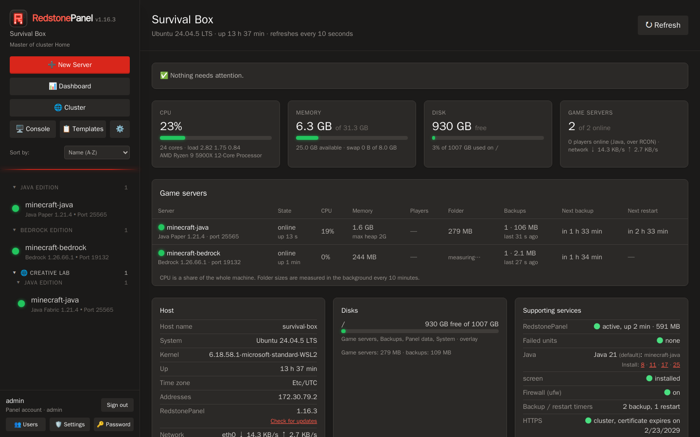</picture>

**[🚀 Quick start](#quick-start)** · **[⬇️ Install](#install)** · **[📖 User manual](docs/guide/README.md)** ·
**[✨ What's new](docs/wiki/Whats-New.md)** · **[❓ Is it right for me?](docs/wiki/FAQ.md)** ·
**[🛣️ Roadmap](docs/wiki/Roadmap.md)** · **[📚 Wiki](docs/wiki/Home.md)**

## Quick start

From a fresh Ubuntu, Debian or 64-bit Raspberry Pi OS machine (see
[Supported systems](#supported-systems)) to players joining, in about five minutes:

**1. Install the panel.**

```bash
curl -fsSL https://raw.githubusercontent.com/qrussell/redstonepanel/main/install.sh | sudo sh
```

**2. Sign in.** Open **http://&lt;your-server&gt;:8080/** and sign in with your Linux username
and password (any member of the `sudo` group).

**3. Create a server.** Click **➕ New Server**, choose **Java** or **Bedrock** (and for Java,
Vanilla, Paper or Fabric and a version), then click **Deploy Fresh Server**. (On a Raspberry
Pi or another ARM64 machine, Java only: Mojang makes the Bedrock server for x86-64 only.) The panel
downloads it, installs the Java it needs, picks a free port and starts it. A Java server is
ready in about a minute; watch it in **🖥️ Console**.

**4. Join.** In Minecraft, add a server at **&lt;your-server&gt;**. The first Java server
uses port 25565 and the first Bedrock server 19132; the server's **Overview** shows its port.
Players outside your home also need port forwards on your internet router: **🔀 Port
forwarding** lists exactly which, with steps for pfSense and other routers.

That's it. The **setup guide** on the dashboard then walks you through the rest: backup
schedules, HTTPS and crash alerts in Discord.

The installer adds the signed qrussell-repo apt repository and runs
`apt install redstonepanel`, so `apt upgrade` keeps the panel current. Prefer to do it by
hand, or to use a `.deb`? See [Install](#install) below or the
[installation page](docs/wiki/Installation.md). The [user manual](docs/guide/README.md) covers
every feature step by step.

## Why RedstonePanel

| You want… | RedstonePanel gives you… |
| --- | --- |
| **Java and Bedrock** | Both, side by side. Java as **Vanilla**, **Paper** (plugins) or **Fabric** (mods), on the Minecraft version you pick, each with the Java it needs installed for you. An **Update available** alert for every server, and Bedrock servers that can update themselves, with a backup first and the old version put back if the new one won't start. |
| **Mods and plugins without the hassle** | A catalog from **Modrinth** and **Hangar** with one-click bundles (performance, essentials, Geyser for Bedrock players), dependencies installed for you, update checks and one-click undo. Or drop `.jar`, `.mcpack` and `.mcaddon` files on the server. |
| **Worlds that are safe** | Scheduled and on-demand backups that copy running servers consistently, copies off the machine on a NAS or S3 storage, one-click restore (with an undo), a backup before mod updates, and uninstalled servers you can bring back. |
| **To know what's going on** | A dashboard of the machine and every server, a **Needs attention** list, Discord or webhook alerts for crashes and backups, and a log of who joined and who was turned away. |
| **Everything from the browser** | Live chat and console, a `server.properties` editor, player roles and whitelists, a file manager with an editor, scheduled restarts that warn players, world downloads. |
| **More than one machine** | **Clusters**: one master panel manages every node's servers with all their tabs, creates servers on any node, **moves or copies a server to another machine** *(new in 1.16)*, and renews the cluster's certificates for you. |
| **Something that stays out of the way** | Plain systemd services that keep running, and keep backing up, even while the panel is stopped. Servers live in `/opt` and backups in `/var/backups`: no containers to dig through. |
| **Security you can reason about** | Linux (PAM) or panel accounts with admin and user roles, HTTPS (self-signed, certbot or the cluster's own CA), optional trusted-LAN access, a signed apt repository. |
| **No cost, no lock-in** | MIT licensed, no paid tier, no account to create, no telemetry. |

## A quick tour

| | |
| --- | --- |
| <a href="docs/guide/README.md#3-the-dashboard"><picture><source media="(prefers-color-scheme: light)" srcset="docs/guide/images/light/dashboard.png"></picture></a> **Dashboard:** the machine, every server and what needs attention | <a href="docs/guide/README.md#5-overview"><picture><source media="(prefers-color-scheme: light)" srcset="docs/guide/images/light/overview.png">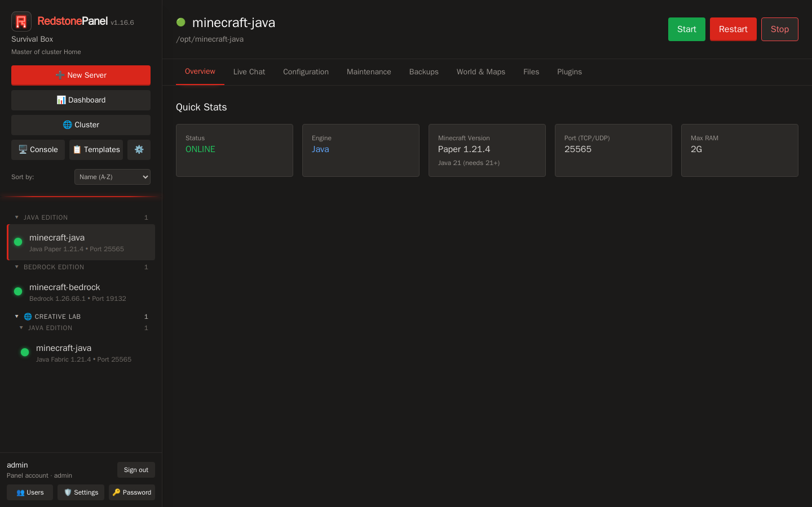</picture></a> **Each server:** start, stop, restart, and a tab for everything |
| <a href="docs/guide/README.md#12-mods-plugins-and-add-ons"><picture><source media="(prefers-color-scheme: light)" srcset="docs/guide/images/light/mods.png">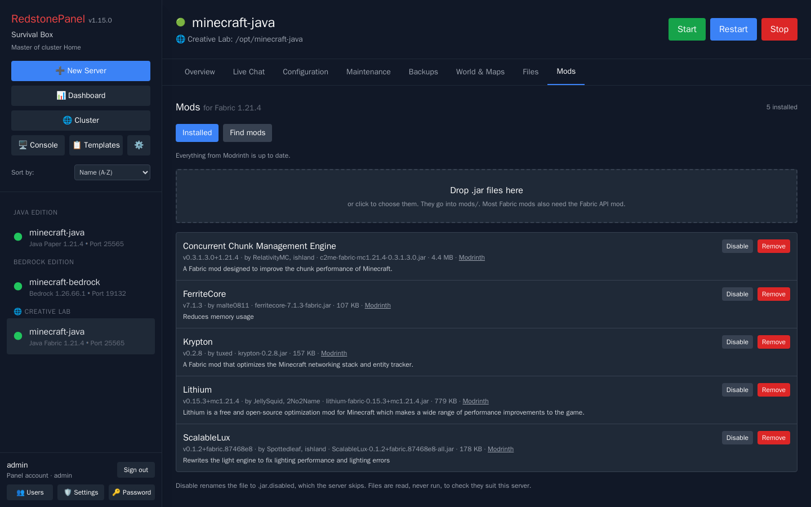</picture></a> **Mods and plugins:** what's installed, a catalog, updates | <a href="docs/guide/README.md#9-backups"><picture><source media="(prefers-color-scheme: light)" srcset="docs/guide/images/light/backups.png">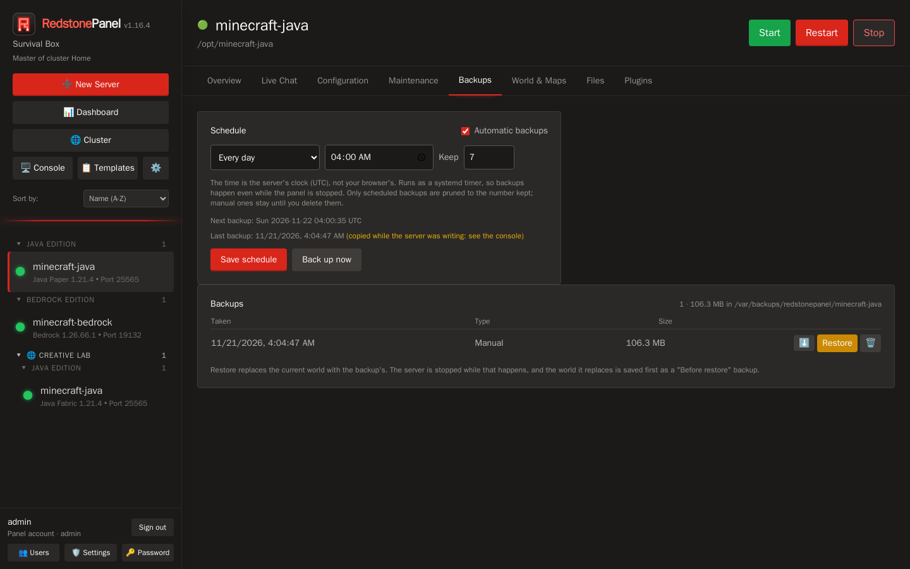</picture></a> **Backups:** schedules, restore, download |
| <a href="docs/guide/README.md#11-files"><picture><source media="(prefers-color-scheme: light)" srcset="docs/guide/images/light/files.png">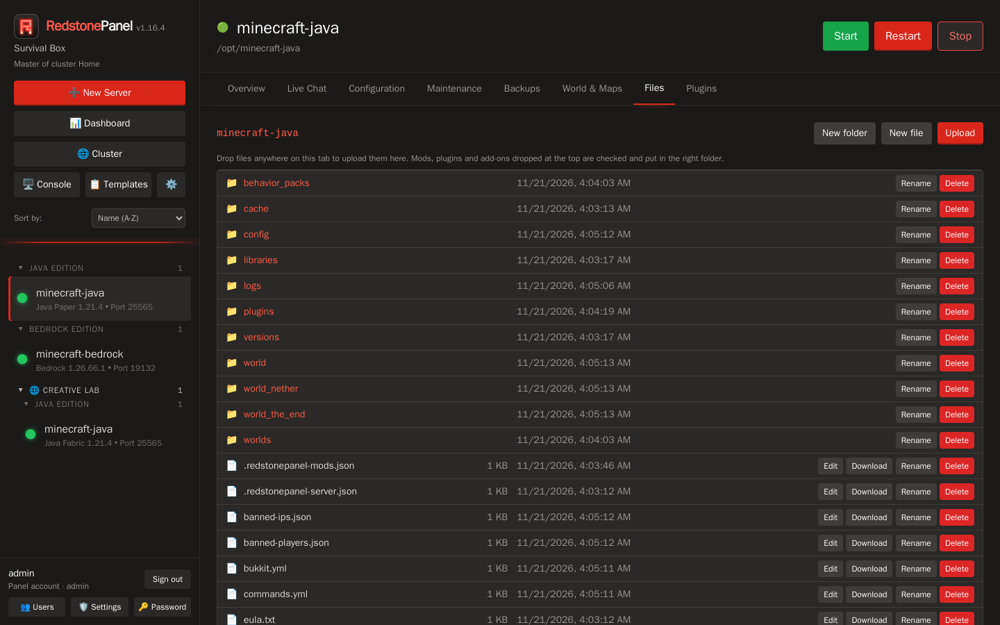</picture></a> **Files:** browse, upload, edit configs | <a href="docs/guide/README.md#6-live-chat"><picture><source media="(prefers-color-scheme: light)" srcset="docs/guide/images/light/live-chat.png">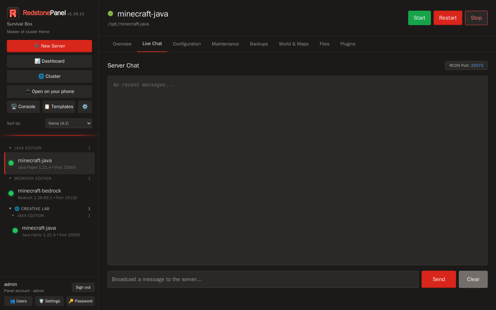</picture></a> **Live chat** and server commands |
| <a href="docs/guide/README.md#4-create-or-import-a-server"><picture><source media="(prefers-color-scheme: light)" srcset="docs/guide/images/light/new-server.png">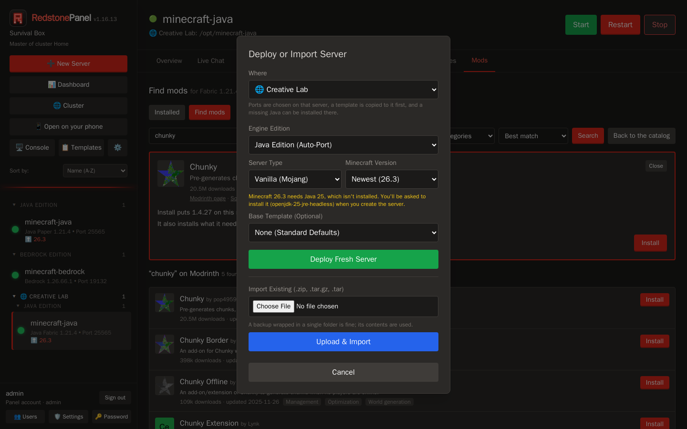</picture></a> **New Server:** edition, type, version and, on a cluster, where | <a href="docs/guide/README.md#18-clusters"><picture><source media="(prefers-color-scheme: light)" srcset="docs/guide/images/light/cluster.png">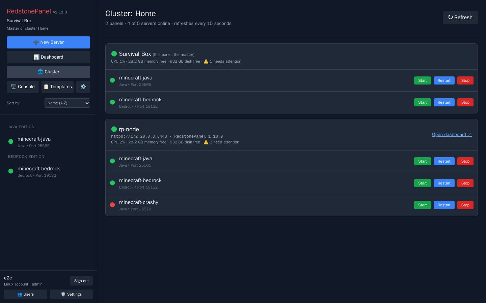</picture></a> **Cluster:** every panel and its servers on one page |

The screenshots follow your light or dark theme (on GitHub; GitLab shows the dark ones). To
see them in the other theme:

<details>
<summary>🌙 <b>Show the tour in the dark theme</b></summary>

<table>
<tr><td><a href="docs/guide/README.md#3-the-dashboard"></a><br>Dashboard</td><td><a href="docs/guide/README.md#5-overview"></a><br>Each server</td></tr>
<tr><td><a href="docs/guide/README.md#12-mods-plugins-and-add-ons"></a><br>Mods and plugins</td><td><a href="docs/guide/README.md#9-backups"></a><br>Backups</td></tr>
<tr><td><a href="docs/guide/README.md#11-files"></a><br>Files</td><td><a href="docs/guide/README.md#6-live-chat"></a><br>Live chat</td></tr>
<tr><td><a href="docs/guide/README.md#4-create-or-import-a-server"></a><br>New Server</td><td><a href="docs/guide/README.md#18-clusters"></a><br>Cluster</td></tr>
</table>

</details>
<details>
<summary>☀️ <b>Show the tour in the light theme</b></summary>

<table>
<tr><td><a href="docs/guide/README.md#3-the-dashboard">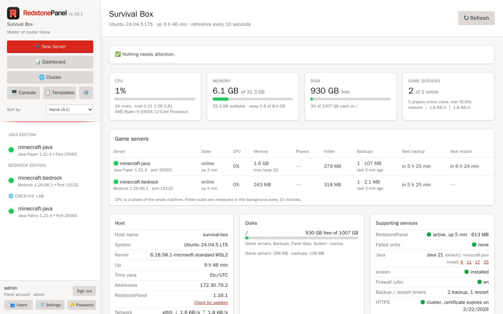</a><br>Dashboard</td><td><a href="docs/guide/README.md#5-overview">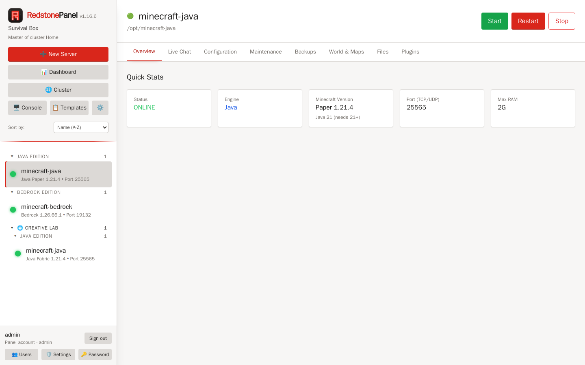</a><br>Each server</td></tr>
<tr><td><a href="docs/guide/README.md#12-mods-plugins-and-add-ons">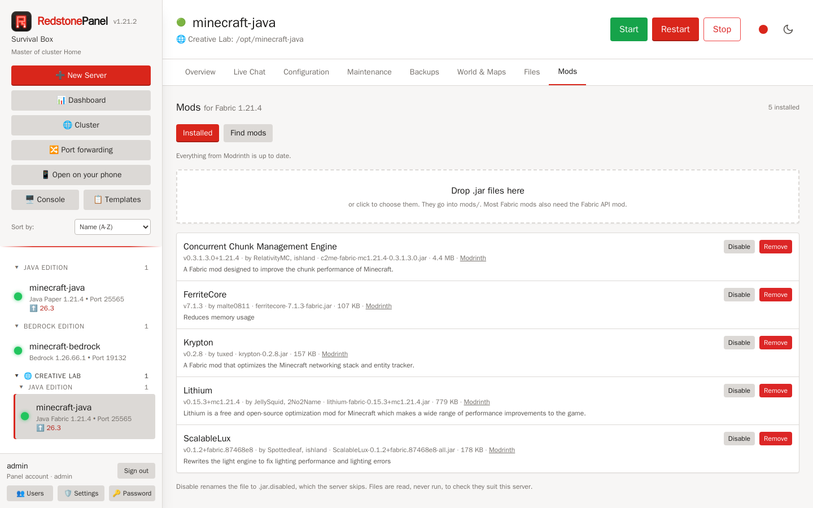</a><br>Mods and plugins</td><td><a href="docs/guide/README.md#9-backups">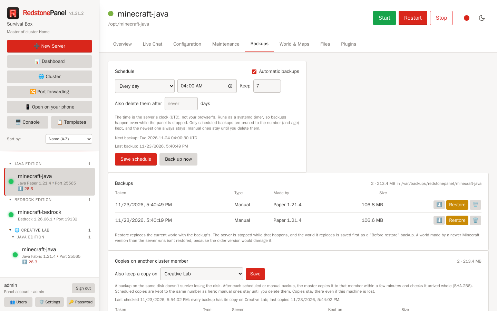</a><br>Backups</td></tr>
<tr><td><a href="docs/guide/README.md#11-files">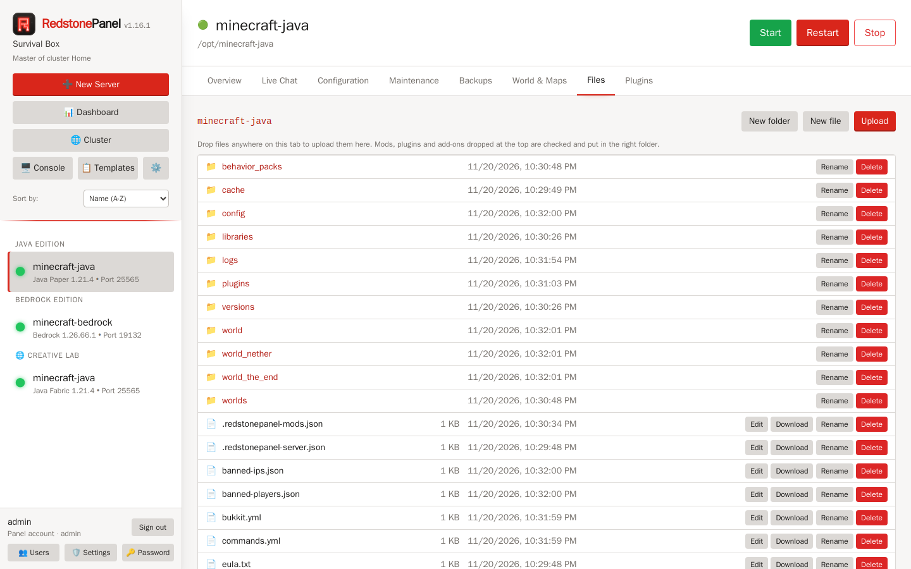</a><br>Files</td><td><a href="docs/guide/README.md#6-live-chat">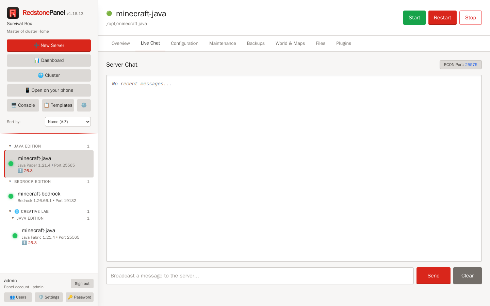</a><br>Live chat</td></tr>
<tr><td><a href="docs/guide/README.md#4-create-or-import-a-server">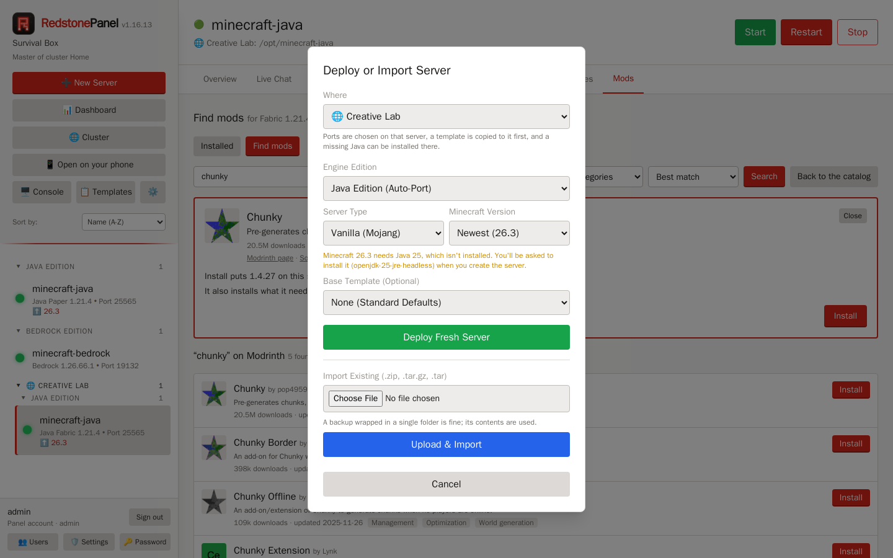</a><br>New Server</td><td><a href="docs/guide/README.md#18-clusters">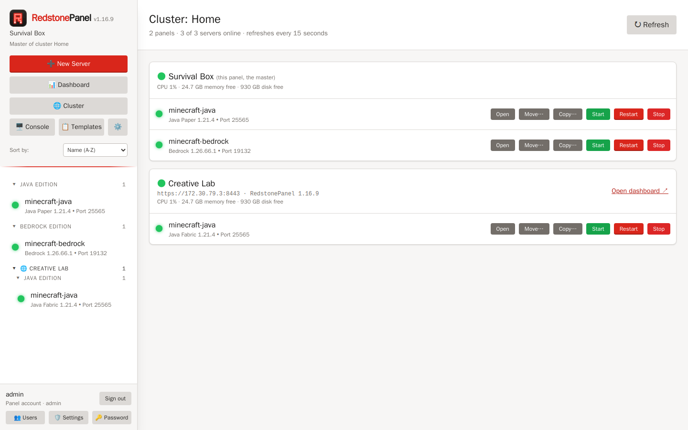</a><br>Cluster</td></tr>
</table>

</details>

The [user manual](docs/guide/README.md) walks through every feature with screenshots.

## What's new in 1.17

**Advanced options on New server** *(1.17.2)*. Choose what the panel otherwise decides for a new server: its name and port, a specific Paper build or Fabric loader, Vanilla snapshots, the Java it runs on, its heap and hard memory and CPU limits, startup flags such as Aikar's, and the world and common settings. Every field is optional and checked before anything is downloaded. Read the [1.17.2 release notes](release-notes/v1.17.2.md).

**Why did it crash?** *(1.17.1)*. When a server crashes or won't start, its Overview shows a **Last crash** card that names the cause in plain words (a missing dependency, a mod for another version, the wrong Java, the port already in use, out of memory, the EULA, a damaged world) and the mod or plugin it points at, with **Turn off and restart** and **Undo the last mod update** one click away. Crash alerts now say why too. Read the [1.17.1 release notes](release-notes/v1.17.1.md).

**Server performance and tuning** *(1.17)*. Each server shows how well it runs (TPS and MSPT, memory against its limits, players), with 24-hour and 7-day history charts for every server and the machine, and suggestions based on what was measured. **Memory and limits** changes a Java server's heap safely and can cap a server's memory and CPU, and webhooks can warn about low TPS or a full disk. Read the [1.17.0 release notes](release-notes/v1.17.0.md).

## What's new in 1.16

**Port forwarding** *(1.16.14)*. A new **🔀 Port forwarding** page says exactly what to forward on your internet router for players outside your home: every server's ports and protocols, and on a cluster each machine's LAN address, with step-by-step help for pfSense and other routers. Read the [1.16.14 release notes](release-notes/v1.16.14.md).

**Less downtime for big worlds** *(1.16.13)*. Moving a server between cluster members can now copy the world while it keeps running, then stop it only for the last changes, so it's down for seconds. And the master can find the other RedstonePanels on your network to add as nodes. Read the [1.16.13 release notes](release-notes/v1.16.13.md).

**Bedrock that keeps up** *(1.16.12)*. The panel tells you when a newer Minecraft, Paper, Fabric or Bedrock version is out, and Bedrock servers can update themselves: players are warned, a backup is taken first, and a failed update is rolled back. Bedrock servers also now always save before they stop. Read the [1.16.12 release notes](release-notes/v1.16.12.md).

**Backups off the machine** *(1.16.11)*. Copy each server's backups to an SSH server or S3-compatible storage (Backblaze B2, Wasabi, Cloudflare R2, MinIO, AWS S3), checked as they're copied, keep them by age as well as by count, and bring a server back on a new machine straight from that storage. Bedrock servers also get the firewall rules they actually listen on. Read the [1.16.11 release notes](release-notes/v1.16.11.md).

**A panel that works on a phone** *(1.16.10)*. Every page fits a phone: the sidebar becomes a
☰ menu, Start, Restart and Stop are big buttons and tables turn into cards. Over HTTPS the panel
installs as an app, and **📱 Open on your phone** shows a QR code to open it on your phone.
Read the [1.16.10 release notes](release-notes/v1.16.10.md).

**Debian, newer Ubuntu and the Raspberry Pi** *(1.16.9)*. The panel now installs on Ubuntu
26.04 LTS and 26.10, Debian 13 and 64-bit Raspberry Pi OS on a Pi 4 or 5, as well as Ubuntu
24.04, on x86-64 and ARM64 machines (Java servers only on ARM64, since Bedrock is made for
x86-64 only). Read the [1.16.9 release notes](release-notes/v1.16.9.md).

**Backups on another cluster member** *(1.16.8)*. In a cluster, a server's backups can also be
kept on another member, checked as they're copied, so a world survives losing the machine it
ran on. Read the [1.16.8 release notes](release-notes/v1.16.8.md).

**Two-factor sign-in** *(1.16.7)*. Any account can ask for a code from an authenticator app
after its password, with ten recovery codes for a lost phone, and admins can require it for
every admin. Read the [1.16.7 release notes](release-notes/v1.16.7.md).

**A console that makes room** *(1.16.6)*. The console used to slide up over the bottom of the
window, hiding buttons until it was closed. While it's open, the page now ends above it and the
sidebar stays visible. Read the [1.16.6 release notes](release-notes/v1.16.6.md).

**A gameplay port for each Bedrock server** *(1.16.5)*. Since 1.16.4 every new Bedrock server
used UDP 19132 for gameplay, so a second Bedrock server clashed with the first. Each now gets
its own, on the same number as its port. Read the
[1.16.5 release notes](release-notes/v1.16.5.md).

**New Bedrock servers keep all their settings** *(1.16.4)*. A newly created Bedrock server's
`server.properties` had only its ports, so **Configuration** showed almost nothing to edit. It
now has every setting from the official Bedrock download. Read the
[1.16.4 release notes](release-notes/v1.16.4.md).

**A server list that folds** *(1.16.3)*. Click any heading in the sidebar (Java Edition,
Bedrock Edition or a cluster node) to fold it; a folded heading shows how many of its servers
are online, and the browser remembers what you folded. Each cluster node's servers now get their
own Java and Bedrock headings, like this machine's. Read the
[1.16.3 release notes](release-notes/v1.16.3.md).

**Kick, ban and unban, and a new look** *(1.16.2)*. **Configuration → Whitelist & Access**
can now kick anyone online and, on Java, ban and unban (running or stopped), with a
**Banned** list. Bedrock gets kick only, since it has no ban list. RedstonePanel also has its own
logo and a stone-and-redstone theme in dark and light. Read the
[1.16.2 release notes](release-notes/v1.16.2.md).

**A setup guide for new panels** *(1.16.1)*. The dashboard of a new panel opens with four
steps to a safe setup: your first server, a backup schedule for every server, HTTPS (or plain
HTTP on a network you trust) and crash alerts in Discord or any webhook. Each step opens the
place where it's done and ticks itself when it is. Read the
[1.16.1 release notes](release-notes/v1.16.1.md).

**Move a server to another machine** *(1.16.0)*. On a cluster master's 🌐 Cluster page, **Move…** stops a
server, streams its whole folder to another machine of the cluster (checked byte for byte), and
starts it there with the same name and ports when they're free, the Java it needs, and its
memory, backup and restart schedules and Phantom. The old machine keeps its files as a removed
server until you click **Delete the old copy**, and a move that fails undoes itself. **Copy…**
makes a second copy without stopping the server, and templates can be copied between the master
and its nodes. Read the [release notes](release-notes/v1.16.0.md), or
[every release's highlights](docs/wiki/Whats-New.md).

## All features

- create, start, stop and update servers
- a server list grouped by machine and edition, with headings that fold and show how many
  servers are online
- Java servers as **Vanilla**, **Paper** (plugins) or **Fabric** (mods), on the Minecraft
  version you choose, each run with the Java it needs
- live chat and console commands (over RCON)
- a `server.properties` editor
- per-server permissions for helpers (1.18): give a user account View, Console & chat,
  Start/stop/restart, Players, Files, Mods & plugins, Settings or Backups on the servers you
  pick, with **Moderator** and **Co-owner** presets (**Users → Servers**)
- SFTP for FileZilla, WinSCP or any SFTP program (1.18, off until turned on): sign in as
  `account.server` with the panel password or an SSH key, and reach only that server's folder
- a file manager for each server's folder (admins, and users given **Files**): browse, edit text files such as plugin
  configs, drag and drop uploads, download, rename and delete
- mods (Fabric), plugins (Paper) and add-ons (Bedrock): drop `.jar`, `.mcpack` or `.mcaddon`
  files on the server and they're checked and put in the right place; the list shows what's
  installed, warns about the wrong Minecraft version or missing dependencies, and can
  disable or remove each one
- a catalog of mods and plugins from Modrinth and Hangar: bundles and a hand-picked starter
  set, categories and sorting, details before you install, dependencies installed for you;
  see which have updates, update them all with a world backup first, and undo the last update
- player roles (operator, member and so on)
- reusable server templates
- export a server as a zip backup, and import server backups (.zip, .tar.gz/.tgz or .tar; a
  backup wrapped in a single folder is unpacked from inside it)
- restore servers you uninstalled with **Keep World** (➕ New Server → Removed servers, or
  `sudo redstonepanel restore NAME`): their files stay in `/opt`, and restoring gives them a
  new systemd service under the same name, on their old port if it's still free
- scheduled and on-demand backups with retention by count and age, and restoring a world from
  a backup (**Backups** tab, or `sudo redstonepanel backup NAME`)
- off-site copies of backups on an SSH server (rsync) or S3-compatible storage (Backblaze B2,
  Wasabi, Cloudflare R2, MinIO, AWS S3), checked with SHA-256, with their own retention, restore
  from a copy, and bringing a server back on a new machine (**Panel Settings → Backup storage**)
- notifications to Discord or any webhook when a server crashes, starts or stops, and when a
  backup finishes or fails
- a **Last crash** card when a server crashes or won't start: the cause in plain words (missing
  dependency, mod for another version, wrong Java, port in use, out of memory, EULA, damaged
  world), the likely mod or plugin with **Turn off and restart**, **Undo the last mod update**,
  and the log with its error lines highlighted
- scheduled restarts that warn players in game first
- update alerts for every server (Bedrock, Minecraft releases, Paper builds, Fabric loader),
  checked every 6 hours, and **Update automatically** for Bedrock servers (**Maintenance**, or
  `sudo redstonepanel check-updates`)
- Phantom LAN proxies for Bedrock servers (**Add-ons → Server tools**): install, start, stop
  and remove one per server, so a server on another port shows up under LAN Games
- a panel activity log, and a player access log per server: who joined, left or was turned away
  (names and IDs only), with whitelist/allowlist editing (**Configuration → Whitelist & Access**)
- kick, ban and unban players: Online now, a Banned list (Java) and Kick/Ban on access log rows
- a setup guide on a new panel's dashboard: first server, backup schedules, HTTPS and alerts,
  each step ticked from what the panel can see
- a dashboard for the machine: CPU, memory, disks, network, each server's CPU, memory,
  players and disk use, supporting services (Java, firewall, timers, certificates,
  Phantom proxies), a list of what needs attention, and on a cluster master each node's
  resources
- a port forwarding guide for your internet router: which ports, TCP or UDP, to which
  machine's LAN address, for every server and cluster member, with pfSense steps, a check
  through your internet address, and warnings for shared ports and carrier-grade NAT
- performance for each server (1.17): tick health (TPS) over RCON, memory against its limits,
  24-hour and 7-day history charts for every server and the machine, and suggestions based on
  what was measured (never applied for you); a **Memory** setting and optional hard memory and
  CPU limits per server; webhook alerts for low TPS and a nearly full disk
- clusters: one master panel manages the servers of other RedstonePanels with every tab,
  creates servers on them, moves or copies servers between them, renews their certificates and
  backs the cluster up every night

The panel is a FastAPI app with a plain HTML/JavaScript front end. It ships as an
`Architecture: all` Debian package for **Ubuntu 24.04, 26.04 and 26.10, Debian 13 and 64-bit
Raspberry Pi OS**, on x86-64 and ARM64 machines.

## Documentation

| | |
| --- | --- |
| [User manual](docs/guide/README.md) | How to use every feature, step by step, with screenshots. |
| [Installation](docs/wiki/Installation.md) | Requirements, the one-line installer, apt by hand, the `.deb`, upgrading and removing. |
| [What's new](docs/wiki/Whats-New.md) | Every release's highlights, newest first. Full notes are in [release-notes/](release-notes). |
| [Discord setup](docs/wiki/Discord.md) | A Discord for your community: a private space per Minecraft server, the panel's alerts, chat bridges and voice. |
| [FAQ](docs/wiki/FAQ.md) | Is RedstonePanel right for you, and common questions. |
| [Roadmap](docs/wiki/Roadmap.md) | What's planned next, and ideas under consideration. |
| `man redstonepanel` | Every command-line option. |

The same pages are published to the project's [wiki](https://github.com/qrussell/redstonepanel/wiki)
whenever they change on `main`.

## Install

### One command

```bash
curl -fsSL https://raw.githubusercontent.com/qrussell/redstonepanel/main/install.sh | sudo sh
```

[`install.sh`](install.sh) checks that this is a [supported system](#supported-systems), adds the repository's key
(refusing it unless its fingerprint matches the one below) and source, and installs the panel.
It does what the next section does by hand.

### Supported systems

| System | x86-64 (Intel, AMD) | ARM64 | Notes |
| --- | --- | --- | --- |
| Ubuntu 26.04 LTS | ✅ tested | ✅ tested | The best choice for a new machine. |
| Ubuntu 24.04 LTS | ✅ tested | ✅ | |
| Ubuntu 26.10 | ✅ tested | ✅ | Supported by Ubuntu until July 2027. |
| Debian 13 (trixie) | ✅ tested | ✅ tested | Debian packages Java 21 and 25 only (see [Java](#what-gets-installed)). |
| Raspberry Pi OS, 64-bit (Debian 13 based) | | ✅ Pi 4 and Pi 5 | Java servers only. See [Raspberry Pi](#raspberry-pi). |
| Ubuntu 25.04 and 25.10 | ✅ | ✅ | Still installs, but Ubuntu no longer updates them: upgrade to 26.04. |

**Bedrock servers need an x86-64 machine.** Mojang only makes Bedrock Dedicated Server for
64-bit Intel and AMD Linux, so on ARM64 (a Raspberry Pi, an ARM VPS) the panel hides Bedrock
and runs Java servers only. Bedrock players can still join a Java server through Geyser (in
the add-on catalog), or a cluster can keep its Bedrock servers on an x86-64 member.

Not supported: **Debian 12** and the Raspberry Pi OS built on it (their Python 3.11 is older
than the panel needs), **32-bit** Raspberry Pi OS or any other 32-bit system, and other
distributions. `install.sh` says which of these it found and stops; `FORCE=1` makes it carry on
anyway.

### Raspberry Pi

A **Raspberry Pi 4 or 5** makes a quiet, cheap Java server for a family or a few friends.

1. With Raspberry Pi Imager, write **Raspberry Pi OS Lite (64-bit)** to the card or SSD, and
   turn on SSH in its settings.
2. Sign in over SSH and run the one-line installer below. It installs the same package as on
   any other machine.
3. Create a **Paper** server: it uses noticeably less CPU than Vanilla, which matters on a Pi.

**Memory.** Each new Java server may use up to 2 GB (1 GB on a machine with 3 GB or less); its
**Overview** shows this as **Max RAM**. Leave about 1 GB for the system and the panel:

| Pi | What fits |
| --- | --- |
| 2 GB | Not recommended: one small server, which gets 1 GB. |
| 4 GB | One server at the default 2 GB, for about 5 to 10 players. |
| 8 GB | Two or three servers at 2 GB, or one at 4 to 5 GB with more players or mods. |
| 16 GB | Several servers; CPU, not memory, is the limit. |

To change a server's memory, open it and go to **Maintenance → Memory and limits**. The
panel refuses a size that would leave too little for the system with the other running servers,
and a **Hard memory limit** of **Automatic** keeps one server from taking the whole Pi.

**Storage.** Run from an SSD (USB 3, or NVMe on a Pi 5) rather than a microSD card if you
can: worlds and backups write a lot, and cards wear out and slow the server down. Keep backups
on a second drive or another machine.

**Cooling.** A Pi 5 needs its active cooler (or a case with a fan) to run a server all day
without slowing itself down.

**Java.** Raspberry Pi OS packages Java 21 and 25, which run Minecraft 1.17 and newer. Older
versions ask for Java 8; the panel says the Pi doesn't have it and offers Java 21 instead,
which some old versions and modpacks don't start on.

### From the qrussell-repo apt repository (recommended)

RedstonePanel is published in **qrussell-repo**, a signed apt repository. Adding it once
installs the latest version now, and `apt upgrade` brings each new version after that.

1. Add the repository's signing key and the repository:

   ```bash
   sudo apt install -y curl ca-certificates
   curl -fsSL https://qrussell.github.io/qrussell-repo/deb/qrussell-repo.gpg | sudo tee /usr/share/keyrings/qrussell-repo.gpg >/dev/null
   echo "deb [signed-by=/usr/share/keyrings/qrussell-repo.gpg] https://qrussell.github.io/qrussell-repo/deb ./" | sudo tee /etc/apt/sources.list.d/qrussell.list
   ```

   To check the key before trusting it, `gpg --show-keys /usr/share/keyrings/qrussell-repo.gpg`
   should show the fingerprint `9994A9EB39EB3C101C949FB2012BA14E0FE3A355`.

2. Install the latest version:

   ```bash
   sudo apt update
   sudo apt install redstonepanel
   ```

   `apt-cache policy redstonepanel` shows which version is installed and which is the latest
   in the repository.

3. Open **http://&lt;server&gt;:8080/** in a browser and sign in (see
   [Signing in](#signing-in)).

**Upgrading:** new versions reach the repository within a few hours of their release. Install
them with your normal updates:

```bash
sudo apt update && sudo apt upgrade
```

### From a .deb file

If you'd rather not add a repository, download `redstonepanel_X_all.deb` from the
[latest release](https://github.com/qrussell/redstonepanel/releases/latest), then:

```bash
sudo apt install ./redstonepanel_X_all.deb
```

Replace `X` with the version you downloaded. Upgrade the same way, with the newer file.

### What gets installed

Either way, `apt` pulls in the dependencies from Ubuntu's or Debian's archive (`python3-fastapi`,
`python3-uvicorn`, `python3-multipart`, PAM, `screen` and so on), then starts the
`redstonepanel` service.

Java isn't installed with the package. When you create a Java Edition server, the panel
offers to install the Java its Minecraft version needs, so a host that only runs Bedrock
servers never gets Java.

Java 25 runs Minecraft 26.1 and newer. Older Minecraft versions want older Java: 1.20.5 to
1.21.11 need Java 21, 1.18 to 1.20.4 need Java 17, 1.17 Java 16 (Ubuntu's Java 17 runs it) and
older versions Java 8. The panel uses the Java each version asks
for when it's installed, else the closest newer one. When none is new enough, an admin can
install it from the panel (it runs `apt install openjdk-21-jre-headless`, for example). It offers
the Java versions this system's package sources have: Ubuntu 24.04 and 26.04 package 8, 11, 17,
21 and 25 (and newer releases more), Debian 13 and Raspberry Pi OS only 21 and 25. When a
Minecraft version needs a Java the system doesn't package, the panel says so and offers the
closest newer one. The
dashboard lists each installed Java with the servers using it and can remove one no server
uses.

Several Java versions can be installed side by side; each server's systemd unit names the one
it runs (`/usr/lib/jvm/java-21-openjdk-amd64/bin/java`, or `…-arm64` on ARM64).

`ufw` is also recommended. When it is installed, the panel opens each game server's ports
in it (for Bedrock servers, which use NetherNet unless `transport=raknet` is set: TCP
server-port, UDP server-udp-ports and UDP 7551) and keeps them in step with the server's
settings, also when server.properties is edited by hand. The dashboard points out game-port
rules that no server uses any more.

| What | Where |
| --- | --- |
| Panel code | `/usr/share/redstonepanel` |
| Panel state (accounts, settings, TLS, templates) | `/var/lib/redstonepanel` |
| Activity log | `/var/log/redstonepanel/panel.log` |
| Game servers | `/opt/minecraft-*` |
| Backups | `/var/backups/redstonepanel/<server>/` |
| Service | `systemctl status redstonepanel` |

`apt remove` stops the panel and keeps its state. `apt purge` also deletes
`/var/lib/redstonepanel`. Neither one touches your game servers in `/opt/minecraft-*` or
your backups.

## Backups

Each server's **Backups** tab takes backups on a schedule (hourly, every 6 or 12 hours, daily
or weekly, at a time you pick) and on demand with **Back up now**. They're `.tar.gz` files of
the server's folder, without what can be downloaded again (`server.jar`, `bedrock_server`,
Bedrock's own packs) or logs, in `/var/backups/redstonepanel/<server>/`, readable only by
root.

- **Schedules are systemd timers** (`redstonepanel-backup@<server>.timer`), so backups happen
  even while the panel is stopped. A missed backup (machine off) runs at the next boot.
- **Consistent copies of running servers.** Java servers stop writing to disk while the
  files are copied (`save-off` / `save-all flush` / `save-on` over RCON); Bedrock servers do
  the same with `save hold` / `save query` / `save resume`. A Java server without RCON is
  copied while it runs, and the panel warns you: open its **Live Chat** tab once to set RCON
  up.
- **Retention.** Only scheduled backups are pruned to the number you keep and, if you set it,
  to an age in days (the newest always stays). Manual backups and the ones taken before a
  restore stay until you delete them.
- **Off-site copies.** Under **Panel Settings → Backup storage** an admin adds an SSH server
  (the panel's own SSH key, `rsync`, host key checked on first use) or S3-compatible storage
  (AWS Signature Version 4, multipart uploads over 100 MB, nothing extra installed). Each
  backup is copied there straight after it's taken, in its own transient systemd unit, and
  checked with SHA-256; the storage keeps its own number and age of scheduled copies. A server's
  **Backups** tab restores from a copy, and **➕ New Server → From backup storage** brings a
  server back on a new machine. A failed copy shows under **Needs attention** and can send a
  webhook. `rsync` and `openssh-client` are recommended packages.
- **Restore** (admins) replaces the server's world with the one in a backup. The server is
  stopped while that happens, and the world it replaces is saved first as a "Before restore"
  backup, so a restore can be undone.
- Uninstalling a server removes its timer and keeps its backups; restoring the server brings
  its schedule back.

`sudo redstonepanel backup NAME` takes a manual backup from the command line;
`sudo redstonepanel offsite-copy NAME` copies a server's backups to its backup storage now.

## Notifications

**Panel Settings → Notifications** (admins) sends a message to a Discord channel, or to any
web address that accepts a JSON POST, when something happens. Pick the events: a server
crashed, started or stopped, a scheduled restart, a backup finished or failed. By default only
crashes, failed backups and scheduled restarts are sent.

1. In Discord: the channel's settings → **Integrations** → **Webhooks** → **New Webhook** →
   **Copy Webhook URL**.
2. Paste it into **Panel Settings → Notifications**, tick the events, **Save notifications**,
   then **Send a test**.

Other services get a JSON body with `text`, `event`, `server`, `panel`, `message` and `time`.

- **Crashes are reported even while the panel is stopped.** The package installs a systemd
  drop-in for every `minecraft-*.service` whose start and stop hooks send the message. A
  server stuck in a crash loop sends one "crashed" message per 5 minutes, not one per restart.
- **Crash messages say why** when the panel recognises the cause (from 1.17.1), for example
  "survival crashed (exit status 1). … Ledger requires Fabric API, which isn't installed." The
  same line is on the server's **Last crash** card.
- **Crashed Bedrock servers come back.** Bedrock runs under `screen`, which exits normally when
  the game dies, so until 1.8 systemd didn't notice and left a crashed Bedrock server stopped.
  The same hook now tells a crash from a `stop` typed in the console and starts the server
  again after 20 seconds, as systemd already does for Java.
- The webhook URL lets anyone post to your channel, so it is stored readable only by root and
  the panel never shows it again (only its host and last characters).
- `sudo redstonepanel notify-test` sends a test message from the command line.

## Scheduled restarts

Each server's **Maintenance** tab can restart it every day, every 6 or 12 hours, or every
Sunday, at a time you pick (the server's clock). Players are warned in chat first, for example
"Server restarts in 5 minutes", then 1 minute and 10 seconds before.

- Java servers are warned over RCON: open the **Live Chat** tab once so the panel sets it up.
  Without RCON the restart still happens on time, without a warning.
- A stopped server stays stopped, and a restart waits for a backup of the same server to finish.
- Like backups, restarts are systemd timers (`redstonepanel-restart@<server>.timer`), so they
  happen while the panel is stopped. Uninstalling the server removes its timer; restoring it
  brings the schedule back.

## Signing in

There are two kinds of account:

- **Linux accounts.** Members of the `sudo` or `redstonepanel` group sign in with their
  Linux username and password, checked through PAM. They are panel admins. To let someone
  in without giving them `sudo`:

  ```bash
  sudo usermod -aG redstonepanel alice
  ```

- **Panel accounts.** These exist only in the panel, with role `admin` or `user`. An admin
  creates them in the panel, or root creates them from the command line:

  ```bash
  sudo redstonepanel add-user alice --role user
  ```

  The password is asked for interactively, or read from standard input when it is piped.
  The default role is `admin`. A `user` can do what an admin allows on the servers the admin
  picks (**👥 Users → Servers**: view, console, start/stop, players, files, mods, settings,
  backups), and sees no servers until given some. Only an `admin` can manage accounts and
  Panel Settings, create, import, uninstall or purge a server, and restore or delete backups.

`sudo redstonepanel status` shows the service state, the address, the HTTPS and sign-in
mode, and the panel accounts. See `man redstonepanel` for details.

## Panel Settings

**Panel name.** Running RedstonePanel on several servers? Each panel shows a name in the
sidebar, the browser tab and on the sign-in page, so you can tell them apart. It defaults to
the server's host name; change it under **Panel Settings** or with
`sudo redstonepanel set-name "Basement Survival"`. The name is visible before signing in.

Admins can also change how the panel is reached under **Panel Settings**:

- **HTTP (default).** Plain HTTP on port 8080. Fine on a trusted home network; anyone who
  can watch the traffic can see passwords and session cookies.
- **HTTPS, self-signed.** The panel makes its own certificate authority and serves HTTPS
  (port 8443 by default). Install the CA certificate the panel offers for download into your
  browser or OS to get rid of the warning.
- **HTTPS, custom certificate.** Point the panel at a certificate and key you already
  have, for example from certbot.
- **SFTP.** Off by default. Turned on, people sign in with FileZilla or WinSCP on port 2022 as
  `account.server` with their panel password or an SSH key (**🔑 Password → SSH keys**), and
  reach only that server's folder. Admins reach every server; users need **Files** on it.
  Accounts with two-factor sign-in must use a key. It needs `python3-paramiko` (installed
  with the panel as a recommended package).
- **Trusted-LAN sign-in.** Visitors from the private networks you list (by default
  `10.0.0.0/8`, `172.16.0.0/12`, `192.168.0.0/16`, `fc00::/7`) can use the panel without
  signing in. Its limits:
  - LAN visitors get the **user** role, never admin, with what user accounts could do
    before 1.18 on every server (no files, no mods). Changing panel settings and
    accounts, and uninstalling or purging a server, still need an admin sign-in.
  - It never applies to requests through a reverse proxy (any `X-Forwarded-For`,
    `Forwarded` or `X-Real-IP` header) or from loopback, so a proxy on the same machine
    can't make internet visitors look local.
  - It only applies when the browser used one of this machine's own names or addresses
    (add extra names such as `minecraft.lan` in the settings), which blocks DNS rebinding.
  - Anyone on those networks gets in, including guests on your Wi-Fi.

### Locked out?

If a settings change leaves the panel unreachable (a bad certificate, a port clash, a
forgotten trusted range), run this on the server:

```bash
sudo redstonepanel reset-security
```

It switches the panel back to plain HTTP on port 8080 with sign-in required, and restarts it.
On a cluster member, run `sudo redstonepanel cluster-https` afterwards to rejoin the cluster's HTTPS.

## Clusters: several servers from one panel

Running RedstonePanel on several servers? Make one panel the **master** of a cluster and add
the others as **nodes**. The master then manages every node's game servers: its sidebar lists
them under each node's name with all their tabs (Configuration, Backups, Files, Mods, Java,
Phantom and the rest), **New Server** has a **Where** choice, and the **🌐 Cluster** page shows
every panel at a glance. Every node keeps its own dashboard for its own servers, and its game
servers keep running if the master is down.

1. On the master: **Panel Settings → Cluster → Create cluster**
   (or `sudo redstonepanel cluster create "Home"`). The panel restarts on HTTPS (port 8443).
2. Still on the master: **Make a join code** (or `sudo redstonepanel cluster join-code`). Codes
   work once and expire after an hour.
3. On each new node, paste the code into **Panel Settings → Cluster → Join**, or run
   `sudo redstonepanel join 'rpjoin1:...'`.
4. Download the cluster CA from **Panel Settings → Cluster** and import it on your devices once,
   so browsers trust every panel in the cluster.

The master and its nodes connect to each other on the HTTPS port (8443 by default). If a
firewall such as ufw is active, allow that port between them, for example
`sudo ufw allow from 192.168.1.0/24 to any port 8443 proto tcp`.

Admins on the master act as admins on the nodes, and users as users; both panels log each
change with the master user's name. What the master can do on a node is still limited: it can
manage game servers, templates and Java, but never see or change the node's users, settings or
HTTPS, update the panel, or erase a server's files (uninstalling keeps the world as a removed
server). Cluster certificates only cover private addresses (10.x, 172.16–31.x, 192.168.x,
100.64–127.x) and local names (`.lan`, `.local`, `.home.arpa`, `.internal`), so the CA you
import can't be used to impersonate other websites. The master renews them 30 days before they
expire.

**A master on the internet** can use its own certificate (certbot) for browsers: choose **HTTPS
with my own certificate** under Panel Settings → Connection. Browsers only talk to the master, so
the nodes can stay on private addresses. A node that has its own public certificate can join too;
the master then checks it with the system's trust store instead of the cluster CA.

**If the master is lost:** download an encrypted backup from **Panel Settings → Cluster →
Backup** (or `sudo redstonepanel cluster backup FILE`) after adding or removing nodes, and keep
it off the master. **Nightly backups** (Panel Settings → Cluster, or
`sudo redstonepanel cluster nightly on`) also keep the last 7 on the master itself. `sudo redstonepanel cluster promote FILE` on any other panel makes that panel
the master. Nodes accept it straight away and refuse the old master from then on.

**Moving a server to another machine:** on the master's **🌐 Cluster** page, click **Move…**
next to the server and pick where it goes. The server stops, its whole folder is streamed
through the master to the other machine and checked against a SHA-256 checksum, and it starts
there under the same name and ports when they're free. The Java it needs is installed there, and
its memory, backup and restart schedules and Phantom come along. The old machine keeps the files
as a removed server marked "moved to …" until you click **Delete the old copy**; if anything goes
wrong, the move undoes itself and the server starts where it was. **Copy…** does the same without
stopping the server or removing anything. Both machines need RedstonePanel 1.16 or later; only
admins on the master can move servers. Older backups and the player history stay on the old
machine.

`sudo redstonepanel leave` takes a node out of the cluster (remove it on the master too). The
design is in [docs/design/fleet.md](docs/design/fleet.md) and
[docs/design/move.md](docs/design/move.md).

## Exposing the panel to the internet

Don't forward port 8080 to the internet. If you need remote access, prefer a VPN (for
example WireGuard or Tailscale). If you do need a public address, put a reverse proxy with a
real certificate in front of the panel, on the same machine, and keep the panel in its
default HTTP mode. With Caddy, the whole config is:

```
panel.example.com {
    reverse_proxy 127.0.0.1:8080
}
```

With nginx:

```nginx
server {
    listen 443 ssl;
    server_name panel.example.com;
    # ssl_certificate / ssl_certificate_key from certbot

    location / {
        proxy_pass http://127.0.0.1:8080;
        proxy_set_header Host $host;
        proxy_set_header X-Forwarded-For $proxy_add_x_forwarded_for;
        proxy_set_header X-Forwarded-Proto $scheme;
    }
}
```

The panel trusts `X-Forwarded-Proto` only from `127.0.0.1`, which is why the proxy should
run on the same machine; it then marks session cookies `Secure`. The panel still listens on
all interfaces, so block port 8080 from outside with your firewall (for example
`sudo ufw deny 8080/tcp`). Keep sign-in required, and use strong passwords.

## Security note

The panel runs as **root**. It has to: it writes systemd units, installs packages, opens
firewall ports and manages files in `/opt`. Anyone with a panel **admin** account
effectively has root on the machine, so treat admin accounts like `sudo` access. Keep the
panel off the open internet unless it is behind a proxy as described above, and keep
the system updated.

To report a security problem, please open a private
[security advisory](https://github.com/qrussell/redstonepanel/security/advisories/new)
rather than a public issue.

## Building from source

You need Docker. From a checkout:

```bash
docker run --rm -v "$PWD:/src:ro" -v "$PWD/dist:/out" ubuntu:24.04 bash /src/packaging/build-deb.sh
```

This builds `dist/redstonepanel_X_all.deb` in a clean Ubuntu container and runs lintian on
it. One build serves every supported system and both x86-64 and ARM64.

To test it like a real server, install it in a systemd container:

```bash
docker build --build-arg REL=24.04 -t rp-systemd:24.04 packaging/test
docker run -d --privileged --name rp-2404 -v "$PWD/dist:/dist:ro" -v "$PWD/packaging/test:/t:ro" rp-systemd:24.04
docker exec rp-2404 bash /t/test-install.sh
docker rm -f rp-2404
```

For Debian, build with `--build-arg DISTRO=debian --build-arg REL=13`; for ARM64, add
`--platform linux/arm64` to `docker build` and `docker run` (on an x86-64 machine this needs
QEMU, for example `docker run --privileged --rm tonistiigi/binfmt --install arm64`, and is
slow). On ARM64 the test checks that Bedrock is refused instead of installed.

`test-install.sh` installs, signs in (Linux and panel accounts, and two-factor sign-in with
app codes, recovery codes, the admin requirement and both resets), switches HTTPS on and off,
upgrades, removes and purges the package, printing PASS/FAIL for each step. Pass
`--no-install-recommends` to test a Bedrock-only install.

The tests with several panels start their own containers on a Docker network; run them from
the checkout after building the .deb:

```bash
bash packaging/test/test-cluster.sh          # create, join, node allowlist, renew, promote, leave
bash packaging/test/test-cluster-phase2.sh   # a master running game servers on its nodes
bash packaging/test/test-move.sh             # move and copy servers between panels
bash packaging/test/test-backup-copies.sh    # backup copies kept on another member (1.16.8)
bash packaging/test/test-offsite.sh          # backup copies on SSH and S3 (SeaweedFS) storage (1.16.11)
```

### The stylesheet

The UI uses Tailwind CSS, compiled into `static/css/tailwind.css` and committed, so the
panel works on networks without internet access. After adding or changing Tailwind
classes in `static/*.html` or `static/js/app.js`, regenerate it (needs Node.js):

```bash
packaging/build-css.sh
```

### Releases

Development happens on GitLab (`gitlab.cielocloud.dev/lab/redstonepanel`), which mirrors
`main` and tags to GitHub. Each version is released on both. To release version 1.0.1:

1. On a branch, add a `debian/changelog` entry (`dch -v 1.0.1`) and regenerate `CHANGELOG`
   from it (`python3 packaging/changelog.py`; CI fails if you forget), update the version in
   `packaging/redstonepanel.8`, and write the release description in
   `release-notes/v1.0.1.md`. Add the release's highlights to the top of
   `docs/wiki/Whats-New.md`, update `docs/wiki/Roadmap.md` and the user manual for what
   changed, and retake the screenshots if the UI changed
   (`bash packaging/screenshots/demo.sh`: it takes each one in the dark theme, in
   `docs/guide/images/`, and the light theme, in `docs/guide/images/light/`). Merge it through a merge request.
2. Tag `main` as `v1.0.1` and push the tag to GitLab.

`.github/workflows/release.yml` runs on every push to `main` (each merge, once GitLab
mirrors it) and on tags. It builds the .deb, runs
the install tests on Ubuntu 24.04, 26.04 and 26.10 and Debian 13 (with and without
recommends), and on Ubuntu 26.04 and Debian 13 on GitHub's ARM64 runners, runs the five
cluster tests above, and for a tag publishes
a GitHub Release with the .deb, using `release-notes/<tag>.md` as its description (or
GitHub's generated notes if the file is missing). The tag must match the version in
`debian/changelog`. The qrussell-repo apt repository picks up the release within 4 hours.

The wiki pages live in `docs/wiki/` (plus the user manual, `docs/guide/README.md`) and are
published to both wikis whenever they change on `main` and on every release:
`.github/workflows/wiki.yml` updates the GitHub wiki, and the `wiki` job in `.gitlab-ci.yml`
updates the GitLab wiki (`packaging/publish-gitlab-wiki.py`). Both use
`packaging/sync-wiki.py`, which rewrites links for each site. The GitLab job needs a project
access token with the `api` scope and the Developer role, saved as the masked CI/CD variable
`WIKI_TOKEN`; without it the job passes and says so. Don't edit either wiki by hand: the next
publish overwrites the pages that come from the repository.

On GitLab the same tag runs `.gitlab-ci.yml`. Its checks run first, including the unit tests
with each supported system's own Python and FastAPI packages (`python-system`). Then `build-deb`
builds the .deb in `ubuntu:24.04` (it runs on every merge request and on `main` too, with
the .deb kept as a job artifact for 30 days). Finally `release` runs
`packaging/gitlab-release.py`, which uploads the .deb to the project's package registry
(Deploy → Package registry, `redstonepanel/<version>`) and creates the GitLab release
with the same description and the .deb attached. The install tests run only on GitHub.

If a GitLab release is missing or wrong, run a pipeline on `main` (Build → Pipelines → Run
pipeline) with the variable `RELEASE_TAG` set to the tag, e.g. `v1.0.1`. Its
`release-from-github` job copies the .deb from the GitHub release, then creates or updates
the GitLab release. Older releases were backfilled this way.

## License

MIT. See [LICENSE](LICENSE).
