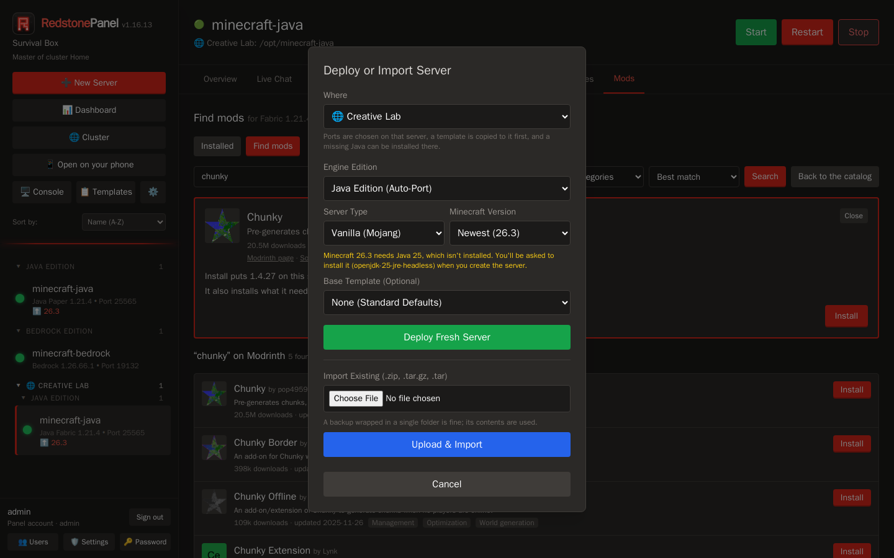
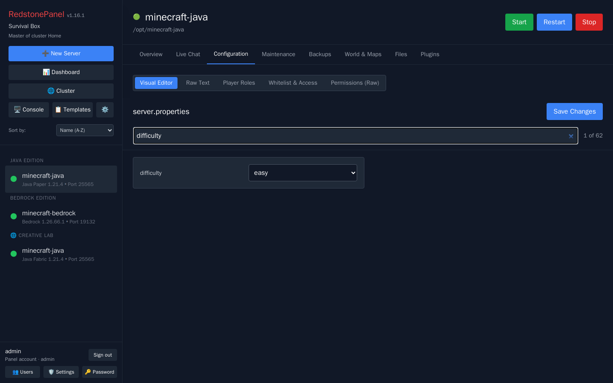
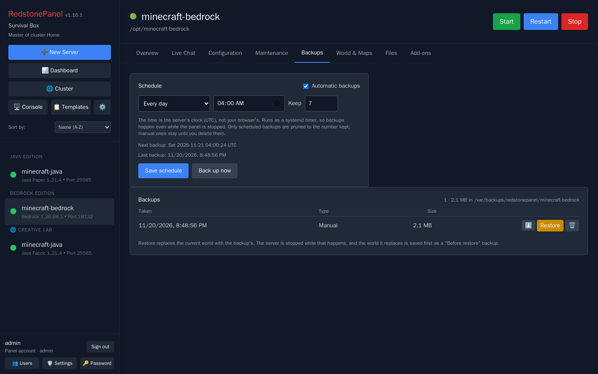
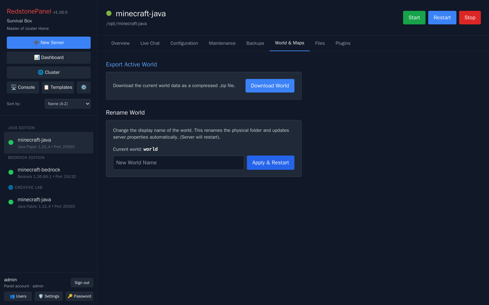
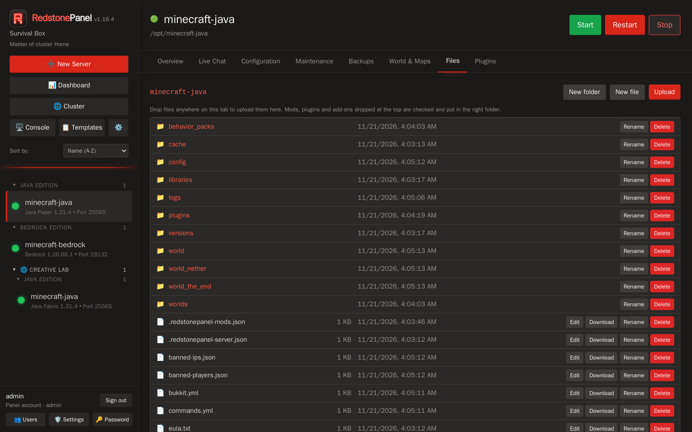
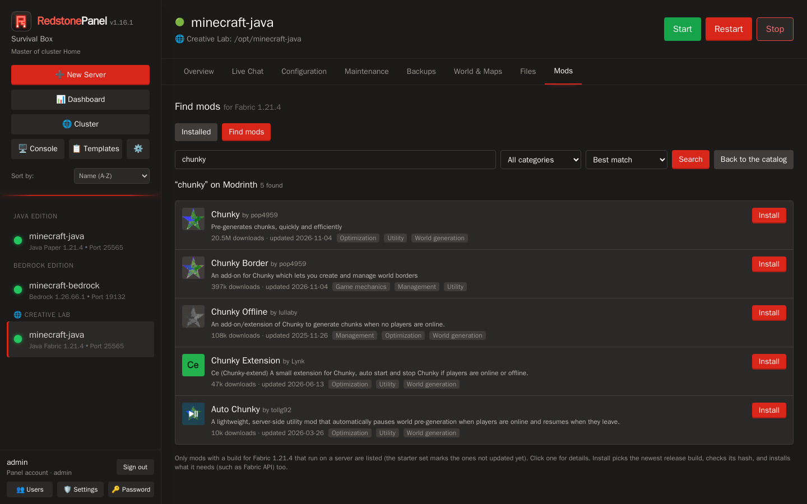
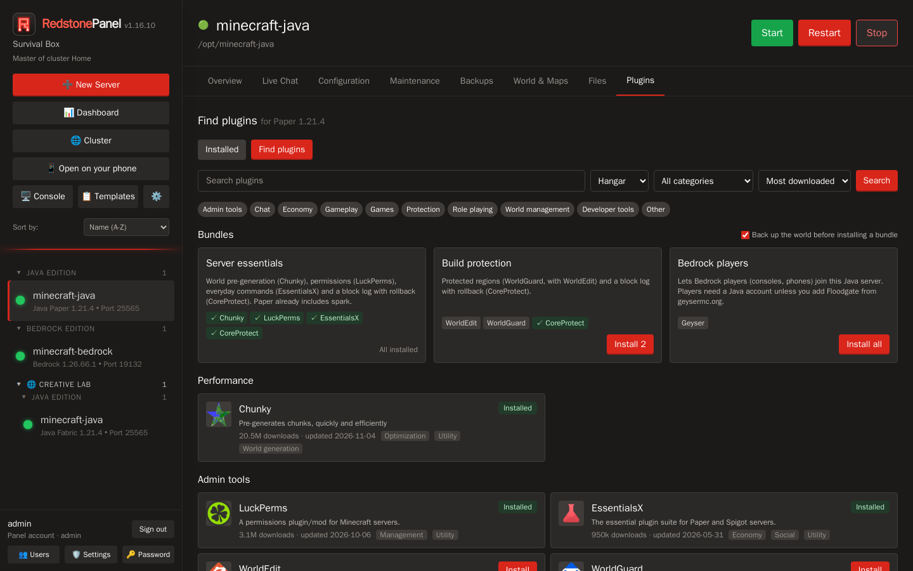
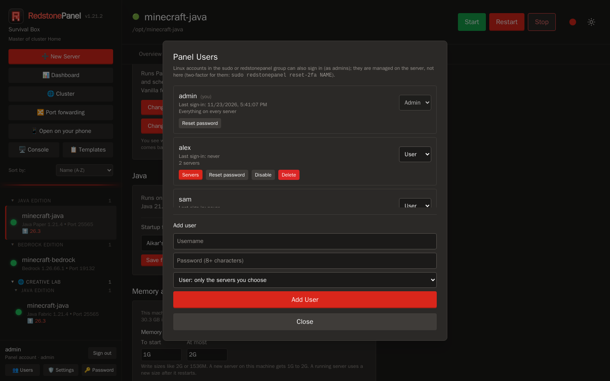
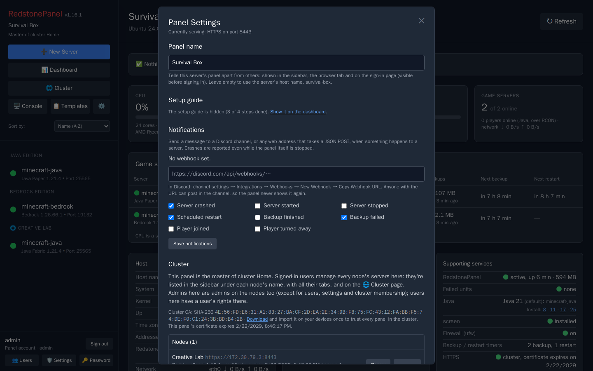
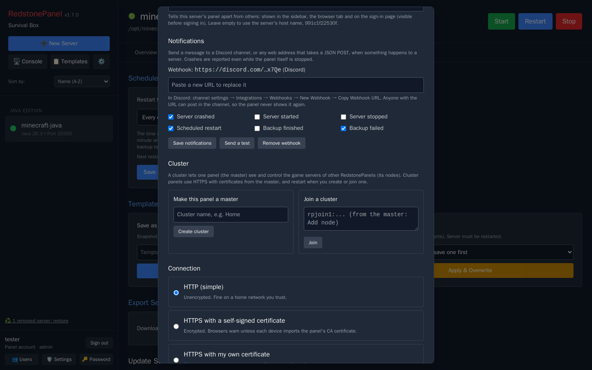

# RedstonePanel user guide

How to set up RedstonePanel and use each of its features. The screenshots come from a demo
panel called "Survival Box" running version 1.7.0 with one Java and one Bedrock server.

For installation details, file locations and the security model, see the main
[README](../../README.md). For every command-line option, run `man redstonepanel`.

**Contents**

1. [Install](#1-install)
2. [Sign in](#2-sign-in)
3. [The dashboard](#3-the-dashboard)
4. [Create or import a server](#4-create-or-import-a-server)
5. [Overview](#5-overview)
6. [Live Chat](#6-live-chat)
7. [Configuration and player roles](#7-configuration-and-player-roles)
8. [Maintenance: templates, export, update, uninstall](#8-maintenance-templates-export-update-uninstall)
9. [Backups](#9-backups)
   - [Scheduled restarts](#scheduled-restarts)
10. [World & Maps](#10-world--maps)
11. [Files](#11-files)
12. [Mods, plugins and add-ons](#12-mods-plugins-and-add-ons)
13. [Console](#13-console)
14. [Templates](#14-templates)
15. [Restore a removed server](#15-restore-a-removed-server)
16. [Users](#16-users)
17. [Panel Settings: name, HTTPS, sign-in](#17-panel-settings-name-https-sign-in)
    - [Notifications](#notifications)
18. [Clusters](#18-clusters)
19. [Command line](#19-command-line)
20. [Troubleshooting](#20-troubleshooting)

---

## 1. Install

RedstonePanel runs on **Ubuntu 24.04 or 25.04**. Install it from the signed qrussell-repo apt
repository, so that `apt upgrade` brings each new version:

```bash
sudo apt install -y curl ca-certificates
curl -fsSL https://qrussell.github.io/qrussell-repo/deb/qrussell-repo.gpg | sudo tee /usr/share/keyrings/qrussell-repo.gpg >/dev/null
echo "deb [signed-by=/usr/share/keyrings/qrussell-repo.gpg] https://qrussell.github.io/qrussell-repo/deb ./" | sudo tee /etc/apt/sources.list.d/qrussell.list
sudo apt update
sudo apt install redstonepanel
```

The package doesn't install Java. The first time you create a Java Edition server, the panel
offers to install the Java that Minecraft version needs (see [Java versions](#java-versions)),
so a machine that only runs Bedrock never gets Java.

Install `ufw` too if you want the panel to open each game server's port in the firewall for
you. It closes the port again when the server is removed.

**Updating.** When a new version is out, the dashboard's **Needs attention** says so and the
**Host** card shows **Update now** (admins). Click it: the panel updates its package with apt,
restarts, and the page reloads by itself, usually within a minute. Game servers keep running.
**Check for updates** on the Host card asks apt straight away instead of waiting for the daily
check. From a terminal, `sudo redstonepanel upgrade` does the same, or use
`sudo apt update && sudo apt upgrade`.

The panel then runs as the `redstonepanel` service on port **8080**. Open
`http://<server>:8080/` in a browser.

## 2. Sign in


There are two kinds of account:

- **Linux accounts** in the `sudo` or `redstonepanel` group sign in with their normal Linux
  username and password. They are panel admins. To let someone in without giving them
  `sudo`, run `sudo usermod -aG redstonepanel alice`.
- **Panel accounts** exist only in the panel. Admins create them under **👥 Users** (see
  [Users](#16-users)), or root creates one with `sudo redstonepanel add-user alice --role user`.

Admins can turn sign-in off for devices on your home network; see
[Panel Settings](#17-panel-settings-name-https-sign-in).

## 3. The dashboard

When no server is selected, the right side shows the state of this machine and everything the
panel relies on. It's what you see after signing in, and **📊 Dashboard** in the sidebar brings
it back. It refreshes every 10 seconds while the page is open.


- **Needs attention** comes first, and only lists what's wrong: a disk over 90% full, memory
  or swap nearly full, a failed or crash-looping server, a failed backup, a Java server whose
  Java isn't installed, a game port the firewall (ufw) blocks, a stopped Phantom proxy, a
  certificate expiring within 14 days, an unreachable cluster node, or a newer RedstonePanel
  in apt. Items about a server have an **Open** link.
- **CPU, Memory, Disk, Game servers**: use right now, with the load average, swap, the free
  space where the servers live, players online and network traffic.
- **Game servers**: one row per server with its state and uptime, CPU (a share of the whole
  machine), memory, players online (Java servers with RCON set up), folder size, backups and
  when the next backup and restart are due. Click a row to open the server. Folder sizes are
  measured in the background every 10 minutes, so a new server shows *measuring…* at first.
- **Host**: host name, Ubuntu release, kernel, uptime, time zone, addresses, the panel's
  version and whether an update is waiting.
- **Disks**: each file system holding the servers, backups and panel data, with free space.
- **Supporting services**: the panel itself, failed units, installed Java versions and which
  servers use each (with **Install** and **Remove**, see [Java versions](#java-versions)), `screen`, the firewall, Phantom proxies, backup and restart timers, HTTPS
  and its certificate, notifications, and the cluster.
- On a cluster master, **Cluster** adds a card per panel with its CPU, memory, disk, servers
  online and anything that needs attention. Nodes need RedstonePanel 1.11 or newer for this.

Visitors from a trusted local network who haven't signed in see the dashboard without
addresses, versions, certificates or settings.


The sidebar on the left holds everything that isn't about one server:

| Item | What it does |
| --- | --- |
| **RedstonePanel v1.7.0 / Survival Box** | The version, and the panel's name, so you can tell several panels apart. |
| **➕ New Server** | Create a server, import one, or restore a removed one. |
| **📊 Dashboard** | This machine's resources, services and what needs attention (above). |
| **🌐 Cluster** | On a cluster master: every panel's servers (see [Clusters](#18-clusters)). |
| **🖥️ Console** | The panel's live activity log. |
| **📋 Templates** | Saved server settings to reuse. |
| **⚙️** | Appearance: dark or light mode and the accent colour. Saved in your browser. |
| **Sort by** | Name A–Z, Z–A, or online servers first. |
| Server list | Every server, grouped by edition: green dot = running, with its version and port. Click one to open it. |
| **♻️ N removed servers: restore** | Shown when servers were uninstalled with **Keep World**. |
| **👥 Users / 🛡️ Settings / 🔑 Password** | Accounts and panel settings (admins), and changing your own password (panel accounts). |

On the right is the selected server. **Start**, **Restart** and **Stop** are always at the top,
with six tabs underneath. Admins also get **Files** and, on Fabric, Paper and Bedrock servers,
**Mods**, **Plugins** or **Add-ons**.

## 4. Create or import a server

Click **➕ New Server**.



**Deploy a fresh server**

1. Choose **Java Edition** or **Bedrock Edition**.
2. For Java, choose the **Server Type** and **Minecraft Version**:
   - **Vanilla (Mojang)**: the official server.
   - **Paper (plugins)**: a faster server that runs Bukkit/Paper plugins. Put plugin `.jar`
     files in the server's `plugins` folder.
   - **Fabric (mods)**: runs Fabric mods. Put mod `.jar` files in the server's `mods`
     folder; players need the same mods.
   - **Newest** is the default. Pick an older version to match your players' clients or your
     plugins and mods.
   - The line under the lists says which Java that version needs and which installed Java
     will run it. If none is new enough, an admin is asked to install it when they click
     **Deploy Fresh Server**; other accounts are told which package an admin needs to install
     (`openjdk-21-jre-headless`, for example).
3. Optionally pick a **Base Template** (see [Templates](#14-templates)) to start from saved
   settings.
4. Click **Deploy Fresh Server**.

The panel then:

- names the server (`minecraft-java`, then `minecraft-java-2`, and so on) and picks a free
  port (Java from 25565, Bedrock from 19132);
- downloads the server: Mojang's `server.jar`, the newest stable Paper build, or Fabric's
  server launcher for the chosen version (always saved as `server.jar`), or the latest
  Bedrock Dedicated Server. Vanilla and Paper downloads are checked against their published
  checksums;
- accepts the Minecraft EULA for you (`eula=true`), so by deploying a server you agree to it;
- creates a systemd service that runs as the `minecraft` user and restarts the server if it
  crashes;
- opens the port in `ufw`, if `ufw` is installed;
- starts the server.

Watch the progress in **🖥️ Console**. A Java server is ready in about a minute; most of that
time is the first world being generated.

**Import a server you already have**

Under **Import Existing**, choose a `.zip`, `.tar.gz`/`.tgz` or `.tar` of a server folder and
click **Upload & Import**. A backup wrapped in a single folder is fine; its contents are used.
The panel gives it a name, a free port and a service, like a fresh deploy.

**Removed servers** are listed at the bottom of the same dialog. See
[Restore a removed server](#15-restore-a-removed-server).

## 5. Overview

The **Overview** tab (shown in [The dashboard](#3-the-dashboard)) shows quick stats:

- status;
- engine;
- Minecraft version;
- the port players connect to;
- the Java heap limit.

For Java servers it also shows which Java version the server needs and which one is installed.


Players connect to `<server address>:<port>`. On Bedrock, use the port shown here; the
default 19132 belongs to the first Bedrock server.

## 6. Live Chat


The chat players see in game. Type in the box and click **Send**:

- plain text is broadcast to everyone as `[Server] …`;
- text starting with `/` runs as a server command, for example `/time set day`,
  `/whitelist add Steve` or `/list`. The reply shows under the chat.

**Clear** empties the panel's view; it doesn't touch the server.

Java servers are reached over **RCON**. The first time you open this tab on a server without
RCON, the panel turns it on with a random password and restarts the server once; send your
message again when it's back. The RCON port is shown top right. Bedrock servers have no RCON;
the panel types into the server's own console instead.

## 7. Configuration and player roles

**Visual Editor**: every setting in `server.properties`, as a form.


Type in the filter box to find a setting quickly, for example `difficulty`, `pvp`, `rcon` or
`port`.



Click **Save Changes**, then **Restart** the server so it reads the new settings.

**Raw Text** is the same file as plain text, for pasting a whole configuration or editing
settings the form doesn't know.


**Player Roles** lists players seen in the server's logs plus everyone already in the
permissions file, with a role for each:

- **Java:** *Operator* (in `ops.json`) or *Member*;
- **Bedrock:** *Operator*, *Member* or *Visitor* (in `permissions.json`).

Changing a role takes effect at the next restart.


**Permissions (Raw)** edits `ops.json` (Java) or `permissions.json` (Bedrock) directly.

## 8. Maintenance: templates, export, update, uninstall


- **Save as Template**: saves this server's properties and permissions as a reusable
  template.
- **Apply Template**: overwrites this server's settings with a template, keeping its ports.
  Restart afterwards.
- **Export Server → Download .zip**: the whole server folder as a zip, to move it to another
  machine. Import it there with **➕ New Server → Import**.
- **Update Server → Check & Update**: for Java, choose **Newest** or a Minecraft version (the
  server keeps its type: a Paper server gets the newest Paper build of that version). Older
  versions than the server's own aren't offered, because a world can't go back. The new jar is
  downloaded before the server is stopped, so a failed download changes nothing. Then it stops
  the server, installs the download and starts it again. Your world, settings, ports,
  operators and allowlist are kept. Take a backup first: a Java world opened by a newer
  version can't go back to an older one. Bedrock servers always update to the newest release.
  On Fabric and Paper servers, moving to a newer Minecraft version first lists the mods or
  plugins that have no build for it yet on Modrinth or Hangar (and any it couldn't check),
  so you can wait rather than update into a server that won't start. If the new version
  needs a Java that isn't installed, you're asked to install it first.
- **Java** (admins, Java servers): which Java the server runs on and which it needs. Choose
  another installed Java that's new enough and click **Use**; a running server restarts.

### Java versions

Each Minecraft version needs a particular Java: 26.1 and newer need Java 25, 1.20.5 to
1.21.11 Java 21, 1.18 to 1.20.4 Java 17, and older versions Java 8. Each server's systemd unit
names its own Java (`/usr/lib/jvm/java-21-openjdk-amd64/bin/java`), so servers needing
different versions run side by side, and the system's default `java` doesn't matter.

- **Installing.** When you create, update or restore a Java server and the Java it needs isn't
  installed, the panel asks to install it (`openjdk-21-jre-headless`, for example) with apt,
  shows the progress in **🖥️ Console**, and then carries on. Servers that were waiting for
  that Java, such as an imported one that couldn't start, are moved onto it and started.
  You can also install one ahead of time from the dashboard: **Supporting services → Java →
  Install**. Only admins can install or remove Java.
- **Removing.** A Java that no server uses shows **Remove** on the dashboard, and the
  dashboard's **Needs attention** mentions it. The panel removes only the
  `openjdk-N-jre-headless` package, and refuses if apt would take anything else with it
  (a JDK you installed, for example); remove those yourself. Anything else on the machine that
  uses that Java stops working, so check before removing. A removed server that's restored
  later installs its Java again.
- **When the exact Java isn't installed**, a server runs on the closest newer one, which
  usually works. **Maintenance → Java** offers to install the exact one and switch to it.

Uninstalling and purging need an **admin**; other accounts, and visitors on a trusted local
network, don't see these two sections.

- **Uninstall (Keep World)**: removes the server's systemd service, so it leaves the panel.
  Its files stay in `/opt/minecraft-…` and its backups stay too, so it can be
  [restored](#15-restore-a-removed-server).
- **Danger Zone → Purge Data**: removes the service and deletes the server's folder,
  world included. This can't be undone. Backups in `/var/backups/redstonepanel` are kept.

Both also remove the server's backup and restart timers, close its game port in `ufw`, and
clear it from systemd's list of failed units. Failed units left behind by servers removed
with older versions are cleared the next time the dashboard loads.

## 9. Backups


**Set up automatic backups**

1. Tick **Automatic backups**.
2. Choose how often: every hour, every 6 or 12 hours, every day, or every Sunday.
3. Choose the time and how many scheduled backups to **Keep**.
4. Click **Save schedule**. **Next backup** shows when the next one will run.

The time is the **server's clock**, and the form shows its time zone (UTC on most servers). A
"04:00" backup on a UTC server runs at 04:00 UTC, whatever time your browser shows.

**How it works**

- Each schedule is a systemd timer (`redstonepanel-backup@<server>.timer`), so backups happen
  even while the panel itself is stopped. If the machine was off at backup time, the backup
  runs when it boots.
- Running servers are copied consistently:
  - **Java:** the panel pauses saving over RCON while the files are copied. A Java server
    without RCON is copied while it runs, and the panel warns you; open its **Live Chat** tab
    once to set RCON up.
  - **Bedrock:** the server's own `save hold` / `save resume` commands are used.
- A backup is a `.tar.gz` of the server folder: the world, `server.properties`, operators,
  allowlist and so on. It leaves out what can be downloaded again (`server.jar`,
  `bedrock_server`, Bedrock's built-in packs) and logs.
- Backups are stored in `/var/backups/redstonepanel/<server>/`, readable only by root. Copy
  that folder to another disk or machine if you want backups that survive losing this one.
- Only **Scheduled** backups are pruned to the number you keep. **Manual** and **Before
  restore** backups stay until you delete them.

**Other buttons**

- **Back up now**: takes a manual backup immediately.
- **⬇️**: downloads a backup.
- **Restore** (admins): stops the server, replaces its world with the one in the backup, and
  starts it again. The world being replaced is saved first as a **Before restore** backup, so
  you can undo a restore by restoring that one. **Before mod update** backups are taken by
  **Update all** on the Mods / Plugins tab.
- **🗑**: deletes a backup (admins).

Bedrock servers work the same way:



From the command line, `sudo redstonepanel backup minecraft-java` takes a backup.

### Scheduled restarts

**Maintenance → Scheduled Restarts** restarts the server every day, every 6 or 12 hours, or
every Sunday, at the time you pick (the server's clock).


1. Tick **On**.
2. Choose how often and the time.
3. Choose a warning: none, or 1, 5, 10 or 15 minutes.
4. Click **Save schedule**. **Next restart** shows when it will happen.

Players see "Server restarts in 5 minutes" in chat, then again 1 minute and 10 seconds before,
and the restart happens at the time you chose. Things to know:

- Java servers are warned over RCON. Open the **Live Chat** tab once so the panel sets it up;
  without it the restart still happens on time, without a warning.
- A server you stopped stays stopped.
- If a backup of the same server is running, the restart waits for it.
- The schedule is a systemd timer (`redstonepanel-restart@<server>.timer`), so it works while
  the panel is stopped.

## 10. World & Maps



- **Download World**: only the world folder, as a zip. Use it to open the world in
  single-player or a map viewer.
- **Rename World**: renames the world folder, updates `level-name` in `server.properties`, and
  restarts the server.

## 11. Files

**Files** (admins only) shows the server's folder in `/opt/minecraft-…`, so you can change
things the other tabs don't cover: plugin and mod settings, `ops.json`, `bukkit.yml`, and so on.



- Click a folder to open it; the path at the top goes back up.
- **Upload**, or drag files from your computer onto the tab, adds them to the folder you're
  in, with a progress bar for each. Uploading a file that already exists asks before
  replacing it. Up to 512 MB per file.
- Mods, plugins and Bedrock add-ons dropped at the top of the folder (or into `mods` or
  `plugins`) are checked and put in the right place, as on the
  [Mods / Plugins / Add-ons](#12-mods-plugins-and-add-ons) tab.
- **Download** saves a file. To get a whole folder, use **Export Server** (Maintenance) or a
  [backup](#9-backups).
- **Rename**, **Delete** (a folder is deleted with everything in it), **New folder**,
  **New file**.
- Text files up to 1 MB (`.yml`, `.json`, `.properties`, `.toml`, `.txt`, logs and the like)
  open in the editor. **Save** (or Ctrl+S) writes the file. If the server changed the file
  after you opened it, saving stops and asks you to reload it, so neither change is lost
  silently.


Most servers read their files when they start, so **Restart** after changing settings.
Some plugins have a reload command; check the plugin's documentation.

Safety:

- Nothing outside the server's folder can be reached. Symlinks are listed (with where they
  point) but never followed, and a file with other hard links isn't opened.
- Files and folders the panel creates belong to the `minecraft` user, like the rest of the
  server.
- Every change is in the activity log with the admin who made it (`[FILES] alex saved …`).

## 12. Mods, plugins and add-ons

Admins see a **Mods** tab on Fabric servers, **Plugins** on Paper servers and **Add-ons** on
Bedrock servers. Vanilla servers can't load mods or plugins, so they don't have one.


**Adding:** drag `.jar` files (Fabric, Paper) or `.mcpack` / `.mcaddon` files (Bedrock) onto
the tab, or click the box to choose them. Each one is checked before it's installed:

- A Fabric mod goes into `mods/`, a Paper or Bukkit/Spigot plugin into `plugins/`.
- A file that can't work on this server is refused with the reason: a Forge or NeoForge mod,
  a plugin on a Fabric server, a mod on a Paper server, a proxy (Velocity, BungeeCord)
  plugin, or a jar that isn't a mod or plugin at all.
- A newer version of something already installed (same mod id, different file name) asks
  first and then replaces the old file, so the server never has two copies.
- The panel only reads each jar's description file; nothing in it is run.

**The list** shows each mod or plugin's name, version, authors and file, and warns when:

- it was made for a different Minecraft version than the server runs (from the mod's
  `fabric.mod.json`, or the plugin's `api-version`);
- it needs another mod or plugin that isn't installed, for example *Needs fabric-api* (most
  Fabric mods need [Fabric API](https://modrinth.com/mod/fabric-api)).

**Disable** renames the file to `….jar.disabled`, which the server skips; **Enable** renames
it back. **Remove** deletes it. Changes apply when the server restarts; the tab offers
**Restart now**.

**Bedrock add-ons.** A `.mcpack` holds one pack, a `.mcaddon` usually a behavior pack and a
resource pack. Each pack is unpacked into `behavior_packs/` or `resource_packs/` and added to
the active world (`world_behavior_packs.json`, `world_resource_packs.json`), so it's on after
a restart. **Disable** takes a pack out of the world and keeps its files; **Remove** deletes
it. Players download resource packs only if they accept server packs. Skin packs and world
templates are refused.


### Server tools: Phantom (Bedrock)

Consoles and phones list a Bedrock server under **Friends → LAN Games** only when it runs on
port 19132. [Phantom](https://github.com/jhead/phantom) answers those LAN pings for a server
on any other port and forwards players to it. The Add-ons tab of a Bedrock server has a
**Server tools** card for it (admins):

- **Install** downloads Phantom 0.5.4 from GitHub once, checks it against a SHA-256 built into
  the panel (Phantom publishes none), and keeps it in `/usr/local/lib/redstonepanel/phantom/`.
  It then creates `phantom-<server>.service`, which runs as the `minecraft` user, forwards to
  the server on this machine and starts at boot, and opens UDP 19132 and the Phantom's own
  port (19300 and up, one per server) in ufw.
- The card shows whether it's running, where it forwards, the UDP ports it listens on and its
  recent log, with **Stop** / **Start**, **Restart** and **Uninstall**. Uninstall stops and
  deletes the service and closes the ports no other Phantom needs.
- If you change the server's port, the card says the Phantom points at the old one; **Repair**
  points it at the new port.
- Several servers can each have a Phantom: they share UDP 19132. A Bedrock server on 19132
  can't share it, so Install is refused while one is on this machine (move it to another port
  in Configuration). A server on 19132 needs no Phantom anyway.
- Phantom services you made yourself that point at the server or use its port are listed too,
  with what's wrong with them, Start / Stop and **Remove unit**, which deletes only the unit
  file, never the program. If yours is called `phantom-<server>.service`, remove it before
  installing the panel's.

Removing a server removes its Phantom as well.

### Finding mods and plugins

On Fabric and Paper servers, **Find mods** (or **Find plugins**) searches
[Modrinth](https://modrinth.com) and, for Paper, [Hangar](https://hangar.papermc.io), PaperMC's
plugin site. Only projects with a build for the server's loader and Minecraft version, and
that run on a server, are shown, so client-only mods such as Sodium don't appear. With an
empty search you see the most downloaded.



**Install** picks the newest release build (a beta only when there's no release, never an
alpha), downloads it from the site's own download server, checks it against the checksum the
site gives, and then installs it like a dropped file. Mods and plugins it needs are installed
first, for example Fabric API. A dependency that isn't on the same site, or a Hangar plugin
that's downloaded from somewhere else, is named so you can get it yourself.



### Updates

When you open the tab, the panel asks Modrinth and Hangar whether anything installed has a
newer build for the server's Minecraft version. Jars installed from the tab are known by
their project; jars you added by hand are looked up on Modrinth by their checksum, so most of
them are found too. Each one shows where it's from, with **Update to …** when there's
something newer.


- **Update all** updates every one, and can back up the world first (ticked by default): the
  backup shows on the Backups tab as **Before mod update**.
- An update keeps the old file as `….jar.previous`, which the server doesn't load, and
  **Undo** puts the last update's old files back. They're kept until the next update.
- Restart the server to load the new versions.

Where each jar came from is kept in `.redstonepanel-mods.json` in the server folder.

Every install, change and removal goes in the activity log (`[MODS] alex installed Sodium …`).

## 13. Console


**🖥️ Console** opens the panel's activity log at the bottom of the screen: deploys, updates,
service starts and stops, firewall changes, backups, and who signed in. Lines are coloured by
kind: errors and crashes red, warnings yellow, backups and restarts blue, sign-ins and settings
purple, commands the panel runs grey. The same log is in
`/var/log/redstonepanel/panel.log`. Close it with **❌ Close**.

## 14. Templates

**📋 Templates** opens the template manager. A template is a set of `server.properties`
values plus an operators/permissions list, for one edition.


- Create one from a server you've set up: **Maintenance → Save as Template**.
- Edit its properties and permissions here, then click **Save All Updates**.
- Use it when deploying (**➕ New Server → Base Template**), or apply it to an existing
  server (**Maintenance → Apply Template**). Ports are never copied from a template, so
  servers made from the same template don't clash.

## 15. Restore a removed server

A server uninstalled with **Keep World** still has its files in `/opt`. The sidebar shows
**♻️ N removed servers: restore**, and they are listed under **➕ New Server → Removed servers**
(see the [New Server dialog](#4-create-or-import-a-server)).

- **Restore** gives the server a new systemd service under the same name and starts it:
  - it keeps its old port, unless another server took that port in the meantime; then it moves
    to the next free one and tells you;
  - the server binary is downloaded only if it's missing;
  - its backup schedule comes back.
- **🗑** (admins) permanently deletes the removed server's files. This can't be undone.

The same from a terminal:

```bash
sudo redstonepanel removed
sudo redstonepanel restore minecraft-java-2
```

## 16. Users

**👥 Users** (admins) manages panel accounts.



- **Add user**: a username, a password of at least 8 characters, and a role:
  - **User** can manage servers;
  - **Admin** can also manage panel users and Panel Settings, uninstall and purge servers,
    restore backups, and delete backups and removed servers.
- For each account you can change the role, **Reset password**, **Disable** (it can't sign
  in until enabled again) or **Delete**.
- Linux accounts aren't listed here; they're managed with the usual Linux tools.

An admin account controls a service that runs as root, so treat it like `sudo` access.

## 17. Panel Settings: name, HTTPS, sign-in

**🛡️ Settings** (admins).



**Panel name**: shown in the sidebar, the browser tab and on the sign-in page. It defaults to
the machine's host name and helps when you run several panels.

**Connection**:


- **HTTP (simple)**: port 8080, fine on a trusted home network.
- **HTTPS with a self-signed certificate**: the panel makes its own certificate authority.
  Download its CA certificate from here and install it on your devices once to get rid of
  the browser warning.
- **HTTPS with my own certificate**: point it at a certificate and key you already have, for
  example from certbot.

### Notifications

Get a message in Discord, or any service that takes a webhook, when something happens.



1. In Discord, open the channel's settings → **Integrations** → **Webhooks** → **New
   Webhook**, then **Copy Webhook URL**.
2. Paste it into **Notifications** and tick the events you want:
   - **Server crashed**: the server stopped without being asked to. It starts again by itself
     after 20 seconds (Java and Bedrock alike).
   - **Server started** / **Server stopped**: every start and stop, including your own.
   - **Scheduled restart**: a [scheduled restart](#scheduled-restarts) happened, or failed.
   - **Backup finished** / **Backup failed**.
3. Click **Save notifications**, then **Send a test**.

By default only crashes, failed backups and scheduled restarts are sent. A server that keeps
crashing sends one message every 5 minutes, not one per crash.

Crash, start and stop messages come straight from systemd, so they arrive even while the panel
is stopped. The webhook URL lets anyone post in your channel, so the panel stores it readable
only by root and never shows it again. Paste a new one to replace it, or **Remove webhook**.

Other services receive a JSON POST with the fields `text`, `event`, `server`, `panel`,
`message` and `time`.

**Sign-in**:

- **Always required (recommended)**.
- **Not required on the local network**: devices on the private networks you list can manage
  servers without signing in. Things to know:
  - they get the *User* role, so users, settings and uninstalling servers still need an
    admin sign-in;
  - it never applies to requests coming through a reverse proxy;
  - everyone on those networks gets in, including guests on your Wi-Fi.

If a change locks you out, run `sudo redstonepanel reset-security` on the machine (see
[Troubleshooting](#20-troubleshooting)).

**Don't forward port 8080 to the internet.** For remote access use a VPN (WireGuard,
Tailscale), or a reverse proxy with a real certificate as described in the
[README](../../README.md#exposing-the-panel-to-the-internet).

## 18. Clusters

Running RedstonePanel on several machines? One panel can be the **master** of a cluster and
show every **node's** game servers on its **🌐 Cluster** page, with start, stop and restart.
Each panel's CPU, memory and free disk are shown under its name, and the master's dashboard
has a card per panel.


1. On the master: **Settings → Cluster → Make this panel a master**, give the cluster a name,
   and click **Create cluster**. The panel restarts on HTTPS (port 8443).
2. On the master: make a **join code**. Codes work once and expire after an hour.
3. On each node: paste the code under **Settings → Cluster → Join a cluster**, and click
   **Join**.
4. Download the cluster CA from **Settings → Cluster** and install it on your devices once.

Each node keeps its own dashboard, and its game servers keep running if the master is down.
The master can only list, start, stop and restart a node's servers; it can't change the
node's users or settings, or delete servers. Download an encrypted **cluster backup** after
adding or removing nodes, so another panel can take over if the master is lost. Details are
in the [README](../../README.md#clusters-several-servers-from-one-panel).

## 19. Command line

Everything below runs as root (`sudo`). `man redstonepanel` has the details.

| Command | What it does |
| --- | --- |
| `redstonepanel status` | Address, HTTPS and sign-in mode, panel users. |
| `redstonepanel add-user NAME [--role admin\|user]` | Create a panel account (asks for the password). |
| `redstonepanel set-name "NAME"` | Set the panel name (`""` = host name). |
| `redstonepanel reset-security` | Back to plain HTTP on 8080 with sign-in required. |
| `redstonepanel removed` | List servers uninstalled with Keep World. |
| `redstonepanel restore NAME` | Restore a removed server. |
| `redstonepanel backup NAME` | Back up a server now. |
| `redstonepanel restart-server NAME` | Warn players, then restart a server (what its restart timer runs). |
| `redstonepanel notify-test` | Send a test notification. |
| `redstonepanel cluster create "NAME"` | Make this panel a cluster master. |
| `redstonepanel cluster join-code` | Make a join code (master). |
| `redstonepanel join 'CODE'` | Join a cluster. |
| `redstonepanel leave` | Leave the cluster. |
| `redstonepanel cluster backup FILE` / `cluster promote FILE` | Back up the cluster / make this panel the master from a backup. |

Game servers are ordinary systemd services, so the usual tools work too:

```bash
systemctl status minecraft-java
journalctl -u minecraft-java -f
systemctl list-timers 'redstonepanel-backup@*'
```

## 20. Troubleshooting

**I can't reach the panel after changing a setting.** Run this on the machine:

```bash
sudo redstonepanel reset-security
```

It switches the panel back to plain HTTP on port 8080 with sign-in required. If HTTPS is
turned on but its certificate can't be used, the panel starts on HTTP by itself and warns
admins in the sidebar.

**Players can't connect.** Check:

- the server is green in the sidebar;
- players use the port shown on **Overview**;
- the port is open in the firewall (`sudo ufw status`): TCP for Java, UDP for Bedrock;
- if players connect from the internet, your router forwards that port.

**Live Chat says RCON isn't answering.** The server is probably still starting; wait a moment.
Otherwise **Restart** it so it picks up its RCON settings.

**A backup says it was copied live.** That Java server has no RCON yet. Open its **Live Chat**
tab once; the panel sets RCON up and later backups are consistent.

**Where is everything?**

| What | Where |
| --- | --- |
| Game servers | `/opt/minecraft-*` |
| Backups | `/var/backups/redstonepanel/<server>/` |
| Notification webhook (root only) | `/var/lib/redstonepanel/notifications.json` |
| Panel settings, accounts, templates | `/var/lib/redstonepanel` |
| Activity log | `/var/log/redstonepanel/panel.log` |
| Panel service | `systemctl status redstonepanel` |
