# RedstonePanel user manual

How to set up RedstonePanel and use each of its features, step by step. It's written for
version **1.16.11**. The screenshots come from a demo cluster: a panel called "Survival Box"
(the master) running a Paper server with plugins and a Bedrock server, and a node called
"Creative Lab" running a Fabric server with mods.

**About the screenshots:** each one was taken in the panel's dark and light theme, and on GitHub
you see the one that matches your browser or system theme (GitLab shows the dark one). To
compare, open the [screenshot gallery](#screenshot-gallery) at the end, in either theme. The
close-up of mod updates is from an earlier version.

New to RedstonePanel? Start with [Install](#1-install), then
[Create or import a server](#4-create-or-import-a-server) and [Backups](#9-backups). For file
locations and the security model, see the main [README](../../README.md); for every
command-line option, run `man redstonepanel`. This manual is also published as the
[User Manual](https://github.com/qrussell/redstonepanel/wiki/User-Manual) page of the wiki.

**How do I…**

| …? | Where |
| --- | --- |
| Install or update the panel | [Install](#1-install) |
| Run it on a Windows PC | [On Windows with WSL](#on-windows-with-wsl) |
| Create a Java or Bedrock server | [Create or import a server](#4-create-or-import-a-server) |
| Bring in a server I already have | [Import](#4-create-or-import-a-server) |
| Talk to players or run a command | [Live Chat](#6-live-chat) |
| Change difficulty, game mode, ports… | [Configuration](#7-configuration-player-roles-and-the-whitelist) |
| Make someone an operator, or whitelist them | [Player roles and the whitelist](#7-configuration-player-roles-and-the-whitelist) |
| Back up a world, or put one back | [Backups](#9-backups) |
| Keep backups off this machine (NAS, Backblaze B2, S3) | [Off-site copies](#off-site-copies-ssh-or-s3-storage) |
| Restart a server every night | [Scheduled restarts](#scheduled-restarts) |
| Update a server to a newer Minecraft version | [Maintenance](#8-maintenance-templates-export-update-uninstall) |
| Add mods, plugins or Bedrock add-ons | [Mods, plugins and add-ons](#12-mods-plugins-and-add-ons) |
| Let Bedrock players join a Java server | [Finding mods and plugins](#finding-mods-and-plugins) (the **Bedrock players** bundle) |
| Edit a plugin's config file | [Files](#11-files) |
| Get a Discord message when a server crashes | [Notifications](#notifications) |
| Give a friend access without full control | [Users](#16-users) |
| Turn on HTTPS | [Panel Settings](#17-panel-settings-name-https-sign-in) |
| Manage servers on several machines | [Clusters](#18-clusters) |
| Fix "players can't connect" or a lock-out | [Troubleshooting](#20-troubleshooting) |

**New in 1.16**

| Version | What's new | Where |
| --- | --- | --- |
| 1.16.11 | **Off-site backup copies** to an SSH server or S3-compatible storage, retention by age, and bringing a server back on a new machine; Bedrock servers get the firewall rules they really need. | [Off-site copies](#off-site-copies-ssh-or-s3-storage), [Backup storage](#backup-storage) |
| 1.16.10 | **Works on a phone**: a ☰ menu, big Start/Restart/Stop buttons and tables as cards; **installable as an app** over HTTPS; **📱 Open on your phone** shows a QR code on the desktop. | [On a phone](#on-a-phone) |
| 1.16.9 | Runs on **Ubuntu 26.04 and 26.10, Debian 13 and a Raspberry Pi 4 or 5** (64-bit Pi OS), on x86-64 and ARM64 (Java only on ARM64), with the Java versions each system packages. | [Install](#1-install), [On a Raspberry Pi](#on-a-raspberry-pi), [Java versions](#java-versions) |
| 1.16.8 | **Backup copies on another cluster member**, made by the master, checked with SHA-256 and restorable after losing the original machine. | [Backups](#9-backups) |
| 1.16.7 | **Two-factor sign-in** with an authenticator app and recovery codes, and an option to require it for admins. | [Two-factor sign-in](#two-factor-sign-in) |
| 1.16.6 | The console makes room instead of covering the page, and keeps the sidebar visible. | [Console](#13-console) |
| 1.16.5 | Each Bedrock server gets its own UDP gameplay port (`server-udp-ports`), so several can run on one machine. | [Create a server](#4-create-or-import-a-server) |
| 1.16.4 | New Bedrock servers keep every setting from the Bedrock download, so **Configuration** lists them all. | [Configuration](#7-configuration-player-roles-and-the-whitelist) |
| 1.16.3 | Fold the server list by edition and by cluster node; a folded heading shows how many servers are online. | [The dashboard](#3-the-dashboard) |
| 1.16.2 | **Kick**, **Ban** and **Unban** players, and a **Banned** list for Java servers. | [Kick, ban and unban](#7-configuration-player-roles-and-the-whitelist) |
| 1.16.2 | The RedstonePanel logo, a stone-and-redstone theme with **Redstone Red** accents, and an icon for a phone's home screen. | [The dashboard](#3-the-dashboard), [Sign in](#2-sign-in) |
| 1.16.1 | A setup guide on a new panel's dashboard: first server, backups, HTTPS and alerts. | [The dashboard](#3-the-dashboard) |
| 1.16.0 | Move or copy a server to another machine of a cluster. | [Clusters](#18-clusters) |

Every release's highlights are on the [What's New](../wiki/Whats-New.md) page.

**Contents**

1. [Install](#1-install)
   - [On Windows with WSL](#on-windows-with-wsl)
2. [Sign in](#2-sign-in)
3. [The dashboard](#3-the-dashboard)
4. [Create or import a server](#4-create-or-import-a-server)
5. [Overview](#5-overview)
6. [Live Chat](#6-live-chat)
7. [Configuration, player roles and the whitelist](#7-configuration-player-roles-and-the-whitelist)
8. [Maintenance: templates, export, update, uninstall](#8-maintenance-templates-export-update-uninstall)
9. [Backups](#9-backups)
   - [Off-site copies (SSH or S3 storage)](#off-site-copies-ssh-or-s3-storage)
   - [Scheduled restarts](#scheduled-restarts)
10. [World & Maps](#10-world--maps)
11. [Files](#11-files)
12. [Mods, plugins and add-ons](#12-mods-plugins-and-add-ons)
13. [Console](#13-console)
14. [Templates](#14-templates)
15. [Restore a removed server](#15-restore-a-removed-server)
16. [Users](#16-users)
17. [Panel Settings: name, HTTPS, sign-in](#17-panel-settings-name-https-sign-in)
    - [Notifications](#notifications)
    - [Backup storage](#backup-storage)
18. [Clusters](#18-clusters)
19. [Command line](#19-command-line)
20. [Troubleshooting](#20-troubleshooting)

At the end: the [screenshot gallery](#screenshot-gallery), every screenshot in the light and the dark theme.

---

## 1. Install

RedstonePanel runs on **Ubuntu 24.04, 26.04 or 26.10**, **Debian 13** and **64-bit Raspberry Pi
OS** (on a Raspberry Pi 4 or 5), on x86-64 and ARM64 machines. On ARM64, including every
Raspberry Pi, it runs **Java servers only**, because Mojang makes Bedrock Dedicated Server for
x86-64 only (see [On a Raspberry Pi](#on-a-raspberry-pi)). Ubuntu 25.04 and 25.10 still work
but no longer get updates; Debian 12 and 32-bit systems aren't supported. The quickest way is
the installer, which adds
the signed qrussell-repo apt repository (checking its key) and installs the panel:

```bash
curl -fsSL https://raw.githubusercontent.com/qrussell/redstonepanel/main/install.sh | sudo sh
```

Or do the same by hand, so that `apt upgrade` brings each new version:

```bash
sudo apt install -y curl ca-certificates
curl -fsSL https://qrussell.github.io/qrussell-repo/deb/qrussell-repo.gpg | sudo tee /usr/share/keyrings/qrussell-repo.gpg >/dev/null
echo "deb [signed-by=/usr/share/keyrings/qrussell-repo.gpg] https://qrussell.github.io/qrussell-repo/deb ./" | sudo tee /etc/apt/sources.list.d/qrussell.list
sudo apt update
sudo apt install redstonepanel
```

The package doesn't install Java. The first time you create a Java Edition server, the panel
offers to install the Java that Minecraft version needs (see [Java versions](#java-versions)),
so a machine that only runs Bedrock never gets Java.

Install `ufw` too if you want the panel to open each game server's ports in the firewall for
you: TCP for Java, and for Bedrock (NetherNet, the default since Bedrock 1.26.50, also when
server.properties has no `transport` line) TCP on its port, UDP on its `server-udp-ports` and
UDP 7551 for LAN discovery. A Bedrock server set to `transport=raknet` gets UDP on its port and
its IPv6 port instead. It follows port and transport changes you make in Configuration, and
closes the ports again when the server is removed (7551 stays open while another NetherNet
server needs it). If you edit server.properties by hand, the panel moves the rules within two
minutes or when you open the dashboard. The dashboard also names any game-port rule that no
server uses, with the command to close it.

**Updating.** When a new version is out, the dashboard's **Needs attention** says so and the
**Host** card shows **Update now** (admins). Click it: the panel updates its package with apt,
restarts, and the page reloads by itself, usually within a minute. Game servers keep running.
**Check for updates** on the Host card asks apt straight away instead of waiting for the daily
check. From a terminal, `sudo redstonepanel upgrade` does the same, or use
`sudo apt update && sudo apt upgrade`.

The panel then runs as the `redstonepanel` service on port **8080**. Open
`http://<server>:8080/` in a browser.

### On a Raspberry Pi

Use a **Raspberry Pi 4 or 5**, ideally with 4 GB of memory or more.

1. In **Raspberry Pi Imager**, choose **Raspberry Pi OS Lite (64-bit)**, write it to an SSD or
   a microSD card, and turn on SSH in the settings it offers before writing. An SSD (USB 3, or
   NVMe on a Pi 5) is faster and lasts longer than a card under world saves and backups.
2. Start the Pi, sign in over SSH, and run the installer above.
3. Open `http://<pi>:8080/` and create a **Paper** server: it uses noticeably less CPU than
   Vanilla, which matters on a Pi.

**Bedrock** isn't offered: the **New Server** dialog shows it greyed out with the reason, and a
Bedrock backup can't be imported. To let Bedrock players join, add the **Bedrock players**
bundle (Geyser) to a Java server (see [Finding mods and plugins](#finding-mods-and-plugins)).
In a cluster, a Pi can be the master or a node next to an x86-64 machine that runs the Bedrock
servers; a Bedrock server can't be moved to a Pi.

**Memory.** A new Java server may use up to 2 GB (1 GB on a machine with 3 GB or less);
**Overview → Max RAM** shows it. Leave about 1 GB for the system:

| Pi | What fits |
| --- | --- |
| 2 GB | Not recommended: one small server, which gets 1 GB. |
| 4 GB | One server at 2 GB, for about 5 to 10 players. |
| 8 GB | Two or three servers at 2 GB, or one at 4 to 5 GB. |
| 16 GB | Several servers; the CPU is the limit. |

To change a server's limit, run `sudo systemctl edit --full minecraft-java` (with the server's
name), change `-Xmx2G` to, say, `-Xmx4G`, and restart the server. Updates and moves keep it.

**Java.** Raspberry Pi OS (like Debian 13) packages Java 21 and 25, which run Minecraft 1.17 and
newer. For older versions, which ask for Java 8, the panel says the Pi doesn't have it and
offers Java 21, which some old versions and modpacks don't start on.

**Cooling.** A Pi 5 needs its active cooler (or a case with a fan) to run a server all day
without slowing itself down.

### On Windows with WSL

RedstonePanel also runs in Ubuntu under WSL on Windows. Install **Ubuntu 24.04**
(`wsl --install -d Ubuntu-24.04` in PowerShell), open it, and run the installer above inside
it. Ubuntu under WSL starts systemd by default, which the panel and its game servers need. If
`ps -p 1 -o comm=` doesn't print `systemd`, add `systemd=true` under `[boot]` in
`/etc/wsl.conf` and run `wsl --shutdown` in PowerShell.

The panel then opens in your Windows browser at `http://localhost:8080/`, and creating servers
works as usual. Players on other PCs, though, can't reach them yet: by default WSL keeps Ubuntu
behind its own private network. To let them in:

1. **Turn on mirrored networking** (Windows 11 22H2 or newer). Put this in
   `%UserProfile%\.wslconfig`, then run `wsl --shutdown`:

   ```ini
   [wsl2]
   networkingMode=mirrored
   ```

   Ubuntu then shares your PC's network address. Players connect to your **Windows PC's IP
   address** (from `ipconfig`) and the port shown on the server's **Overview**.

2. **Allow the game ports through the Hyper-V firewall** that sits in front of WSL. In an
   admin PowerShell, for example for the first Bedrock server:

   ```powershell
   New-NetFirewallHyperVRule -Name "MinecraftTCP" -DisplayName "Minecraft TCP" -Direction Inbound -VMCreatorId '{40E0AC32-46A5-438A-A0B2-2B479E8F2E90}' -Protocol TCP -LocalPorts 19132
   New-NetFirewallHyperVRule -Name "MinecraftUDP" -DisplayName "Minecraft UDP" -Direction Inbound -VMCreatorId '{40E0AC32-46A5-438A-A0B2-2B479E8F2E90}' -Protocol UDP -LocalPorts 19140,7551
   ```

3. **Allow the same ports in Windows Defender Firewall**, and make sure Windows treats your
   network as **Private**:

   ```powershell
   New-NetFirewallRule -DisplayName "Minecraft TCP" -Direction Inbound -Protocol TCP -LocalPort 19132 -Action Allow
   New-NetFirewallRule -DisplayName "Minecraft UDP" -Direction Inbound -Protocol UDP -LocalPort 19140,7551 -Action Allow
   ```

**Which ports?** A **Java** server needs TCP on its port (25565 for the first one). Current
**Bedrock** servers use the NetherNet transport: TCP on their `server-port` (19132 for the
first), UDP on their `server-udp-ports` (both in **Configuration**) and UDP 7551 for LAN
discovery. Opening only UDP 19132, as older Bedrock guides say, isn't enough. Each new server
gets its own ports, so add rules for those too. To open the panel from other PCs, allow TCP
8080 (or 8443 with HTTPS) the same way. If `ufw` is active inside Ubuntu, the panel opens the
game ports there as usual; the Windows firewalls still need their own rules.

**Keep in mind:**

- **WSL can stop Ubuntu when nothing on Windows is using it**, for example a while after you
  close the last Ubuntu window, and it only starts after you sign in to Windows. Your game
  servers stop with it. For servers that are always up, keep an Ubuntu window open, or use a
  real Ubuntu machine or VM.
- For players outside your home, forward the same ports on your router to your **Windows
  PC's** IP address.

## 2. Sign in

<picture><source media="(prefers-color-scheme: light)" srcset="images/light/sign-in.png"></picture>

There are two kinds of account:

- **Linux accounts** in the `sudo` or `redstonepanel` group sign in with their normal Linux
  username and password. They are panel admins. To let someone in without giving them
  `sudo`, run `sudo usermod -aG redstonepanel alice`.
- **Panel accounts** exist only in the panel. Admins create them under **👥 Users** (see
  [Users](#16-users)), or root creates one with `sudo redstonepanel add-user alice --role user`.

Admins can turn sign-in off for devices on your home network; see
[Panel Settings](#17-panel-settings-name-https-sign-in).

### Two-factor sign-in

Any account, panel or Linux, can ask for a second step after the password: a six-digit code
from an authenticator app on your phone (Google Authenticator, Microsoft Authenticator, Aegis,
1Password, Bitwarden and so on).

1. Click **🔑 Password** in the sidebar, then **Set Up Two-Factor**.
2. Scan the QR code with the app, or type the key under it.
3. Type the code the app shows and click **Turn On**.
4. **Save the ten recovery codes** it shows (Copy, Download, or print them). Each one signs you
   in once if you lose your phone. They aren't shown again.

From then on the sign-in page asks for a code after your password. Turning it on signs out
your other browsers, which sign in again with a code. Under **🔑 Password** you can also see
how many recovery codes are left, make new ones, or turn it off (both need a current code).

Lost your phone and your recovery codes? Another admin can click **Reset two-factor** for a
panel account under **👥 Users**, or root runs `sudo redstonepanel reset-2fa NAME` (this works
for Linux accounts too). Wrong codes count towards the same limit as wrong passwords: five
in ten minutes and that account and address wait a few minutes.

Admins can make it compulsory for every admin; see
[Panel Settings](#17-panel-settings-name-https-sign-in).

### On a phone

The panel works on a phone or a small tablet. Below 768 px wide:

- The sidebar becomes a menu: tap **☰** in the top bar, which also names the open server. The
  menu closes when you pick something, tap outside it or press Escape.
- On a server's page, **Start**, **Restart** and **Stop** are large buttons across the top, and
  the tabs scroll sideways.
- Tables (the dashboard's servers, backups, files, the access log) become cards, and dialogs
  fill the screen.
- Live Chat keeps its box above the on-screen keyboard, and fields don't make the page zoom in.

<p>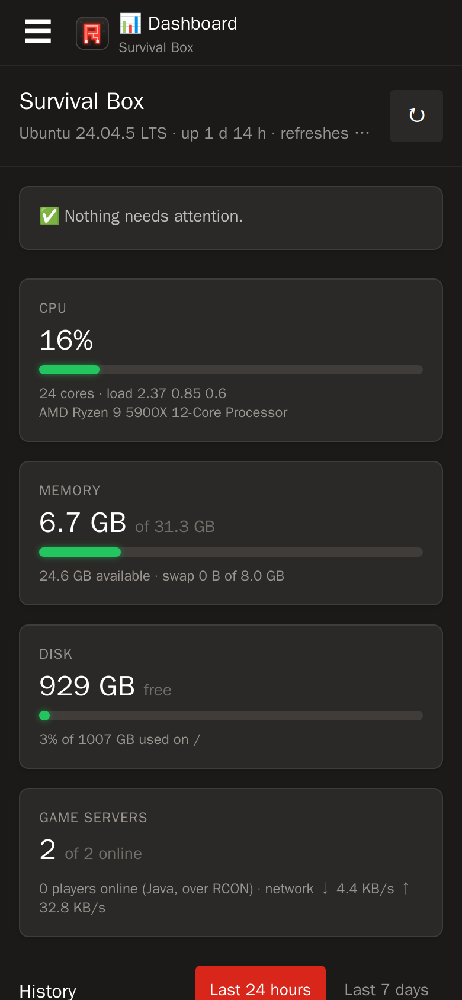  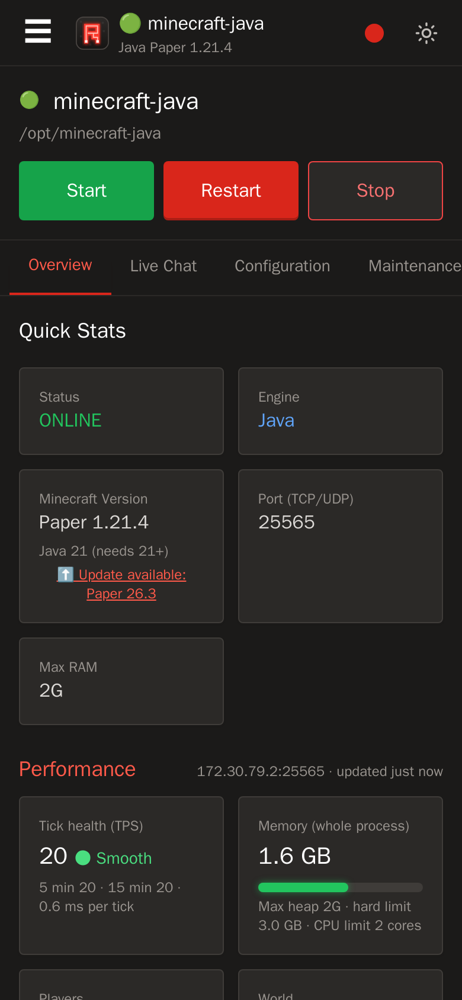</p>

**Open on your phone.** On a computer, click **📱 Open on your phone** in the sidebar and scan the
QR code with the phone's camera. The code is made by the panel itself, so the address never
goes to an outside service. If you opened the panel as `localhost`, it offers this machine's
network addresses instead.

<picture><source media="(prefers-color-scheme: light)" srcset="images/light/phone-qr.png"></picture>

**Install it as an app.** Over HTTPS, Android's Chrome offers **Install app** (or ⋮ → **Install
app**), and on an iPhone use Safari's **Share → Add to Home Screen**. The panel then opens in
its own window with the RedstonePanel icon, without the browser's address bar. Browsers only
install apps from HTTPS sites, so on plain HTTP the phone can only add a bookmark to its home
screen; turn on HTTPS in [Panel Settings](#17-panel-settings-name-https-sign-in). If the phone
can't reach the panel, the app shows **Can't reach the panel** with **Try again**.

## 3. The dashboard

When no server is selected, the right side shows the state of this machine and everything the
panel relies on. It's what you see after signing in, and **📊 Dashboard** in the sidebar brings
it back. It refreshes every 10 seconds while the page is open.

<picture><source media="(prefers-color-scheme: light)" srcset="images/light/dashboard.png"></picture>

- **Set up RedstonePanel** (admins) comes first on a new panel: four steps to a safe setup.
  1. **Create your first server**: opens **➕ New Server**. If the firewall `ufw` is missing or
     off, it says so here, because the panel opens game ports only through `ufw`.
  2. **Back up your worlds**: a button for each server without a backup schedule, which opens
     its **Backups** tab ([Backups](#9-backups)).
  3. **Choose how the panel is reached**: **Turn on HTTPS** opens Panel Settings at
     **Connection**. On a home network you trust, **Keep HTTP, this is my home network** ticks
     the step instead.
  4. **Get told when something breaks**: opens Panel Settings at
     [Notifications](#notifications).

  <picture><source media="(prefers-color-scheme: light)" srcset="images/light/setup-guide.png"></picture>

  Steps tick themselves from what the panel can see, so a step done from the command line or by
  another admin counts too. On a cluster node, joining the cluster ticks the HTTPS step; on a
  master, servers on the nodes count for the first step. The card goes away when every step is
  done. **Hide guide** hides it for every admin; Panel Settings → **Setup guide** shows it again,
  and is also where you can take back **Keep HTTP**.
- **Needs attention** comes first, and only lists what's wrong: a disk over 90% full, memory
  or swap nearly full, a failed or crash-looping server, a failed backup, a Java server whose
  Java isn't installed, a game port the firewall (ufw) blocks, a stopped Phantom proxy, a
  certificate expiring within 14 days, an unreachable cluster node, or a newer RedstonePanel
  in apt. Items about a server have an **Open** link.
- **CPU, Memory, Disk, Game servers**: use right now, with the load average, swap, the free
  space where the servers live, players online and network traffic.
- **Game servers**: one row per server with its state and uptime, CPU (a share of the whole
  machine), memory, players online (Java servers with RCON set up), folder size, backups and
  when the next backup and restart are due. Click a row to open the server. Folder sizes are
  measured in the background every 10 minutes, so a new server shows *measuring…* at first.
- **Host**: host name, Ubuntu release, kernel, uptime, time zone, addresses, the panel's
  version and whether an update is waiting.
- **Disks**: each file system holding the servers, backups and panel data, with free space.
- **Supporting services**: the panel itself, failed units, installed Java versions and which
  servers use each (with **Install** and **Remove**, see [Java versions](#java-versions)), `screen`, the firewall, Phantom proxies, backup and restart timers, HTTPS
  and its certificate, notifications, and the cluster.
- On a cluster master, **Cluster** adds a card per panel with its CPU, memory, disk, servers
  online and anything that needs attention. Nodes need RedstonePanel 1.11 or newer for this.

Visitors from a trusted local network who haven't signed in see the dashboard without
addresses, versions, certificates or settings.

<picture><source media="(prefers-color-scheme: light)" srcset="images/light/overview.png">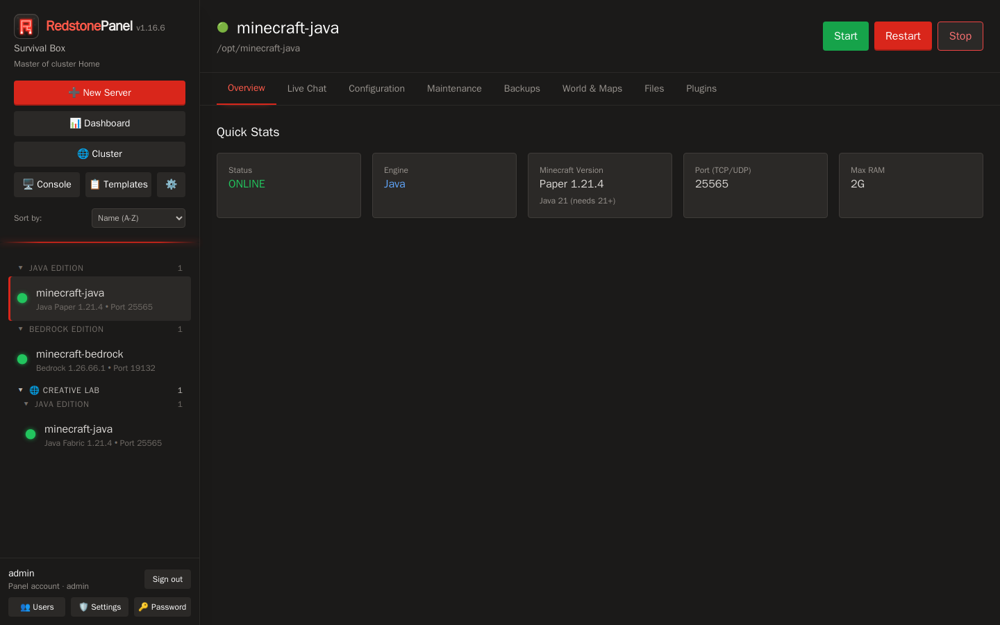</picture>

The sidebar on the left holds everything that isn't about one server:

| Item | What it does |
| --- | --- |
| **RedstonePanel** logo, version and name | The redstone "R" logo, the panel's version (for example `v1.16.4`) and its name, such as **Survival Box**, so you can tell several panels apart. |
| **➕ New Server** | Create a server, import one, or restore a removed one. |
| **📊 Dashboard** | This machine's resources, services and what needs attention (above). |
| **🌐 Cluster** | On a cluster master: every panel's servers (see [Clusters](#18-clusters)). |
| **🖥️ Console** | The panel's live activity log. |
| **📋 Templates** | Saved server settings to reuse. |
| **⚙️** | Appearance: **Color Mode** (dark or light) and **Accent Palette**: **Redstone Red** (the default), Diamond Blue, Emerald Green or Amethyst Purple. Saved in your browser. |
| **Sort by** | Name A–Z, Z–A, or online servers first. |
| Server list | Every server, grouped by edition: green dot = running, grey = stopped, with its version and port. Click one to open it. On a cluster master, each node's servers follow under the node's 🌐 name, grouped by edition the same way. Click a heading to fold it; a folded heading shows how many of its servers are online, and the panel remembers what you folded in this browser. |
| **♻️ N removed servers: restore** | Shown when servers were uninstalled with **Keep World**. |
| **👥 Users / 🛡️ Settings / 🔑 Password** | Accounts and panel settings (admins), and changing your own password (panel accounts) and two-factor sign-in (all accounts). |

On the right is the selected server. **Start**, **Restart** and **Stop** are always at the top
(**Stop** is the outlined red one), with six tabs underneath. Admins also get **Files** and, on Fabric, Paper and Bedrock servers,
**Mods**, **Plugins** or **Add-ons**.

## 4. Create or import a server

Click **➕ New Server**.

<picture><source media="(prefers-color-scheme: light)" srcset="images/light/new-server.png"></picture>

**Deploy a fresh server**

1. Choose **Java Edition** or **Bedrock Edition**. On an ARM64 machine such as a Raspberry Pi,
   Bedrock is greyed out: Mojang only makes the Bedrock server for x86-64.
2. For Java, choose the **Server Type** and **Minecraft Version**:
   - **Vanilla (Mojang)**: the official server.
   - **Paper (plugins)**: a faster server that runs Bukkit/Paper plugins. Put plugin `.jar`
     files in the server's `plugins` folder.
   - **Fabric (mods)**: runs Fabric mods. Put mod `.jar` files in the server's `mods`
     folder; players need the same mods.
   - **Newest** is the default. Pick an older version to match your players' clients or your
     plugins and mods.
   - The line under the lists says which Java that version needs and which installed Java
     will run it. If none is new enough, an admin is asked to install it when they click
     **Deploy Fresh Server**; other accounts are told which package an admin needs to install
     (`openjdk-21-jre-headless`, for example).
3. Optionally pick a **Base Template** (see [Templates](#14-templates)) to start from saved
   settings.
4. On a cluster master, choose **Where**: this panel or one of its nodes. The Java line and
   ports then come from that machine. See [Clusters](#18-clusters).
5. Click **Deploy Fresh Server**.

The panel then:

- names the server (`minecraft-java`, then `minecraft-java-2`, and so on) and picks a free
  port (Java from 25565, Bedrock from 19132);
- downloads the server: Mojang's `server.jar`, the newest stable Paper build, or Fabric's
  server launcher for the chosen version (always saved as `server.jar`), or the latest
  Bedrock Dedicated Server. Vanilla and Paper downloads are checked against their published
  checksums;
- sets the server's ports in its `server.properties`. A Bedrock server keeps the full file
  that comes with the Bedrock download, so every setting is there to change in
  **Configuration**, and gets UDP `server-udp-ports` (its gameplay port) on the same number as
  its TCP `server-port`, so each Bedrock server has its own;
- accepts the Minecraft EULA for you (`eula=true`), so by deploying a server you agree to it;
- creates a systemd service that runs as the `minecraft` user and restarts the server if it
  crashes;
- opens its ports in `ufw`, if `ufw` is installed;
- starts the server.

Watch the progress in **🖥️ Console**. A Java server is ready in about a minute; most of that
time is the first world being generated.

**Import a server you already have**

Under **Import Existing**, choose a `.zip`, `.tar.gz`/`.tgz` or `.tar` of a server folder and
click **Upload & Import**. A backup wrapped in a single folder is fine; its contents are used.
The panel gives it a name, a free port and a service, like a fresh deploy.

**Bring a server back from backup storage** (admins)

If a server's backups were copied to an SSH server or S3 storage (see
[Off-site copies](#off-site-copies-ssh-or-s3-storage)), **From backup storage → Choose a
backup…** lists every backup there, from every panel that copies to it. Pick one and click
**Import from backup storage**: the copy is downloaded and checked, the server gets its old name
if it's free here, its server software is downloaded again, and it starts. Add the storage under
[Backup storage](#backup-storage) first.

**Removed servers** are listed at the bottom of the same dialog. See
[Restore a removed server](#15-restore-a-removed-server).

## 5. Overview

The **Overview** tab (shown in [The dashboard](#3-the-dashboard)) shows quick stats:

- status;
- engine;
- Minecraft version;
- the port players connect to;
- the Java heap limit.

For Java servers it also shows which Java version the server needs and which one is installed.

<picture><source media="(prefers-color-scheme: light)" srcset="images/light/overview-bedrock.png">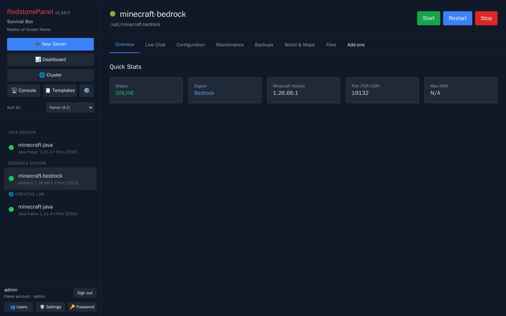</picture>

Players connect to `<server address>:<port>`. On Bedrock, use the port shown here; the
default 19132 belongs to the first Bedrock server.

## 6. Live Chat

<picture><source media="(prefers-color-scheme: light)" srcset="images/light/live-chat.png"></picture>

The chat players see in game. Type in the box and click **Send**:

- plain text is broadcast to everyone as `[Server] …`;
- text starting with `/` runs as a server command, for example `/time set day`,
  `/whitelist add Steve` or `/list`. The reply shows under the chat.

**Clear** empties the panel's view; it doesn't touch the server.

Java servers are reached over **RCON**. The first time you open this tab on a server without
RCON, the panel turns it on with a random password and restarts the server once; send your
message again when it's back. The RCON port is shown top right. Bedrock servers have no RCON;
the panel types into the server's own console instead.

## 7. Configuration, player roles and the whitelist

**Visual Editor**: every setting in `server.properties`, as a form.

<picture><source media="(prefers-color-scheme: light)" srcset="images/light/configuration.png"></picture>

Type in the filter box to find a setting quickly, for example `difficulty`, `pvp`, `rcon` or
`port`.

<picture><source media="(prefers-color-scheme: light)" srcset="images/light/configuration-filter.png"></picture>

Click **Save Changes**, then **Restart** the server so it reads the new settings.

**Raw Text** is the same file as plain text, for pasting a whole configuration or editing
settings the form doesn't know.

**A Bedrock server that shows only its ports?** Bedrock servers created before 1.16.4 got a
`server.properties` with only `server-port`, `server-portv6` and `query.port`. They run on
Bedrock's built-in defaults, but the form has nothing else to show. Updating the server's
Bedrock version doesn't replace that file. Either add the settings you want as lines in **Raw
Text** (for example `difficulty=normal`), or stop the server, copy `server.properties` from a
fresh Bedrock download into its folder with **Files**, set `server-port` and `server-portv6`
back to the values it had, and start it again.

<picture><source media="(prefers-color-scheme: light)" srcset="images/light/configuration-raw.png"></picture>

**Player Roles** lists players seen in the server's logs plus everyone already in the
permissions file, with a role for each:

- **Java:** *Operator* (in `ops.json`) or *Member*;
- **Bedrock:** *Operator*, *Member* or *Visitor* (in `permissions.json`).

Changing a role takes effect at the next restart.

<picture><source media="(prefers-color-scheme: light)" srcset="images/light/player-roles.png">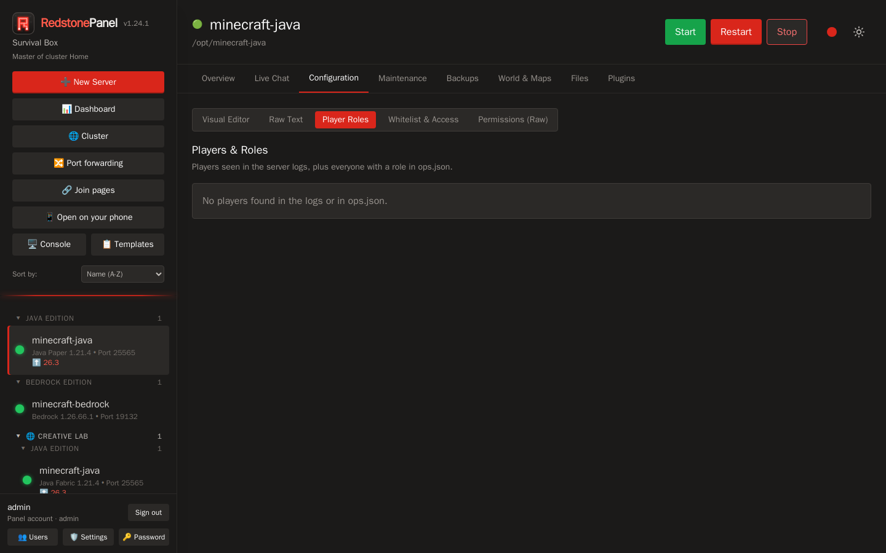</picture>

**Whitelist & Access** shows who is on, who may join and who has tried:

- **Online now**: the players on the server, each with **Kick** and, on Java, **Ban**. Java
  servers with RCON answer straight away; otherwise the list comes from the server's log and
  can be up to 30 seconds behind.
- **Whitelist** (Java `whitelist.json`, Bedrock `allowlist.json`): whether it's on
  (`white-list` or `allow-list` in `server.properties`; turn it on in the Visual Editor), each
  player on it with their last join, **Allow** to add a player and **Remove**. While the server
  runs, changes go through its console (RCON for Java, screen for Bedrock) and apply at once;
  otherwise the panel edits the file and the server reads it when it starts. A Java player
  needs a UUID, which the panel takes from its access log, `usercache.json`, the offline-mode
  formula or Mojang, in that order.
- **Banned** (Java, `banned-players.json`): each banned player with the reason, when, and who
  banned them, and **Unban**. Type a name and an optional reason to ban someone who isn't
  online. Bedrock has no ban list: keep someone out with the allowlist, or remove them now
  with **Kick**.
- **Turned away in the last 7 days**: players the server refused who still aren't allowed,
  how often, and why. **Allow** puts one on the whitelist, and **Unban** lifts a ban.
- **Access log**: who joined, left or was turned away (not on the whitelist, banned, wrong game
  version, server full). Filter by player name or ID, event and period (24 hours to 90 days).
  Each row has **Kick** while that player is online and, on Java, **Ban**.

**Kick** removes a player, with an optional reason they see; they can join again straight away.
**Ban** also removes them if they're online, and keeps them out until you **Unban** them. A kick
needs the server running. On a running Java server, kicking, banning and unbanning go through
RCON: open **Live Chat** once to set it up. A stopped Java server's ban list is edited directly,
and the server reads it when it starts. Bans are by name and UUID, never by address. Users and admins may kick and ban,
as with the console, and each one goes in the activity log with who did it.

The access log comes from the server's own console and log files, which the panel reads every
30 seconds, so it covers players who joined before the panel was installed too, as far back as
the logs go. Only names and IDs are kept, never addresses, in
`/var/lib/redstonepanel/players/`, for 90 days. Purging a server deletes its log. Bedrock
doesn't log refused joins, so on Bedrock the log shows joins and leaves only.

The dashboard's **Needs attention** lists players turned away in the last 24 hours who still
aren't allowed, and **Notifications** can send a message when a player joins or is turned away.

**Permissions (Raw)** edits `ops.json` (Java) or `permissions.json` (Bedrock) directly.

## 8. Maintenance: templates, export, update, uninstall

<picture><source media="(prefers-color-scheme: light)" srcset="images/light/maintenance.png"></picture>

- **Save as Template**: saves this server's properties and permissions as a reusable
  template.
- **Apply Template**: overwrites this server's settings with a template, keeping its ports.
  Restart afterwards.
- **Export Server → Download .zip**: the whole server folder as a zip, to move it to another
  machine. Import it there with **➕ New Server → Import**.
- **Update Server → Check & Update**: for Java, choose **Newest** or a Minecraft version (the
  server keeps its type: a Paper server gets the newest Paper build of that version). Older
  versions than the server's own aren't offered, because a world can't go back. The new jar is
  downloaded before the server is stopped, so a failed download changes nothing. Then it stops
  the server, installs the download and starts it again. Your world, settings, ports,
  operators and allowlist are kept. Take a backup first: a Java world opened by a newer
  version can't go back to an older one. Bedrock servers always update to the newest release.
  On Fabric and Paper servers, moving to a newer Minecraft version first lists the mods or
  plugins that have no build for it yet on Modrinth or Hangar (and any it couldn't check),
  so you can wait rather than update into a server that won't start. If the new version
  needs a Java that isn't installed, you're asked to install it first.
- **Java** (admins, Java servers): which Java the server runs on and which it needs. Choose
  another installed Java that's new enough and click **Use**; a running server restarts.

### Java versions

Each Minecraft version needs a particular Java: 26.1 and newer need Java 25, 1.20.5 to
1.21.11 Java 21, 1.18 to 1.20.4 Java 17, and older versions Java 8. Each server's systemd unit
names its own Java (`/usr/lib/jvm/java-21-openjdk-amd64/bin/java`), so servers needing
different versions run side by side, and the system's default `java` doesn't matter.

The panel offers the Java versions your system's package sources have. Ubuntu packages 8, 11,
17, 21 and 25 (newer releases also newer ones); Debian 13 and Raspberry Pi OS only 21 and 25.
When a Minecraft version needs a Java the system doesn't package, the line under **Minecraft
Version** says so and the panel offers the closest newer one instead: Java 17 for 1.17's
Java 16 on Ubuntu, or Java 21 for an old version's Java 8 on Debian, which some old versions
and modpacks don't start on. If the system has nothing new enough, it says so and installs
nothing.

- **Installing.** When you create, update or restore a Java server and the Java it needs isn't
  installed, the panel asks to install it (`openjdk-21-jre-headless`, for example) with apt,
  shows the progress in **🖥️ Console**, and then carries on. Servers that were waiting for
  that Java, such as an imported one that couldn't start, are moved onto it and started.
  You can also install one ahead of time from the dashboard: **Supporting services → Java →
  Install**. Only admins can install or remove Java.
- **Removing.** A Java that no server uses shows **Remove** on the dashboard, and the
  dashboard's **Needs attention** mentions it. The panel removes only the
  `openjdk-N-jre-headless` package, and refuses if apt would take anything else with it
  (a JDK you installed, for example); remove those yourself. Anything else on the machine that
  uses that Java stops working, so check before removing. A removed server that's restored
  later installs its Java again.
- **When the exact Java isn't installed**, a server runs on the closest newer one, which
  usually works. **Maintenance → Java** offers to install the exact one and switch to it.

Uninstalling and purging need an **admin**; other accounts, and visitors on a trusted local
network, don't see these two sections.

- **Uninstall (Keep World)**: removes the server's systemd service, so it leaves the panel.
  Its files stay in `/opt/minecraft-…` and its backups stay too, so it can be
  [restored](#15-restore-a-removed-server).
- **Danger Zone → Purge Data**: removes the service and deletes the server's folder,
  world included. This can't be undone. Backups in `/var/backups/redstonepanel` are kept.

Both also remove the server's backup and restart timers, close its game ports in `ufw`, and
clear it from systemd's list of failed units. Failed units left behind by servers removed
with older versions are cleared the next time the dashboard loads.

## 9. Backups

<picture><source media="(prefers-color-scheme: light)" srcset="images/light/backups.png"></picture>

**Set up automatic backups**

1. Tick **Automatic backups**.
2. Choose how often: every hour, every 6 or 12 hours, every day, or every Sunday.
3. Choose the time and how many scheduled backups to **Keep**. Optionally, **Also delete them
   after** a number of days ("keep 7, and none older than 14 days"); the newest backup always
   stays, so a server that has been stopped for a month still has one.
4. Click **Save schedule**. **Next backup** shows when the next one will run.

The time is the **server's clock**, and the form shows its time zone (UTC on most servers). A
"04:00" backup on a UTC server runs at 04:00 UTC, whatever time your browser shows.

**How it works**

- Each schedule is a systemd timer (`redstonepanel-backup@<server>.timer`), so backups happen
  even while the panel itself is stopped. If the machine was off at backup time, the backup
  runs when it boots.
- Running servers are copied consistently:
  - **Java:** the panel pauses saving over RCON while the files are copied. A Java server
    without RCON is copied while it runs, and the panel warns you; open its **Live Chat** tab
    once to set RCON up.
  - **Bedrock:** the server's own `save hold` / `save resume` commands are used.
- A backup is a `.tar.gz` of the server folder: the world, `server.properties`, operators,
  allowlist and so on. It leaves out what can be downloaded again (`server.jar`,
  `bedrock_server`, Bedrock's built-in packs) and logs.
- Backups are stored in `/var/backups/redstonepanel/<server>/`, readable only by root. To have
  backups that survive losing this machine, copy them to an SSH server or S3-compatible storage
  ([off-site copies](#off-site-copies-ssh-or-s3-storage), below) or, in a cluster, to another
  member.
- Only **Scheduled** backups are pruned to the number you keep. **Manual** and **Before
  restore** backups stay until you delete them.

**Other buttons**

- **Back up now**: takes a manual backup immediately.
- **⬇️**: downloads a backup.
- **Restore** (admins): stops the server, replaces its world with the one in the backup, and
  starts it again. The world being replaced is saved first as a **Before restore** backup, so
  you can undo a restore by restoring that one. **Before mod changes** backups are taken by
  **Update all** on the Mods / Plugins tab.
- **🗑**: deletes a backup (admins).

**Copies on another cluster member** (cluster masters)

A backup on the same disk doesn't survive losing the disk. In a cluster, open a server's
**Backups** tab on the master and choose **Also keep a copy on**: the master, or another node.

- After each scheduled or manual backup, the master copies it to that member within a few
  minutes (straight away after **Back up now**) and checks it arrived whole with SHA-256. A
  node's backup going to another node passes through the master; nodes never talk to each
  other.
- Copies are kept in `/var/backups/redstonepanel/remote/<member>/<server>/` on the member that
  holds them. **Scheduled** copies are kept to the same number as the server's own; **Manual**
  ones stay until you delete them.
- If a copy fails (the member is off, or its disk is full), it shows under **Needs attention**
  on the master's dashboard, and as **Backup copy to another member or storage failed** in
  webhook notifications. The master tries again every few minutes and catches up on what it missed.
- **⬇️** downloads a copy. **Put back** (admins) copies it into the server's own backups, where
  **Restore** brings its world back.
- If a machine is lost, its servers' copies are still on the other member: make a new server
  of the same edition and version, open its **Backups** tab, click **Use a copy of another
  server's backup…**, **Put back** the copy you want, and **Restore** it.
- Every member needs RedstonePanel 1.16.8 or later. Standalone panels don't have this; they
  can use off-site copies instead.

### Off-site copies (SSH or S3 storage)

<picture><source media="(prefers-color-scheme: light)" srcset="images/light/offsite-copies.png">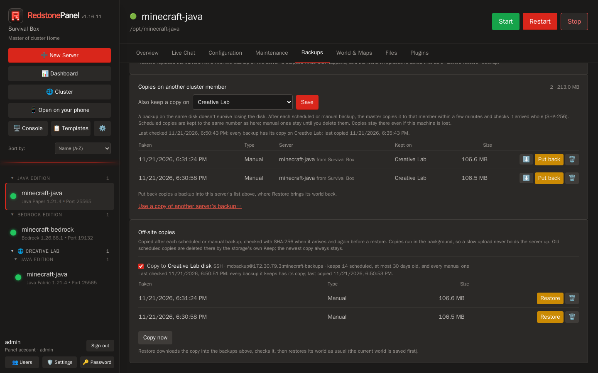</picture>

Any panel, with or without a cluster, can copy its servers' backups off the machine:

- **An SSH server**: a NAS, another PC or a VPS with `rsync` installed. Copies resume where they
  stopped if the connection drops.
- **S3-compatible storage**: Backblaze B2, Wasabi, Cloudflare R2, MinIO, AWS S3 and others.
  Archives over 100 MB go up in parts.

An admin adds the storage once under [Panel Settings → Backup storage](#backup-storage). After
that, each server's **Backups** tab has an **Off-site copies** section:

- Tick **Copy to** a storage to copy this server's backups there (a storage can be set to copy
  every server's backups, which is the default).
- After each scheduled or manual backup, the copy starts straight away in the background, so a
  slow upload never holds the server up, and it happens even while the panel itself is stopped.
  The panel also checks every few minutes for anything missing and copies it.
- Every copy is checked with SHA-256 when it arrives, and again before it's restored. A
  `.sha256` file is kept next to each copy.
- What's copied: every **Manual** backup, and the newest **Scheduled** ones, up to the storage's
  own **Keep** (or the server's, if the storage doesn't set one) and, if set, no older than its
  **Delete copies after** days. Older scheduled copies are deleted from the storage; the newest
  copy always stays. **Before restore** and **Before mod changes** backups stay on this machine.
  So you can keep, for example, 7 here and 30 days off the machine.
- **Restore** (admins) downloads the copy into the server's backups, checks it, and restores
  its world as usual (the current world is saved first as a **Before restore** backup).
- **🗑** deletes a copy from the storage (admins). **Copy now** copies anything missing straight
  away.
- If copying fails (the storage is off, the key was removed, the bucket is full), it shows under
  **Needs attention** on the dashboard and as **Backup copy to another member or storage
  failed** in webhook notifications, once until it works again. The panel keeps trying every
  few minutes.

On the storage, copies are kept as `<folder>/<panel id>/<server>/<backup>.tar.gz`. The panel id
is this machine's host name and four random characters (shown in Panel Settings), so several
panels can share one bucket or folder.

**If the machine dies:** install RedstonePanel on the new machine, add the same storage under
**Panel Settings → Backup storage** (for SSH, add the new panel's key on the storage too), then
**➕ New Server → From backup storage**: pick the backup, and the server is set up again with its
old name if it's free, its server software downloaded again (a Java server at the same
Minecraft version and type), and started.

From the command line, `sudo redstonepanel offsite-copy minecraft-java` copies a server's
backups now, and `sudo redstonepanel offsite-key` prints the panel's SSH key.

Bedrock servers work the same way:

<picture><source media="(prefers-color-scheme: light)" srcset="images/light/backups-bedrock.png"></picture>

From the command line, `sudo redstonepanel backup minecraft-java` takes a backup (and starts
its off-site copy).

### Scheduled restarts

**Maintenance → Scheduled Restarts** restarts the server every day, every 6 or 12 hours, or
every Sunday, at the time you pick (the server's clock).

<picture><source media="(prefers-color-scheme: light)" srcset="images/light/scheduled-restarts.png"></picture>

1. Tick **On**.
2. Choose how often and the time.
3. Choose a warning: none, or 1, 5, 10 or 15 minutes.
4. Click **Save schedule**. **Next restart** shows when it will happen.

Players see "Server restarts in 5 minutes" in chat, then again 1 minute and 10 seconds before,
and the restart happens at the time you chose. Things to know:

- Java servers are warned over RCON. Open the **Live Chat** tab once so the panel sets it up;
  without it the restart still happens on time, without a warning.
- A server you stopped stays stopped.
- If a backup of the same server is running, the restart waits for it.
- The schedule is a systemd timer (`redstonepanel-restart@<server>.timer`), so it works while
  the panel is stopped.

## 10. World & Maps

<picture><source media="(prefers-color-scheme: light)" srcset="images/light/world.png"></picture>

- **Download World**: only the world folder, as a zip. Use it to open the world in
  single-player or a map viewer.
- **Rename World**: renames the world folder, updates `level-name` in `server.properties`, and
  restarts the server.

## 11. Files

**Files** (admins only) shows the server's folder in `/opt/minecraft-…`, so you can change
things the other tabs don't cover: plugin and mod settings, `ops.json`, `bukkit.yml`, and so on.

<picture><source media="(prefers-color-scheme: light)" srcset="images/light/files.png"></picture>

- Click a folder to open it; the path at the top goes back up.
- **Upload**, or drag files from your computer onto the tab, adds them to the folder you're
  in, with a progress bar for each. Uploading a file that already exists asks before
  replacing it. Up to 512 MB per file.
- Mods, plugins and Bedrock add-ons dropped at the top of the folder (or into `mods` or
  `plugins`) are checked and put in the right place, as on the
  [Mods / Plugins / Add-ons](#12-mods-plugins-and-add-ons) tab.
- **Download** saves a file. To get a whole folder, use **Export Server** (Maintenance) or a
  [backup](#9-backups).
- **Rename**, **Delete** (a folder is deleted with everything in it), **New folder**,
  **New file**.
- Text files up to 1 MB (`.yml`, `.json`, `.properties`, `.toml`, `.txt`, logs and the like)
  open in the editor. **Save** (or Ctrl+S) writes the file. If the server changed the file
  after you opened it, saving stops and asks you to reload it, so neither change is lost
  silently.

<picture><source media="(prefers-color-scheme: light)" srcset="images/light/file-editor.png"></picture>

Most servers read their files when they start, so **Restart** after changing settings.
Some plugins have a reload command; check the plugin's documentation.

Safety:

- Nothing outside the server's folder can be reached. Symlinks are listed (with where they
  point) but never followed, and a file with other hard links isn't opened.
- Files and folders the panel creates belong to the `minecraft` user, like the rest of the
  server.
- Every change is in the activity log with the admin who made it (`[FILES] alex saved …`).

## 12. Mods, plugins and add-ons

Admins see a **Mods** tab on Fabric servers, **Plugins** on Paper servers and **Add-ons** on
Bedrock servers. Vanilla servers can't load mods or plugins, so they don't have one.

<picture><source media="(prefers-color-scheme: light)" srcset="images/light/mods.png">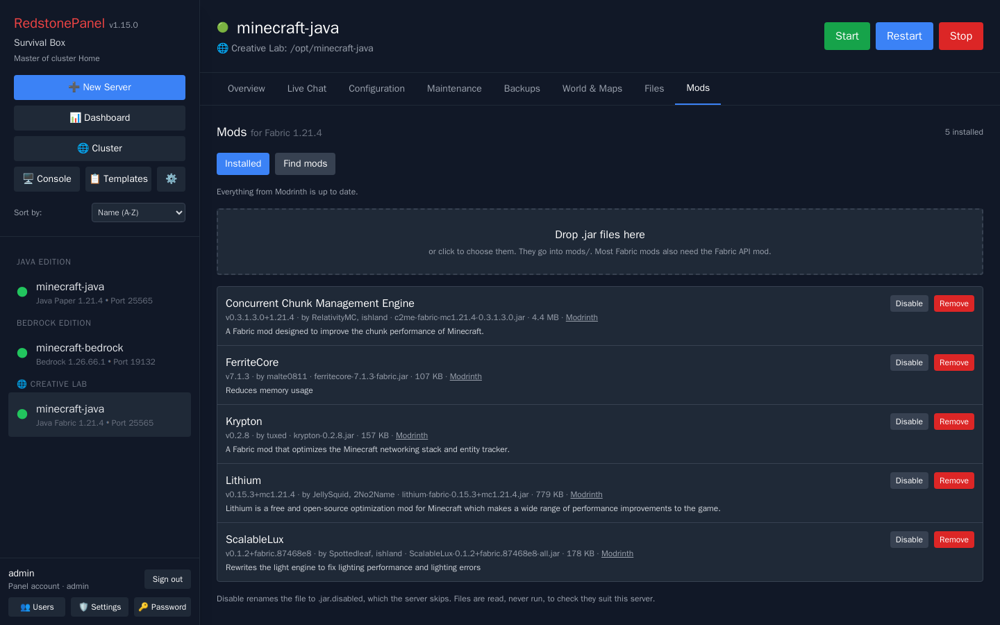</picture>

<picture><source media="(prefers-color-scheme: light)" srcset="images/light/plugins.png">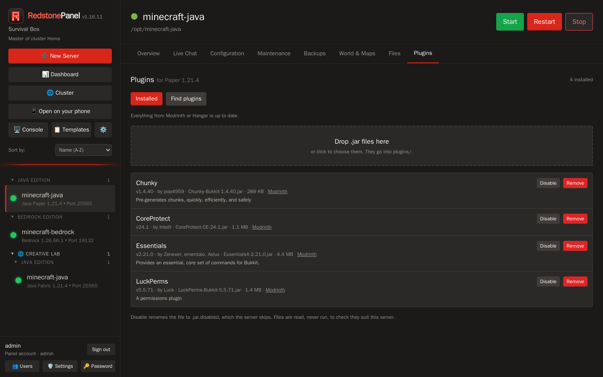</picture>

**Adding:** drag `.jar` files (Fabric, Paper) or `.mcpack` / `.mcaddon` files (Bedrock) onto
the tab, or click the box to choose them. Each one is checked before it's installed:

- A Fabric mod goes into `mods/`, a Paper or Bukkit/Spigot plugin into `plugins/`.
- A file that can't work on this server is refused with the reason: a Forge or NeoForge mod,
  a plugin on a Fabric server, a mod on a Paper server, a proxy (Velocity, BungeeCord)
  plugin, or a jar that isn't a mod or plugin at all.
- A newer version of something already installed (same mod id, different file name) asks
  first and then replaces the old file, so the server never has two copies.
- The panel only reads each jar's description file; nothing in it is run.

**The list** shows each mod or plugin's name, version, authors and file, and warns when:

- it was made for a different Minecraft version than the server runs (from the mod's
  `fabric.mod.json`, or the plugin's `api-version`);
- it needs another mod or plugin that isn't installed, for example *Needs fabric-api* (most
  Fabric mods need [Fabric API](https://modrinth.com/mod/fabric-api)).

**Disable** renames the file to `….jar.disabled`, which the server skips; **Enable** renames
it back. **Remove** deletes it. Changes apply when the server restarts; the tab offers
**Restart now**.

**Bedrock add-ons.** A `.mcpack` holds one pack, a `.mcaddon` usually a behavior pack and a
resource pack. Each pack is unpacked into `behavior_packs/` or `resource_packs/` and added to
the active world (`world_behavior_packs.json`, `world_resource_packs.json`), so it's on after
a restart. **Disable** takes a pack out of the world and keeps its files; **Remove** deletes
it. Players download resource packs only if they accept server packs. Skin packs and world
templates are refused.

<picture><source media="(prefers-color-scheme: light)" srcset="images/light/addons-bedrock.png"></picture>

### Server tools: Phantom (Bedrock)

Consoles and phones list a Bedrock server under **Friends → LAN Games** only when it runs on
port 19132. [Phantom](https://github.com/jhead/phantom) answers those LAN pings for a server
on any other port and forwards players to it. The Add-ons tab of a Bedrock server has a
**Server tools** card for it (admins):

- **Install** downloads Phantom 0.5.4 from GitHub once, checks it against a SHA-256 built into
  the panel (Phantom publishes none), and keeps it in `/usr/local/lib/redstonepanel/phantom/`.
  It then creates `phantom-<server>.service`, which runs as the `minecraft` user, forwards to
  the server on this machine and starts at boot, and opens UDP 19132 and the Phantom's own
  port (19300 and up, one per server) in ufw.
- The card shows whether it's running, where it forwards, the UDP ports it listens on and its
  recent log, with **Stop** / **Start**, **Restart** and **Uninstall**. Uninstall stops and
  deletes the service and closes the ports no other Phantom needs.
- If you change the server's port, the card says the Phantom points at the old one; **Repair**
  points it at the new port.
- Several servers can each have a Phantom: they share UDP 19132. A Bedrock server on 19132
  can't share it, so Install is refused while one is on this machine (move it to another port
  in Configuration). A server on 19132 needs no Phantom anyway.
- A server using the NetherNet transport (`transport=nethernet`) gets no Phantom: Phantom only
  relays the older RakNet protocol. It doesn't need one either: it announces itself to
  consoles on the same network on UDP 7551, which the panel opens in ufw, and it doesn't hold
  UDP 19132 (its `server-port` is TCP), so other servers' Phantoms can run next to it.
- Phantom services you made yourself that point at the server or use its port are listed too,
  with what's wrong with them, Start / Stop and **Remove unit**, which deletes only the unit
  file, never the program. If yours is called `phantom-<server>.service`, remove it before
  installing the panel's.

Removing a server removes its Phantom as well.

### Finding mods and plugins

On Fabric and Paper servers, **Find mods** (or **Find plugins**) is a catalog of
[Modrinth](https://modrinth.com) and, for Paper, [Hangar](https://hangar.papermc.io), PaperMC's
plugin site. It opens on:

- **Bundles**: a few mods or plugins that belong together, installed with one click.
  - Fabric: **Performance pack** (Lithium, FerriteCore, Krypton, C2ME, ScalableLux), **Server
    essentials** (spark, Chunky, LuckPerms, Ledger) and **Bedrock players** (Geyser,
    Floodgate).
  - Paper: **Server essentials** (Chunky, LuckPerms, EssentialsX, CoreProtect), **Build
    protection** (WorldEdit, WorldGuard, CoreProtect) and **Bedrock players** (Geyser).

  A bundle installs only what's missing, with what each one needs, after a world backup
  (**Back up the world before installing a bundle**, on by default; skipped when there's
  nothing to install). One that can't be installed is named and doesn't stop the others.
- **A starter set** of popular server mods or plugins, picked for RedstonePanel and grouped
  as Performance, Admin tools, For players and Libraries. One that hasn't been updated for the
  server's Minecraft version yet is shown greyed out as **Not for 1.21.x yet**.
- **Most downloaded**, below that, and category buttons to browse by (Optimization,
  Management, Economy, …).

Each card shows downloads, when it was last updated, its categories, and **Installed** or
**Update available** when it's on the server. Search by name, pick a **category**, and sort by
**most downloaded**, **most followed**, **recently updated** or **newest**; **Back to the
catalog** clears them. Only projects with a build for the server's loader and Minecraft
version, and that run on a server, are listed, so client-only mods such as Sodium don't
appear. Paper has spark built in, so it's only offered for Fabric.

**Click a mod or plugin** for its details: description, downloads, followers, licence, links
to its page and source code, and exactly what Install would do: the version and file it
picks, and the mods or plugins it needs that would be installed with it (for example
WorldGuard brings WorldEdit).

<picture><source media="(prefers-color-scheme: light)" srcset="images/light/mods-details.png"></picture>

<picture><source media="(prefers-color-scheme: light)" srcset="images/light/mods-catalog.png"></picture>

<picture><source media="(prefers-color-scheme: light)" srcset="images/light/mods-browse.png"></picture>

**Install** picks the newest release build (a beta only when there's no release, never an
alpha), downloads it from the site's own download server, checks it against the checksum the
site gives, and then installs it like a dropped file. Mods and plugins it needs are installed
first, for example Fabric API. A dependency that isn't on the same site, or a Hangar plugin
that's downloaded from somewhere else, is named so you can get it yourself.

<picture><source media="(prefers-color-scheme: light)" srcset="images/light/plugins-hangar.png"></picture>

### Updates

When you open the tab, the panel asks Modrinth and Hangar whether anything installed has a
newer build for the server's Minecraft version. Jars installed from the tab are known by
their project; jars you added by hand are looked up on Modrinth by their checksum, so most of
them are found too. Each one shows where it's from, with **Update to …** when there's
something newer.

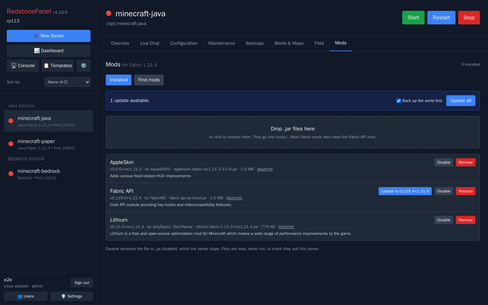

- **Update all** updates every one, and can back up the world first (ticked by default): the
  backup shows on the Backups tab as **Before mod changes**.
- An update keeps the old file as `….jar.previous`, which the server doesn't load, and
  **Undo** puts the last update's old files back. They're kept until the next update.
- Restart the server to load the new versions.

Where each jar came from is kept in `.redstonepanel-mods.json` in the server folder.

Every install, change and removal goes in the activity log (`[MODS] alex installed Sodium …`).

## 13. Console

<picture><source media="(prefers-color-scheme: light)" srcset="images/light/console.png">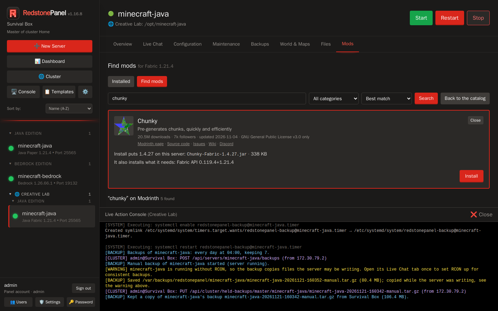</picture>

**🖥️ Console** opens the panel's activity log at the bottom of the screen, beside the sidebar:
deploys, updates, service starts and stops, firewall changes, backups, and who signed in. Lines
are coloured by kind: errors and crashes red, warnings yellow, backups and restarts blue,
sign-ins and settings purple, commands the panel runs grey. The same log is in
`/var/log/redstonepanel/panel.log`.

It also opens by itself when you start something that takes a while, such as creating, starting
or stopping a server, a backup or a restore, so you can watch it happen. While it's open, the
page above it ends where the console starts, so you can still scroll to everything on it, and
the button you clicked stays in view. It takes up to a third of the window's height. Close it
with **❌ Close** at its top right; **🖥️ Console** in the sidebar opens it again.

## 14. Templates

**📋 Templates** opens the template manager. A template is a set of `server.properties`
values plus an operators/permissions list, for one edition.

<picture><source media="(prefers-color-scheme: light)" srcset="images/light/templates.png">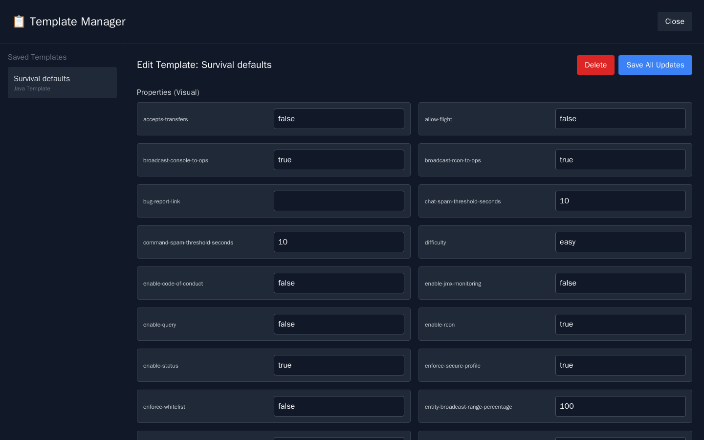</picture>

- Create one from a server you've set up: **Maintenance → Save as Template**.
- Edit its properties and permissions here, then click **Save All Updates**.
- Use it when deploying (**➕ New Server → Base Template**), or apply it to an existing
  server (**Maintenance → Apply Template**). Ports are never copied from a template, so
  servers made from the same template don't clash.

## 15. Restore a removed server

A server uninstalled with **Keep World** still has its files in `/opt`. The sidebar shows
**♻️ N removed servers: restore**, and they are listed under **➕ New Server → Removed servers**
(see the [New Server dialog](#4-create-or-import-a-server)).

- **Restore** gives the server a new systemd service under the same name and starts it:
  - it keeps its old port, unless another server took that port in the meantime; then it moves
    to the next free one and tells you;
  - the server binary is downloaded only if it's missing;
  - its backup schedule comes back.
- **🗑** (admins) permanently deletes the removed server's files. This can't be undone.

The same from a terminal:

```bash
sudo redstonepanel removed
sudo redstonepanel restore minecraft-java-2
```

## 16. Users

**👥 Users** (admins) manages panel accounts.

<picture><source media="(prefers-color-scheme: light)" srcset="images/light/users.png"></picture>

- **Add user**: a username, a password of at least 8 characters, and a role:
  - **User** can manage servers;
  - **Admin** can also manage panel users and Panel Settings, uninstall and purge servers,
    restore backups, and delete backups and removed servers.
- For each account you can change the role, **Reset password**, **Disable** (it can't sign
  in until enabled again) or **Delete**.
- Accounts with two-factor sign-in on show **2FA**. **Reset two-factor** turns it off for
  someone who lost their phone; they sign in with their password and set it up again.
- Linux accounts aren't listed here; they're managed with the usual Linux tools.

An admin account controls a service that runs as root, so treat it like `sudo` access.

## 17. Panel Settings: name, HTTPS, sign-in

**🛡️ Settings** (admins).

<picture><source media="(prefers-color-scheme: light)" srcset="images/light/panel-settings.png"></picture>

**Panel name**: shown in the sidebar, the browser tab and on the sign-in page. It defaults to
the machine's host name and helps when you run several panels.

**Setup guide**: how many of the dashboard's setup steps are done, with **Show it on the
dashboard** or **Hide it** (see [The dashboard](#3-the-dashboard)).

**Connection**:

<picture><source media="(prefers-color-scheme: light)" srcset="images/light/panel-settings-1.png"></picture>

- **HTTP (simple)**: port 8080, fine on a trusted home network.
- **HTTPS with a self-signed certificate**: the panel makes its own certificate authority.
  Download its CA certificate from here and install it on your devices once to get rid of
  the browser warning.
- **HTTPS with my own certificate**: point it at a certificate and key you already have, for
  example from certbot.

In a cluster, the choices are different (as in the screenshot): a node always uses the
cluster's HTTPS, and a master chooses between **HTTPS from the cluster** and **HTTPS with my
own certificate**. See [Clusters](#18-clusters).

### Notifications

Get a message in Discord, or any service that takes a webhook, when something happens.

<picture><source media="(prefers-color-scheme: light)" srcset="images/light/notifications.png"></picture>

1. In Discord, open the channel's settings → **Integrations** → **Webhooks** → **New
   Webhook**, then **Copy Webhook URL**.
2. Paste it into **Notifications** and tick the events you want:
   - **Server crashed**: the server stopped without being asked to. It starts again by itself
     after 20 seconds (Java and Bedrock alike).
   - **Server started** / **Server stopped**: every start and stop, including your own.
   - **Scheduled restart**: a [scheduled restart](#scheduled-restarts) happened, or failed.
   - **Backup finished** / **Backup failed**.
   - **Backup copy to another member or storage failed**: an
     [off-site copy](#off-site-copies-ssh-or-s3-storage) or a copy on another cluster member
     failed (once, until it works again).
   - **Player joined** / **Player turned away**: from the access log (see
     [Whitelist & Access](#7-configuration-player-roles-and-the-whitelist)), within about 30 seconds.
     Turned-away messages are sent at most once a minute per server.
3. Click **Save notifications**, then **Send a test**.

Setting up a whole Discord for your community, with a private space per Minecraft server, is
explained step by step on the [Discord setup](../wiki/Discord.md) page.

By default only crashes, failed backups and scheduled restarts are sent. A server that keeps
crashing sends one message every 5 minutes, not one per crash.

Crash, start and stop messages come straight from systemd, so they arrive even while the panel
is stopped. The webhook URL lets anyone post in your channel, so the panel stores it readable
only by root and never shows it again. Paste a new one to replace it, or **Remove webhook**.

Other services receive a JSON POST with the fields `text`, `event`, `server`, `panel`,
`message` and `time`.

### Backup storage

Where the [off-site copies](#off-site-copies-ssh-or-s3-storage) of this machine's backups go.

<picture><source media="(prefers-color-scheme: light)" srcset="images/light/backup-storage.png"></picture>

Click **Add storage** and choose:

- **SSH server (rsync)**: the **Host**, **Port**, **User** and **Folder** (relative to that
  user's home unless it starts with `/`). Open **This panel's SSH key** and add the line shown to
  `~/.ssh/authorized_keys` of that user on the SSH server. That machine needs `rsync` (`sudo apt
  install rsync`). The panel records the server's host key on the first connection, as `ssh`
  does, and refuses to send anything if it changes later; if that machine was reinstalled, click
  **Forget host key** and **Test** again.
- **S3-compatible**: the **Endpoint** (for example `https://s3.eu-central-003.backblazeb2.com`,
  `https://<account>.r2.cloudflarestorage.com` or `http://192.168.1.30:9000` for MinIO), the
  **Bucket**, an optional **Folder in the bucket**, the **Region** (`auto` for Cloudflare R2) and
  an **Access key** and **Secret key** that can read, write, list and delete in that bucket. Leave
  **Path-style addresses** ticked unless your provider needs bucket names in the host name.
  The secret is stored on this machine readable only by root and never shown again; leave it
  empty when editing to keep it.

For both:

- **Scheduled copies to keep**: empty keeps as many as each server keeps here. **Delete copies
  after (days)**: empty never deletes by age. Manual copies stay until you delete them.
- **Copy every server's backups** (the default), or leave it off and tick the storage on each
  server's **Backups** tab.
- **Test** writes a small file, lists it and deletes it, and says which step failed.
- **Remove** stops copying there. The copies already there stay; delete them on the storage if
  you want them gone.

Each machine in a cluster copies its own servers' backups: add the storage on each node's own
panel (the master can't change a node's settings).

**Sign-in**:

- **Always required (recommended)**.
- **Not required on the local network**: devices on the private networks you list can manage
  servers without signing in. Things to know:
  - they get the *User* role, so users, settings and uninstalling servers still need an
    admin sign-in;
  - it never applies to requests coming through a reverse proxy;
  - everyone on those networks gets in, including guests on your Wi-Fi.

**Require two-factor for admins** (off by default): an admin without
[two-factor sign-in](#two-factor-sign-in) is sent to set it up right after signing in, and
can't do anything else until they have. Set it up for your own account first; the panel won't
turn this on before you do. While it's on, admins can't turn their own two-factor off (another
admin or `reset-2fa` can reset it). Users (not admins) can still choose.

Trusted-network access is unchanged by two-factor: it never gives admin rights. Cluster nodes
don't use it either: the master reaches them with its node token, not a person's sign-in.

If a change locks you out, run `sudo redstonepanel reset-security` on the machine (see
[Troubleshooting](#20-troubleshooting)).

**Don't forward port 8080 to the internet.** For remote access use a VPN (WireGuard,
Tailscale), or a reverse proxy with a real certificate as described in the
[README](../../README.md#exposing-the-panel-to-the-internet).

## 18. Clusters

Running RedstonePanel on several machines? One panel can be the **master** of a cluster and
manage every **node's** game servers. In the master's sidebar, each node's servers are listed
under the node's name (🌐), and opening one gives you every tab, just like a server on the
master. The **🌐 Cluster** page shows every panel at once, with start, stop, restart and **Open**
for each server, and each panel's CPU, memory and free disk. The master's dashboard has a card
per panel.

<picture><source media="(prefers-color-scheme: light)" srcset="images/light/cluster.png">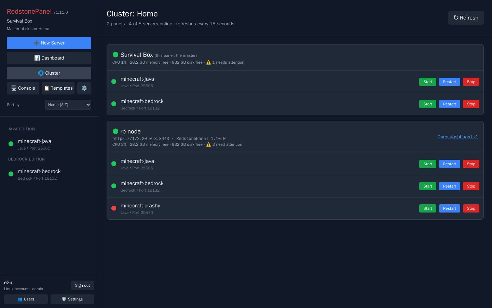</picture>

**A node's server, opened on the master.** The header says which machine it's on
(🌐 Creative Lab), and every tab works as it does on the master: changes go through the master
to the node.

<picture><source media="(prefers-color-scheme: light)" srcset="images/light/node-server.png"></picture>

**Setting up a cluster**

1. On the master: **Settings → Cluster → Make this panel a master**, give the cluster a name,
   and click **Create cluster**. The panel restarts on HTTPS (port 8443).
2. On the master: make a **join code**. Codes work once and expire after an hour.
3. On each node: paste the code under **Settings → Cluster → Join a cluster**, and click
   **Join**.
4. Download the cluster CA from **Settings → Cluster** and install it on your devices once.

**Creating a server on a node:** in **New Server**, pick the node under **Where**. A template
you choose is copied to the node first, ports are picked on the node, and if the node doesn't have
the Java that Minecraft version needs, you're asked to install it there. **Save as Template** on a
node's server adds the template to the master's list.

**Moving a server to another machine** *(1.16)*: on the **🌐 Cluster** page, admins have
**Move…** and **Copy…** next to every server. Choose where it goes:

<picture><source media="(prefers-color-scheme: light)" srcset="images/light/cluster-move.png">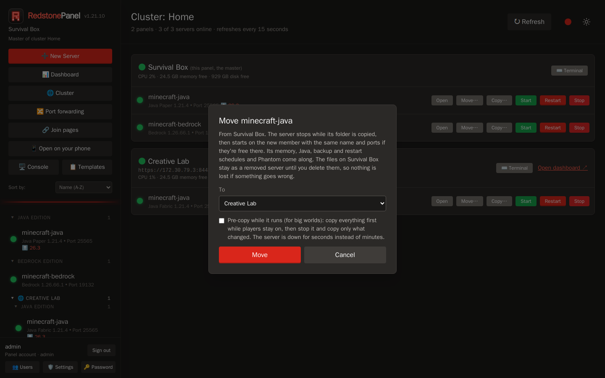</picture>

A move stops the server, packs its whole folder (world, server software, mods and settings),
streams it through the master to the other machine, where every byte is checked, and starts it
there. It keeps its name and ports when they're free on the new machine; if not, it gets others
and the window tells you which. The Java it needs is installed there, and its memory, backup and
restart schedules and Phantom come along. A progress bar follows the copy, and both consoles log
each step (`[MOVE] …`).

<picture><source media="(prefers-color-scheme: light)" srcset="images/light/cluster-moved.png"></picture>

The old machine keeps the files as a removed server marked **moved to …**. Check the server on
its new machine, then click **Delete the old copy** (or 🗑 next to it in **New Server → Removed
servers** with that machine chosen under **Where**). Until then you can restore it there like any
removed server. If anything fails along the way, the new copy is removed and the server starts
again where it was. While a move runs, the server can't be started on the old machine.

**Copy…** works the same way without stopping the server (its world is saved first, as backups
do) and without removing anything. Copying to the same machine always gives the copy a new name;
you choose whether to start it. Schedules and Phantom stay with the original.

Both machines need RedstonePanel 1.16 or later. Older backups and the player history stay on the
old machine.

**Templates between machines:** in the template manager, **Copy to node** sends one of the
master's templates to a node. Templates a node made on its own panel are listed under its name,
with **Copy to this panel**.

**Who can do what:** admins on the master are admins on the nodes; users on the master have a
user's rights there (no file manager, Java or Phantom). Both panels' consoles log each change
with the master user's name, e.g. `[CLUSTER] alex@Main: …`. The master can never change a node's
users, settings or HTTPS, or erase a server's files.

**Certificates:** the master renews the nodes' certificates, and its own, 30 days before they
expire. A master on the internet can serve its own certificate (certbot) to browsers: **Settings →
Connection → HTTPS with my own certificate**. A node with its own public certificate can join too;
under **Settings → Cluster** it shows as checked with "the system's trust store".

**Settings → Cluster on the master** lists every node with its address, version and certificate,
how the master checks it (the cluster CA or the system's trust store), **Renew** and **Remove**,
plus join codes, the cluster backup and **Nightly backups**.

<picture><source media="(prefers-color-scheme: light)" srcset="images/light/panel-settings.png"></picture>

**Nightly backups** write an encrypted cluster backup after 3:00 every night to
`/var/lib/redstonepanel/cluster/backups/` and keep the last 7. Turning them on asks for a
passphrase, which is stored on the master (readable only by root) so the backup can run
unattended; turning them off forgets it. Download one now and then and keep it off the master:
it's what lets `sudo redstonepanel cluster promote FILE` make another panel the master.
Below them, **Connection** lets a master choose between the cluster's HTTPS and its own
certificate.

<picture><source media="(prefers-color-scheme: light)" srcset="images/light/panel-settings-1.png"></picture>

Each node keeps its own dashboard, and its game servers keep running if the master is down.
Download an encrypted **cluster backup** after adding or removing nodes, or turn on **Nightly
backups**, so another panel can take over if the master is lost. Details are in the
[README](../../README.md#clusters-several-servers-from-one-panel).

## 19. Command line

Everything below runs as root (`sudo`). `man redstonepanel` has the details.

| Command | What it does |
| --- | --- |
| `redstonepanel status` | Address, HTTPS and sign-in mode, panel users. |
| `redstonepanel add-user NAME [--role admin\|user]` | Create a panel account (asks for the password). |
| `redstonepanel set-name "NAME"` | Set the panel name (`""` = host name). |
| `redstonepanel reset-security` | Back to plain HTTP on 8080 with sign-in required. |
| `redstonepanel reset-2fa NAME` | Turn off two-factor sign-in for an account that lost its phone and recovery codes. |
| `redstonepanel removed` | List servers uninstalled with Keep World. |
| `redstonepanel restore NAME` | Restore a removed server. |
| `redstonepanel backup NAME` | Back up a server now. |
| `redstonepanel restart-server NAME` | Warn players, then restart a server (what its restart timer runs). |
| `redstonepanel notify-test` | Send a test notification. |
| `redstonepanel cluster create "NAME"` | Make this panel a cluster master. |
| `redstonepanel cluster join-code` | Make a join code (master). |
| `redstonepanel join 'CODE'` | Join a cluster. |
| `redstonepanel leave` | Leave the cluster. |
| `redstonepanel cluster backup FILE` / `cluster promote FILE` | Back up the cluster / make this panel the master from a backup. |
| `redstonepanel cluster nightly on\|off` | Nightly encrypted cluster backups on the master (keeps 7). |

Game servers are ordinary systemd services, so the usual tools work too:

```bash
systemctl status minecraft-java
journalctl -u minecraft-java -f
systemctl list-timers 'redstonepanel-backup@*'
```

## 20. Troubleshooting

**I can't reach the panel after changing a setting.** Run this on the machine:

```bash
sudo redstonepanel reset-security
```

It switches the panel back to plain HTTP on port 8080 with sign-in required. If HTTPS is
turned on but its certificate can't be used, the panel starts on HTTP by itself and warns
admins in the sidebar.

**I lost the phone with my authenticator app.** Sign in with one of your recovery codes
instead of the app's code, then set two-factor up again under **🔑 Password**. No codes left?
Another admin can **Reset two-factor** under **👥 Users**, or run this on the machine:

```bash
sudo redstonepanel reset-2fa NAME
```

**Players can't connect.** Check:

- the server is green in the sidebar;
- players use the port shown on **Overview**;
- the port is open in the firewall (`sudo ufw status`): TCP for Java, UDP for Bedrock, and for a
  NetherNet Bedrock server TCP on its port plus UDP on `server-udp-ports` and 7551. The
  dashboard's **Needs attention** lists any that are missing, with the command to open them;
- if players connect from the internet, your router forwards that port;
- on Windows with WSL, mirrored networking is on and the ports are allowed in the Hyper-V and
  Windows firewalls (see [On Windows with WSL](#on-windows-with-wsl)).

**Live Chat says RCON isn't answering.** The server is probably still starting; wait a moment.
Otherwise **Restart** it so it picks up its RCON settings.

**A backup says it was copied live.** That Java server has no RCON yet. Open its **Live Chat**
tab once; the panel sets RCON up and later backups are consistent.

**Where is everything?**

| What | Where |
| --- | --- |
| Game servers | `/opt/minecraft-*` |
| Backups | `/var/backups/redstonepanel/<server>/` |
| Notification webhook (root only) | `/var/lib/redstonepanel/notifications.json` |
| Panel settings, accounts, templates | `/var/lib/redstonepanel` |
| Activity log | `/var/log/redstonepanel/panel.log` |
| Panel service | `systemctl status redstonepanel` |

## Screenshot gallery

Every screenshot in this manual, in the theme you pick:

<details>
<summary>🌙 <b>Show every screenshot in the dark theme</b></summary>

<table>
<tr><td><br>Sign-in page</td><td><br>The dashboard on a cluster master</td><td><br>Dashboard with a Java server selected</td></tr>
<tr><td><br>New Server dialog</td><td><br>Bedrock server overview</td><td><br>Live Chat</td></tr>
<tr><td><br>Configuration, visual editor</td><td><br>Filtering properties</td><td><br>Raw server.properties</td></tr>
<tr><td><br>Player roles</td><td><br>Maintenance tab</td><td><br>Backups tab, Java server</td></tr>
<tr><td><br>Backups tab, Bedrock server</td><td><br>Scheduled restarts</td><td><br>World & Maps</td></tr>
<tr><td><br>Files tab</td><td><br>Editing a plugin's config.yml</td><td><br>Mods tab on a Fabric server</td></tr>
<tr><td><br>Plugins tab on a Paper server</td><td><br>Add-ons tab on a Bedrock server</td><td><br>Details of a mod before installing it</td></tr>
<tr><td><br>The mod catalog on a Fabric server</td><td><br>Finding mods on Modrinth</td><td><br>Plugins from Hangar on a Paper server</td></tr>
<tr><td><br>Console</td><td><br>Template manager</td><td><br>Panel users</td></tr>
<tr><td><br>Panel Settings: name, notifications and cluster</td><td><br>Panel Settings on a cluster master: connection and sign-in</td><td><br>Notification settings</td></tr>
<tr><td><br>The Cluster page</td><td><br>A node's Fabric server opened from the master</td><td><br>Moving a server to another cluster member</td></tr>
<tr><td><br>A finished move, with the old copy still kept</td></tr>
</table>

</details>
<details>
<summary>☀️ <b>Show every screenshot in the light theme</b></summary>

<table>
<tr><td><br>Sign-in page</td><td><br>The dashboard on a cluster master</td><td><br>Dashboard with a Java server selected</td></tr>
<tr><td><br>New Server dialog</td><td><br>Bedrock server overview</td><td>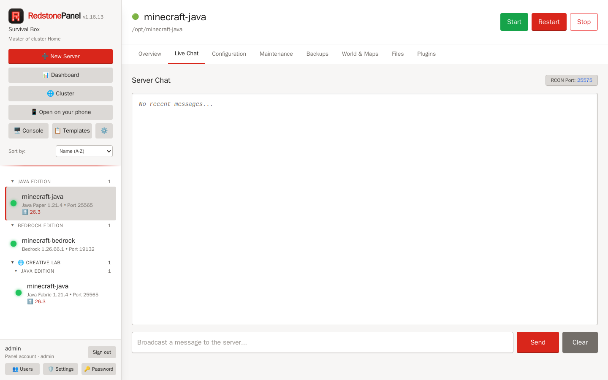<br>Live Chat</td></tr>
<tr><td><br>Configuration, visual editor</td><td>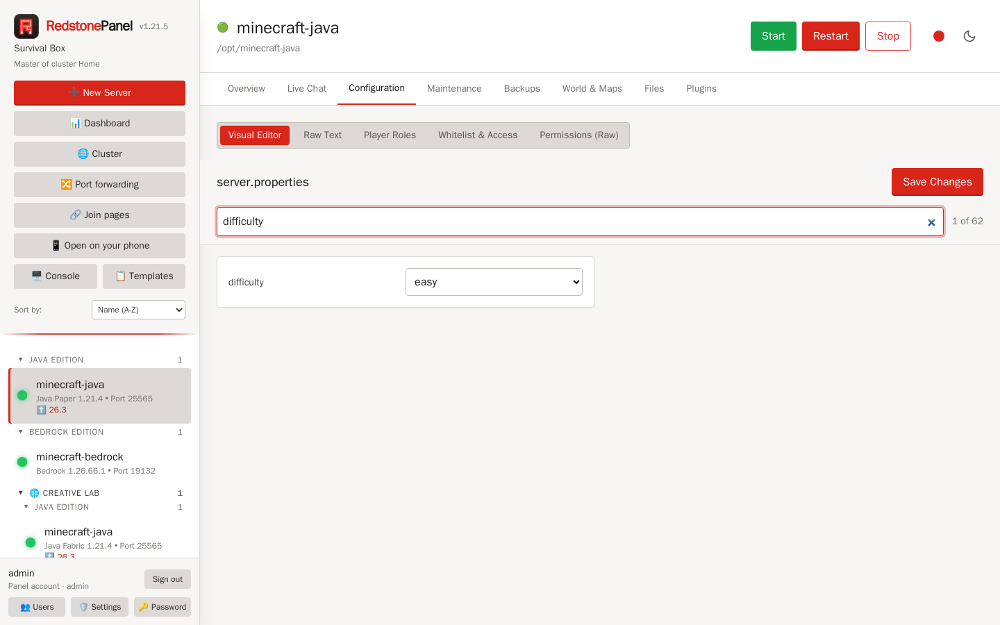<br>Filtering properties</td><td><br>Raw server.properties</td></tr>
<tr><td>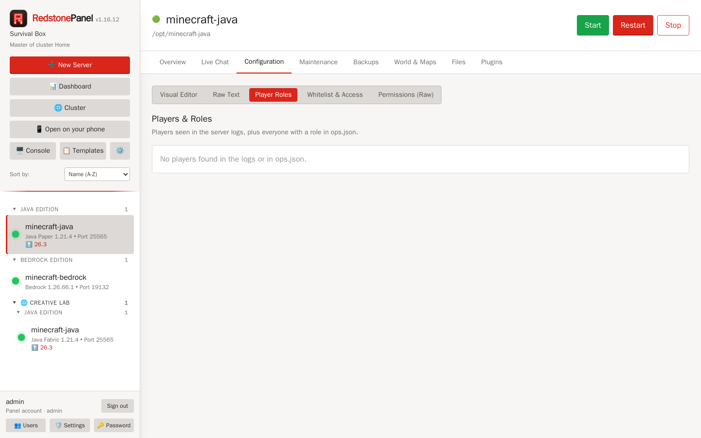<br>Player roles</td><td>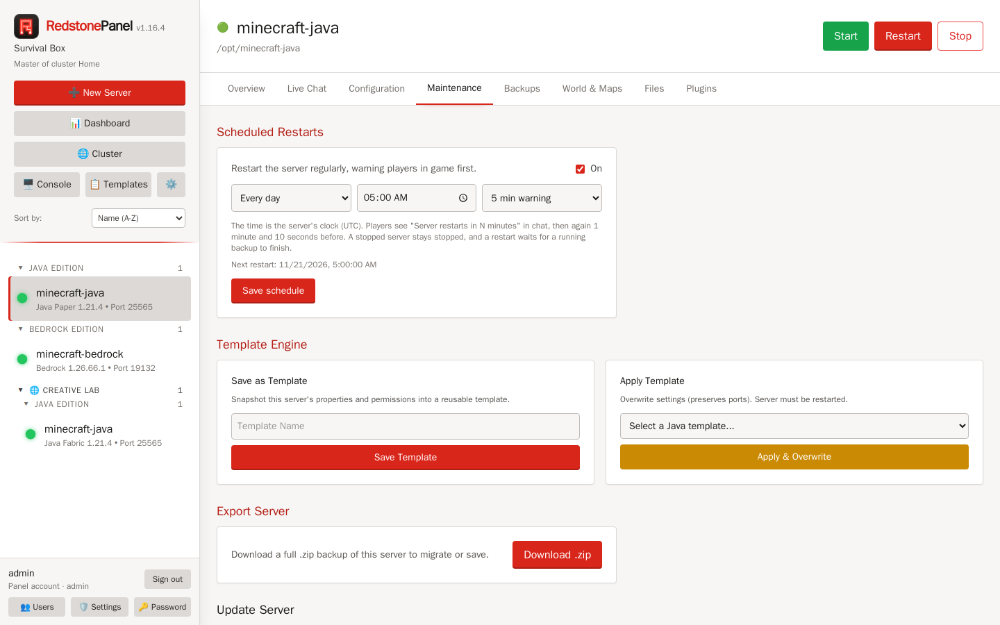<br>Maintenance tab</td><td><br>Backups tab, Java server</td></tr>
<tr><td><br>Backups tab, Bedrock server</td><td><br>Scheduled restarts</td><td>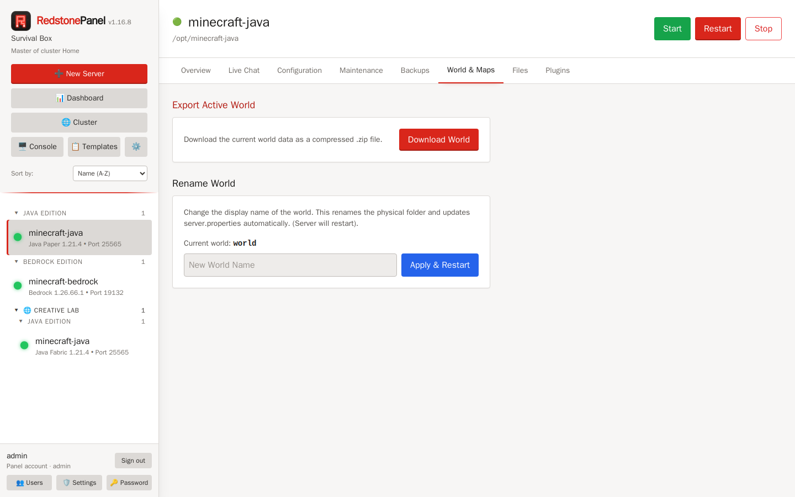<br>World & Maps</td></tr>
<tr><td><br>Files tab</td><td><br>Editing a plugin's config.yml</td><td><br>Mods tab on a Fabric server</td></tr>
<tr><td><br>Plugins tab on a Paper server</td><td><br>Add-ons tab on a Bedrock server</td><td>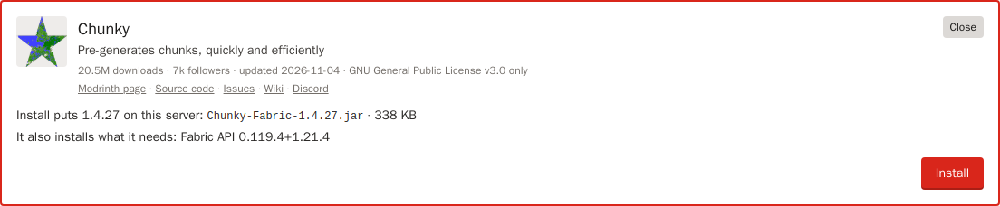<br>Details of a mod before installing it</td></tr>
<tr><td>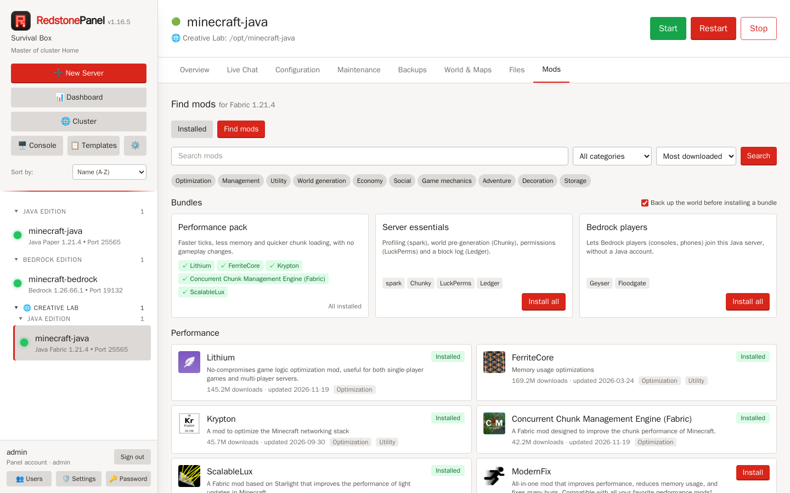<br>The mod catalog on a Fabric server</td><td><br>Finding mods on Modrinth</td><td>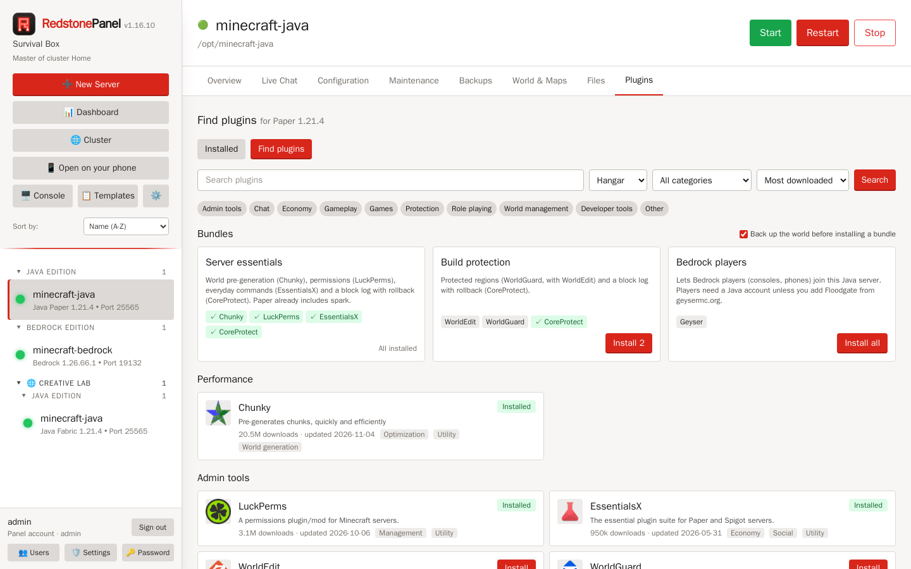<br>Plugins from Hangar on a Paper server</td></tr>
<tr><td><br>Console</td><td>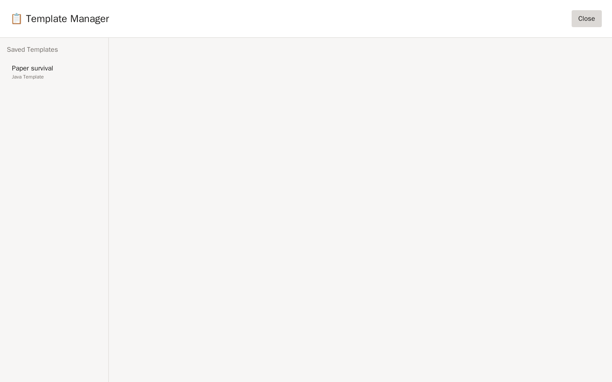<br>Template manager</td><td>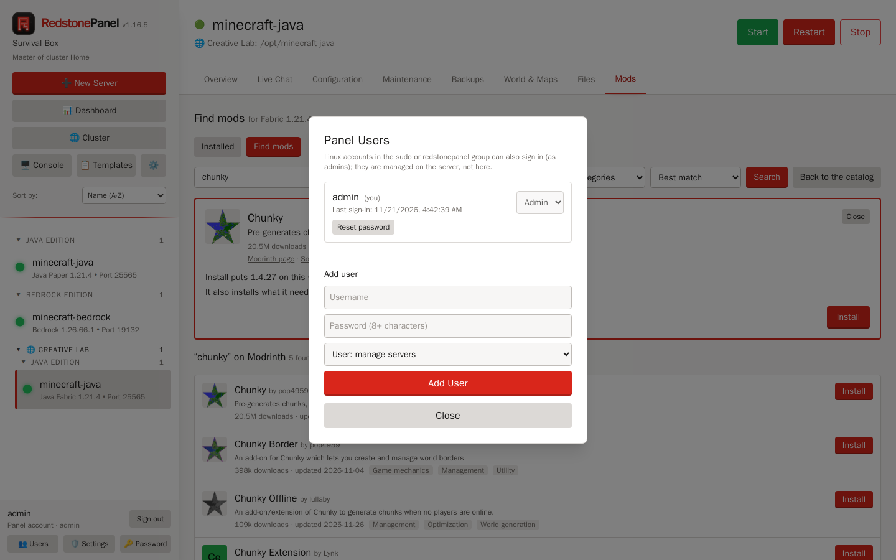<br>Panel users</td></tr>
<tr><td>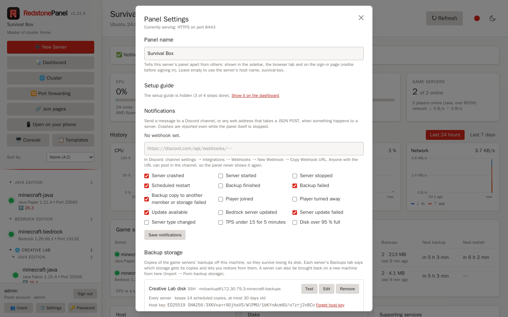<br>Panel Settings: name, notifications and cluster</td><td>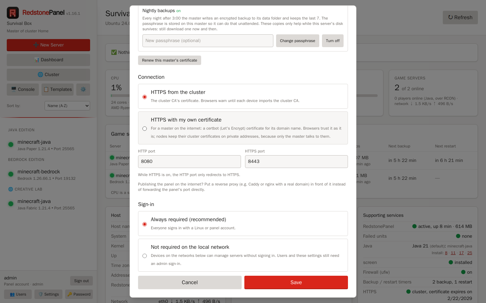<br>Panel Settings on a cluster master: connection and sign-in</td><td><br>Notification settings</td></tr>
<tr><td>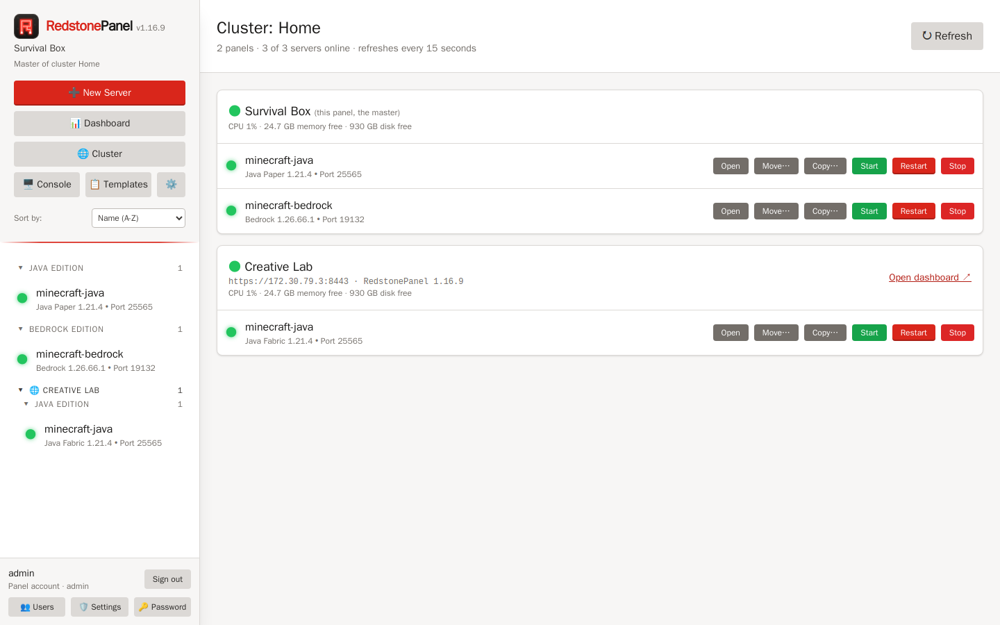<br>The Cluster page</td><td><br>A node's Fabric server opened from the master</td><td><br>Moving a server to another cluster member</td></tr>
<tr><td><br>A finished move, with the old copy still kept</td></tr>
</table>

</details>
