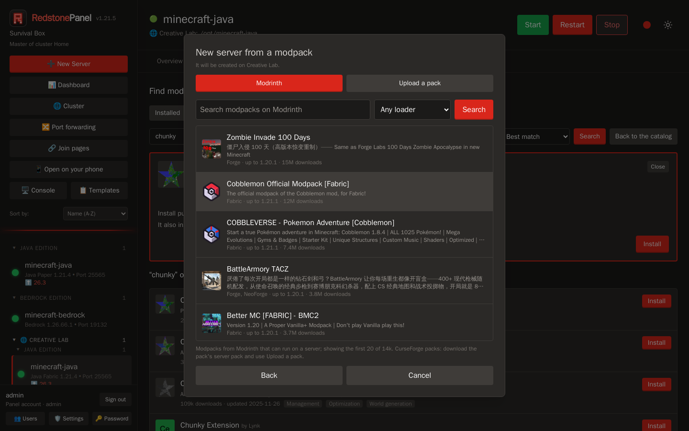
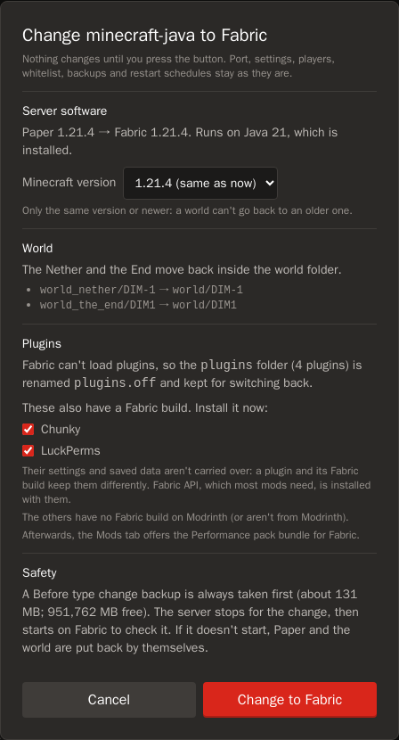
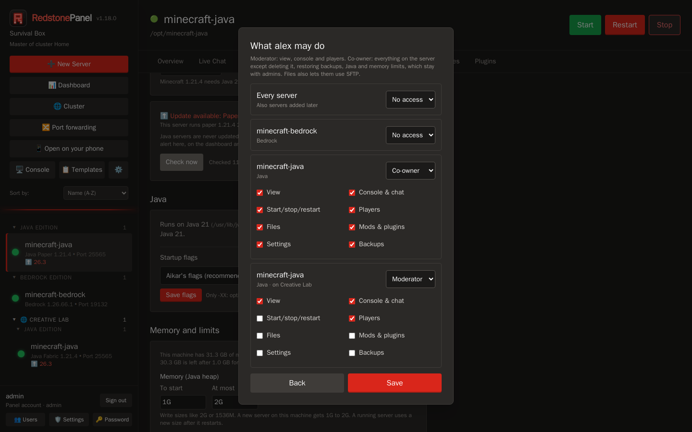

# What's new

The highlights of each RedstonePanel release, newest first. Each version links to its full
release notes. To update, run `sudo apt update && sudo apt upgrade`, or click **Update now** on
the dashboard.

*Maintainers: add each release at the top of this page in the same merge request as its
`release-notes/vX.Y.Z.md`.*

---

## 1.21.5: join pages for players *(November 2026)*

- **🔗 Join pages**: a public page for each server that tells players how to join, with the
  address, whether it's online, how many are playing and the Minecraft version. Off until you
  turn it on.
- A server made from a Modrinth modpack links to **the exact pack version it runs**, with
  steps for Modrinth App and Prism Launcher. Bedrock servers get an **Add this server to
  Minecraft** button.
- The pages have **a port of their own** that answers nothing else, so the panel can stay off
  the internet.
- Unlisted pages with a random link, a note and a link of your own, and player names only if
  you turn them on. On a cluster master, pages for the servers on every node. See
  [Join pages](../guide/README.md#join-pages).

[Release notes](../../release-notes/v1.21.5.md)

## 1.21.4: quick commands in Live Chat *(November 2026)*

- **Live Chat suggests as you type**, like the game: commands after `/`, then the players
  online, players seen before or the fixed choices for each part. **Tab** fills one in.
- **Commands…** opens a form that asks only for what the picked command needs and shows the
  exact command before **Run**.
- **One-click buttons** for List players, Save world, Day, Night and Clear weather.
- A running Vanilla, Fabric, Quilt, Forge or NeoForge server tells the panel its own commands
  and game rules, so mod commands are suggested too. See
  [Live Chat](../guide/README.md#6-live-chat).

[Release notes](../../release-notes/v1.21.4.md)

## 1.21.3: servers you set up yourself *(November 2026)*

- **New server → Found on this computer** lists Minecraft servers on the machine that were set
  up outside the panel, with folder, port, version and what started them.
- **Manage with RedstonePanel** takes one over in place: the old service is stopped and turned
  off, never deleted, no file is moved, and **Undo** puts it back. See
  [A server you set up yourself](../guide/README.md#4-create-or-import-a-server).
- Fixed: a new server no longer opens with a removed server's **Last crash**.

[Release notes](../../release-notes/v1.21.3.md)

## 1.21.2: a simple light/dark switch *(November 2026)*

- **A sun/moon switch in the top right corner** of every page changes between light and dark
  mode with one click. On a phone it is at the right end of the top bar.
- **A colored dot beside it** picks the accent color.
- The **⚙️** button in the sidebar, which looked like a second Settings button, is gone.

[Release notes](../../release-notes/v1.21.2.md)

## 1.21.1: choose where servers are kept *(November 2026)*

- **Panel Settings → Servers folder** takes the full path of a folder on any disk or
  partition. New servers go there; leave it empty for `/opt`.
- **Servers you already have stay where they are** and keep working.
- Folders that won't work (system folders, read-only or `noexec` disks, names with spaces)
  are refused with the reason. See
  [Keeping servers on another disk](Installation.md#keeping-servers-on-another-disk).

[Release notes](../../release-notes/v1.21.1.md)

## 1.21: groundwork for Windows *(November 2026)*

- **Nothing changes on screen.** Everything the panel asks of the operating system now goes
  through one internal package, so a Windows version can be built next to the Linux one.
- **Same commands, same behaviour** on Linux, and nothing to do after upgrading.
- **Next:** 1.22 is planned as the Windows preview. See the [Roadmap](Roadmap.md).

[Release notes](../../release-notes/v1.21.0.md)

## 1.20: Forge, NeoForge, Quilt, Purpur and modpacks *(November 2026)*

<picture><source media="(prefers-color-scheme: light)" srcset="../guide/images/light/modpack-search.png"></picture>

- **Four more server types:** **Purpur** for plugins, **Quilt**, **NeoForge** and **Forge** for
  mods, each with the Java it needs (Forge 1.12.2 runs on Java 8).
- **New server → From a modpack:** search Modrinth's modpacks, or upload a `.mrpack` or a
  CurseForge server pack. The panel installs what the pack needs and only its server-side
  files, and never runs anything from a pack.
- **Modpack** on the Maintenance tab updates the pack, with a backup first. The world, settings
  and your own mods stay.
- **Mods and the catalog** follow the server's type, and **Server type** changes to and from
  the new types.

[Release notes](../../release-notes/v1.20.0.md)

## 1.19: change a server's type in place *(November 2026)*

<picture><source media="(prefers-color-scheme: light)" srcset="../guide/images/light/change-type-preview.png"></picture>

- **Server type** on the Maintenance tab: move a Java server between **Vanilla, Paper and
  Fabric** and keep the world, port, settings and players. A preview comes first, a backup
  always, and the old type comes back by itself if the new one doesn't start.
- **Undo type change** returns to the old software and the world from before.
- **Mods and plugins** are set aside, and the same project's build for the new type is offered.
- **Roll back the last update:** Java updates back up first and can be undone.
- Backups show **Made by** (type and version), and a newer world isn't restored onto an older
  server.

[Release notes](../../release-notes/v1.19.0.md)

## 1.18: helpers with their own access, and SFTP *(November 2026)*

<picture><source media="(prefers-color-scheme: light)" srcset="../guide/images/light/user-servers.png"></picture>

- **Per-server permissions:** **Users → Servers** sets what a user account may do on each
  server (view, console and chat, start/stop/restart, players, files, mods and plugins,
  settings, backups), with **Moderator** and **Co-owner** presets. Users see only their servers.
- **SFTP** for FileZilla or WinSCP, off until you turn it on under **Panel Settings → SFTP**:
  sign in as `account.server` with your password or an **SSH key**, and reach only that
  server's folder.
- Existing user accounts keep what they could do; new ones start with no servers.

[Release notes](../../release-notes/v1.18.0.md)

## 1.17.2: advanced options on New server *(November 2026)*

- **Advanced options** under New server, all optional: the name and port, a **Paper build** or
  **Fabric loader**, **Vanilla snapshots**, the **Java** to run on, the **heap**, **hard memory
  and CPU limits**, **startup flags** (Aikar's flags, plus extra flags for admins), the
  **world** (seed, type, folder) and the common **settings** (MOTD, game mode, difficulty,
  players, whitelist, operators).
- Everything is checked **before anything is downloaded**.
- **Startup flags** can be changed later under **Maintenance → Java**, and stay through
  updates, Java changes, restores and moves.

[Release notes](../../release-notes/v1.17.2.md)

## 1.17.1: why did it crash? *(November 2026)*

- **Last crash** on a server's Overview: when it crashes or won't start, the cause in plain
  words (missing dependency, mod for another version, wrong Java, port in use, out of memory,
  EULA, damaged world) and the likely mod or plugin, with the log's error lines highlighted.
- **Turn off and restart** the suspected mod or plugin, or **Undo the last mod update**, in one
  click (admins). Nothing changes without a click.
- **Crash alerts say why**, and **Needs attention** links to the card.
- The **RedstonePanel logo** opens the project website.

[Release notes](../../release-notes/v1.17.1.md)

## 1.17.0: server performance and tuning *(November 2026)*

- **Performance** on each server's Overview: TPS and MSPT, memory against its heap and limit,
  players, and **Held back by its limits** when a limit is biting.
- **History charts** for 24 hours and 7 days, for every server and for the machine on the
  dashboard, and a **TPS** column in the server list.
- **Memory and limits** under **Maintenance**: the Java heap, and optional hard memory and CPU
  limits per server.
- **Suggestions** based on what was measured, never applied for you, and optional **low TPS**
  and **disk nearly full** alerts.

[Release notes](../../release-notes/v1.17.0.md)

## 1.16.14: port forwarding, for players outside your home *(November 2026)*

- **🔀 Port forwarding** lists what to forward on your internet router for every server, and on
  a cluster for every machine with its LAN address: ports, TCP or UDP, and what each is for.
- **Step-by-step for pfSense** and other routers, a warning when two servers want the same
  outside port, and **Check from here**.
- **The phone menu shows every server**: on short phones it now scrolls as one page, with your
  account buttons after the last server.

[Release notes](../../release-notes/v1.16.14.md)

## 1.16.13: less downtime for big worlds, and finding panels on the network *(November 2026)*

- **Pre-copy while it runs**, an option in the **Move** window: the world is copied while
  players stay on, then the server stops only while what changed is sent. The window says how
  long it was down.
- **Find panels on your network** under **🛡️ Settings → Cluster → Add a node**, with **Add to
  cluster** for each one found.

[Release notes](../../release-notes/v1.16.13.md)

## 1.16.12: Bedrock that keeps up, and update alerts *(November 2026)*

- **Update available** on the dashboard, sidebar and a server's Overview when a newer
  Minecraft release, Paper build, Fabric loader or Bedrock version is out, with an optional
  webhook message.
- **Bedrock servers update themselves** if you turn on **Update automatically** under
  **Maintenance → Update Server**: players are warned, a backup is made, and a failed update
  is rolled back.
- **Bedrock saves before every stop**, so the last minutes of play are no longer lost on
  **Stop** or **Restart**.

[Release notes](../../release-notes/v1.16.12.md)

## 1.16.11: backups off the machine, without a cluster *(November 2026)*

- **Copy backups to an SSH server or S3-compatible storage**, set up under **🛡️ Settings →
  Backup storage** and chosen per server on its **Backups** tab. Each copy is checked with
  SHA-256.
- **Keep backups by age** ("14 days") as well as by count, for local backups and for each
  storage.
- **Restore from a copy**, or bring a server back on a new machine with **New Server → From
  backup storage**.
- **Bedrock firewall fix:** servers using Bedrock's default NetherNet transport get TCP and
  UDP 7551 opened, and the panel follows **server.properties** edited by hand.

[Release notes](../../release-notes/v1.16.11.md)

## 1.16.10: a panel that works on a phone *(November 2026)*

- **Every page fits a phone:** a ☰ menu instead of the sidebar, big **Start**, **Restart** and
  **Stop** buttons, tables as cards and full-screen dialogs.
- **Install it as an app** from your phone's browser over HTTPS, so it opens like any other
  app.
- **📱 Open on your phone** on the desktop shows a QR code of the panel's address.

[Release notes](../../release-notes/v1.16.10.md)

## 1.16.9: newer Ubuntu, Debian, ARM64 and Raspberry Pi *(November 2026)*

- **Ubuntu 26.04 LTS and 26.10, Debian 13**, as well as Ubuntu 24.04, on x86-64 and ARM64.
- **Raspberry Pi 4 or 5** with the 64-bit Raspberry Pi OS, for Java servers. See
  [On a Raspberry Pi](Installation.md#on-a-raspberry-pi) for memory, storage and cooling.
- **Bedrock is x86-64 only**, so it's greyed out on ARM64 machines and nodes; Bedrock players
  can join a Java server through Geyser.
- **The Java versions your system packages** (Debian has 21 and 25), with a note when a
  Minecraft version needs one it doesn't have.

[Release notes](../../release-notes/v1.16.9.md)

## 1.16.8: backups on another cluster node *(November 2026)*

- **Also keep a copy on** another cluster member, from a server's **Backups** tab on the
  master. Each copy is checked with SHA-256 and kept to the same number as the server's own.
- **Restore from a copy** even after the original machine is gone: **Use a copy of another
  server's backup…** on a new server, then **Put back** and **Restore**.
- A failed copy shows under **Needs attention** and can send a webhook alert.

[Release notes](../../release-notes/v1.16.8.md)

## 1.16.7: two-factor sign-in *(November 2026)*

- **A code from your phone after your password**, for panel and Linux accounts. Set it up
  under **🔑 Password** by scanning a QR code with any authenticator app.
- **Ten recovery codes** for a lost phone, and **Reset two-factor** for admins
  (`sudo redstonepanel reset-2fa NAME` on the server).
- **Require two-factor for admins**, an optional setting under **🛡️ Settings → Sign-in**.

[Release notes](../../release-notes/v1.16.7.md)

## 1.16.6: a console that makes room *(November 2026)*

- **The console no longer hides the page.** While it's open, the page beside the sidebar ends
  above it, so buttons near the bottom of a tab can still be reached, and the sidebar's buttons
  stay visible.
- It's at most a third of the window's height, and when a click opens it, the button you
  clicked is scrolled back into view.

[Release notes](../../release-notes/v1.16.6.md)

## 1.16.5: a gameplay port for each Bedrock server *(November 2026)*

- **Several Bedrock servers on one machine work again.** Since 1.16.4 every new Bedrock server
  used UDP 19132 for gameplay, so a second one clashed with the first. Each now gets its own,
  on the same number as its port (19132, 19134, …), which is also easy to forward on a router.

[Release notes](../../release-notes/v1.16.5.md)

## 1.16.4: Bedrock settings fix *(November 2026)*

- **New Bedrock servers keep all their settings.** A newly created Bedrock server's
  `server.properties` had only its ports, so Configuration showed almost nothing to edit. It
  now has every setting from the official Bedrock download.

[Release notes](../../release-notes/v1.16.4.md)

## 1.16.3: a server list that folds *(November 2026)*

A long server list, especially on a cluster, is now easy to tidy.

- **Click any heading** in the sidebar (Java Edition, Bedrock Edition or a cluster node) to fold
  it. A folded heading shows how many of its servers are online, and the browser remembers it.
- **Each cluster node's servers** get their own Java and Bedrock headings, like this machine's.

[Release notes](../../release-notes/v1.16.3.md)

## 1.16.2: kick and ban, and a new look *(November 2026)*

Remove or ban a player with a click, and RedstonePanel now looks like itself.

- **Kick, ban and unban** in **Configuration → Whitelist & Access**: kick anyone online, ban
  and unban on Java (running or stopped), a **Banned** list, and Kick/Ban on each access log row.
  Bedrock has no ban list, so it gets kick only. By name, never by IP address.
- **A new look:** an original RedstonePanel logo and favicon, and warm stone greys with
  redstone-red accents in both the dark and light themes. **Redstone Red** is the new default
  accent; a palette you picked before is kept.
- **Stop** is now an outlined button, so it no longer looks like Restart.

[Release notes](../../release-notes/v1.16.2.md)

## 1.16.1: a setup guide for new panels *(November 2026)*

A new panel now shows you how to get to a safe setup, right on the dashboard.

- **Set up RedstonePanel** (admins): four steps to create your first server, put every server on
  a backup schedule, choose HTTPS (or keep HTTP on a network you trust) and get crash alerts in
  Discord or any webhook. Each step opens the place where it's done.
- **Steps tick themselves** from what the panel can see, so work done elsewhere counts, and an
  upgraded panel only shows what's missing.
- **Hide guide** when you're done; **Panel Settings → Setup guide** brings it back.

[Release notes](../../release-notes/v1.16.1.md)

## 1.16.0: move a server to another machine *(November 2026)*

Move a server to another machine in your cluster, or copy it, from the master's cluster page.
Nothing is deleted until you say so.

- **Move…** on every server of the 🌐 Cluster page (admins). The server stops, its whole folder
  is streamed to the other machine and checked byte for byte, and it starts there with the same
  name and ports when they're free, the Java it needs, its memory, backup and restart schedules
  and Phantom.
- **Nothing is lost.** The old machine keeps its files as a removed server marked "moved to …"
  until you click **Delete the old copy**. A move that fails undoes itself and starts the server
  where it was.
- **Copy…** a server, to another machine or the same one, without stopping it.
- **Templates** can be copied from the master to a node and from a node to the master.

[Release notes](../../release-notes/v1.16.0.md)

## 1.15.0: manage every node from the master *(November 2026)*

Manage every node's servers from the cluster master: every tab, new servers on any node, and
real certificates for a master on the internet.

- **Every server, every tab, from the master.** Node servers are listed in the master's sidebar
  under the node's name and open with Configuration, Backups, Files, Mods, Java, Phantom and the
  rest. Uploads and downloads work through the master too.
- **Rights follow the master's accounts.** Master admins are admins on the nodes and master
  users are users. Both panels log each change as `[CLUSTER] user@master`.
- **New Server → Where.** Create a server on any node. Its template is copied over first, and
  the Java it needs can be installed there.
- **Real certificates** (certbot) for a master on the internet, and nodes with public
  certificates can join.
- **Automatic certificate renewal** 30 days before expiry, and **nightly encrypted cluster
  backups** (keeps 7).

[Release notes](../../release-notes/v1.15.0.md)

## 1.14.2: who joined, who was turned away *(20 November 2026)*

See who joins your servers, who the whitelist keeps out, and edit the whitelist from the panel
(**Configuration → Whitelist & Access**). Names and IDs only, never addresses.
[Release notes](../../release-notes/v1.14.2.md)

## 1.14.1: NetherNet-aware firewall and Phantom *(20 November 2026)*

The panel knows about Bedrock's NetherNet transport: it opens the right firewall ports, checks
them on the dashboard, and doesn't offer Phantom where it can't help.
[Release notes](../../release-notes/v1.14.1.md)

## 1.14.0: a catalog of mods and plugins *(20 November 2026)*

**Find mods** and **Find plugins** became a catalog: bundles, a hand-picked starter set,
categories and sorting, and a details view that says exactly what Install will do.
[Release notes](../../release-notes/v1.14.0.md)

## 1.13.2: Phantom from the panel *(20 November 2026)*

Bedrock servers on any port can show up under **Friends → LAN Games**: the panel installs and
runs Phantom LAN proxies for them. [Release notes](../../release-notes/v1.13.2.md)

## 1.13.1: Java when it's needed *(20 November 2026)*

Java is installed when a server needs it, and only the versions your servers use stay
installed. The panel can update itself from the dashboard.
[Release notes](../../release-notes/v1.13.1.md)

## 1.13.0: Modrinth and Hangar *(19 November 2026)*

Find, install and update mods and plugins from Modrinth and Hangar, inside the panel.
[Release notes](../../release-notes/v1.13.0.md)

## 1.12.0: drop in mods and plugins *(19 November 2026)*

Add mods, plugins and Bedrock add-ons by dropping them on the server. Each is checked and put
in the right place. [Release notes](../../release-notes/v1.12.0.md)

## 1.11.0: host dashboard *(18 November 2026)*

See the whole machine at a glance: the panel's empty screen became a dashboard with a
**Needs attention** list. [Release notes](../../release-notes/v1.11.0.md)

## 1.10.0: edit files *(18 November 2026)*

A file manager and text editor for each server's folder: plugin configs, `ops.json`, mods and
more. [Release notes](../../release-notes/v1.10.0.md)

## 1.9.0: more than vanilla *(18 November 2026)*

Paper and Fabric servers, on the Minecraft version you choose, each with the Java it needs.
[Release notes](../../release-notes/v1.9.0.md)

## 1.8.1: only admins delete *(18 November 2026)*

Only admins can uninstall or purge a server. [Release notes](../../release-notes/v1.8.1.md)

## 1.8.0: know what's happening *(18 November 2026)*

Discord and webhook notifications when a server crashes, scheduled restarts that warn players,
and crashed Bedrock servers come back by themselves.
[Release notes](../../release-notes/v1.8.0.md)

## 1.7.0: scheduled backups *(18 November 2026)*

Back up worlds on a schedule, and put one back with a click.
[Release notes](../../release-notes/v1.7.0.md)

## 1.6.0: restore removed servers *(18 November 2026)*

Bring back a server you uninstalled with **Keep World**.
[Release notes](../../release-notes/v1.6.0.md)

## 1.5.0: clusters *(17 November 2026)*

Run several RedstonePanels from one: a master panel sees and controls the game servers on the
others. [Release notes](../../release-notes/v1.5.0.md)

## 1.4.0: Bedrock connection diagnostics *(17 November 2026)*

Shows why Bedrock players can't connect, including Phantom proxies the panel didn't install.
[Release notes](../../release-notes/v1.4.0.md)

## Earlier

1.0.0 to 1.3.1 (14–16 November 2026): the first releases, with Java and Bedrock servers as
systemd services, live chat over RCON, the `server.properties` editor, templates, export,
importing `.zip`, `.tar.gz` and `.tar` backups, and panel names. See
[all releases](https://github.com/qrussell/redstonepanel/releases).
