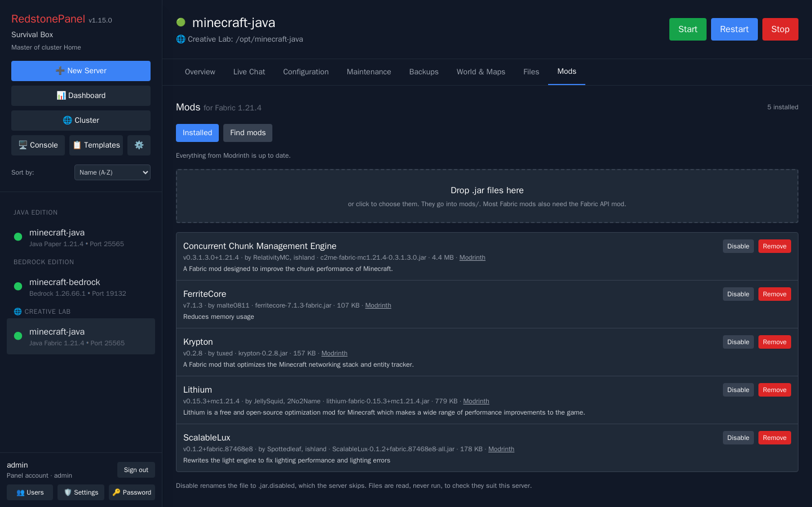

Add mods, plugins and Bedrock add-ons by dropping them on the server.



## Added

- **Mods, Plugins and Add-ons tab** (admins). Fabric servers get **Mods**, Paper servers **Plugins**, Bedrock servers **Add-ons**:
  - **Drag files onto it**, or click to choose them: `.jar` for Fabric and Paper, `.mcpack` or `.mcaddon` for Bedrock.
  - **Checked before installing.** Fabric mods go into `mods/`, Paper and Bukkit/Spigot plugins into `plugins/`. Files that can't work are refused with the reason: Forge and NeoForge mods, plugins on Fabric, mods on Paper, proxy plugins, and anything on a vanilla server. The panel only reads each jar's description; nothing in it is run.
  - **Updating** a mod: drop the new version and confirm, and the old file is replaced, so the server never has two copies.
  - **The list** shows name, version, authors and file, and warns when something was made for a different Minecraft version or needs a mod or plugin that isn't installed (for example Fabric API).
  - **Disable** (renames to `.jar.disabled`), **Enable** and **Remove**, then **Restart now**.
  - **Bedrock add-ons** are unpacked into `behavior_packs/` or `resource_packs/` and turned on for the world. Disable takes a pack out of the world; Remove deletes it.
- **Drag and drop on the Files tab**, with a progress bar per file. Mods, plugins and add-ons dropped at the top of a server's folder are checked and placed as above; other files go into the folder you're in.

## Notes

- Everything is admin-only, like the Files tab, and logged (`[MODS] …`).
- Changes apply when the server restarts.

## Installing

RedstonePanel runs on **Ubuntu 24.04 and 25.04**. The easiest way to install it, and to get every later version with `apt upgrade`, is the signed **qrussell-repo** apt repository:

```bash
sudo apt install -y curl ca-certificates
curl -fsSL https://qrussell.github.io/qrussell-repo/deb/qrussell-repo.gpg | sudo tee /usr/share/keyrings/qrussell-repo.gpg >/dev/null
echo "deb [signed-by=/usr/share/keyrings/qrussell-repo.gpg] https://qrussell.github.io/qrussell-repo/deb ./" | sudo tee /etc/apt/sources.list.d/qrussell.list
sudo apt update
sudo apt install redstonepanel
```

Then open **http://&lt;server&gt;:8080/** and sign in with a Linux account in the `sudo` group.

To check the repository key before trusting it, `gpg --show-keys /usr/share/keyrings/qrussell-repo.gpg` should show the fingerprint `9994A9EB39EB3C101C949FB2012BA14E0FE3A355`.

Prefer not to add a repository? Download `redstonepanel_1.12.0_all.deb` below and run `sudo apt install ./redstonepanel_1.12.0_all.deb`. You then install each new version the same way.

The [user guide](https://github.com/qrussell/redstonepanel/blob/main/docs/guide/README.md) walks through every feature, with screenshots.

## Upgrading

If you use the qrussell-repo repository:

```bash
sudo apt update && sudo apt upgrade
```

New versions reach the repository within a few hours of their release. Otherwise, install the new .deb as above.

Running servers keep running through the upgrade.

**Full Changelog**: https://github.com/qrussell/redstonepanel/compare/v1.11.0...v1.12.0
