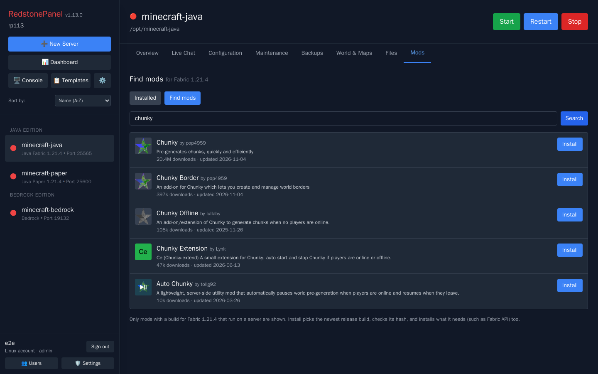
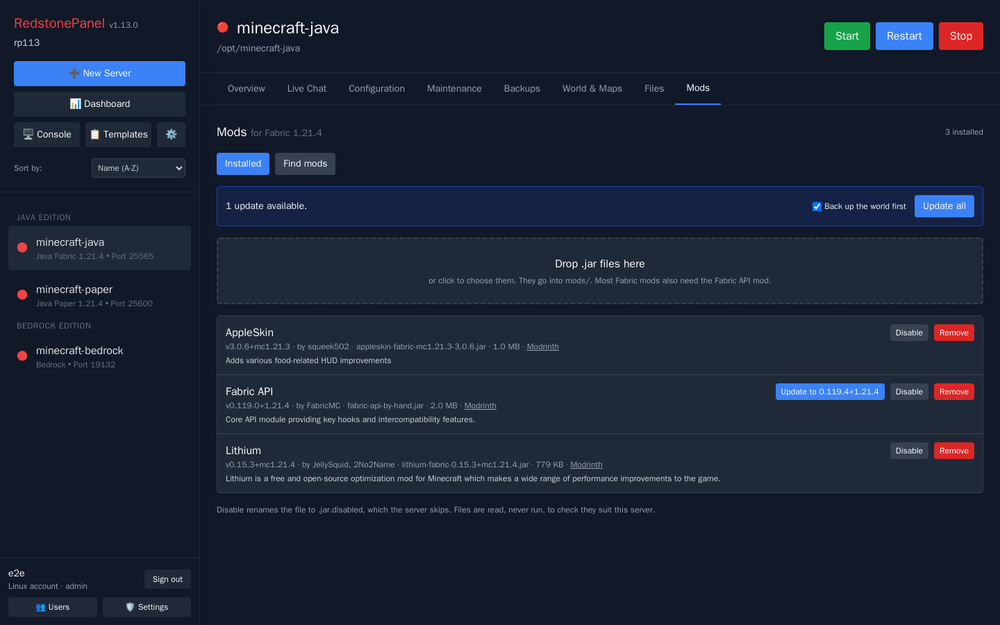

Find, install and update mods and plugins from Modrinth and Hangar, inside the panel.



## Added

- **Find mods / Find plugins** on the Mods and Plugins tabs (admins):
  - Searches **Modrinth** (Fabric mods, Paper plugins) and **Hangar** (Paper plugins). Only projects with a build for the server's loader and Minecraft version that run on a server are shown.
  - **Install** picks the newest release build, downloads it from the site's own download server, checks its checksum, and installs it like a dropped file. Mods and plugins it needs, such as Fabric API, are installed with it.
- **Updates.** Opening the tab checks for newer builds for the server's Minecraft version. Jars added by hand are recognised by checksum on Modrinth.
  - **Update to …** per mod or plugin, and **Update all**, which backs up the world first (a new **Before mod update** backup).
  - The old file is kept as `.jar.previous`, and **Undo** puts the last update's files back.
- **Before a Minecraft update.** Maintenance → Update lists the mods and plugins with no build for the version you're moving to, so you can wait instead of updating into a server that won't start.



## Notes

- Downloads come only from `cdn.modrinth.com` and `hangarcdn.papermc.io` over HTTPS, and every file is checked against the site's checksum before anything is installed.
- CurseForge isn't supported: its API needs a key, and some authors block downloads from other apps.
- Everything is admin-only and logged (`[MODS] …`). Changes apply when the server restarts.

## Installing

RedstonePanel runs on **Ubuntu 24.04 and 25.04**. The easiest way to install it, and to get every later version with `apt upgrade`, is the signed **qrussell-repo** apt repository:

```bash
sudo apt install -y curl ca-certificates
curl -fsSL https://qrussell.github.io/qrussell-repo/deb/qrussell-repo.gpg | sudo tee /usr/share/keyrings/qrussell-repo.gpg >/dev/null
echo "deb [signed-by=/usr/share/keyrings/qrussell-repo.gpg] https://qrussell.github.io/qrussell-repo/deb ./" | sudo tee /etc/apt/sources.list.d/qrussell.list
sudo apt update
sudo apt install redstonepanel
```

Then open **http://&lt;server&gt;:8080/** and sign in with a Linux account in the `sudo` group.

To check the repository key before trusting it, `gpg --show-keys /usr/share/keyrings/qrussell-repo.gpg` should show the fingerprint `9994A9EB39EB3C101C949FB2012BA14E0FE3A355`.

Prefer not to add a repository? Download `redstonepanel_1.13.0_all.deb` below and run `sudo apt install ./redstonepanel_1.13.0_all.deb`. You then install each new version the same way.

The [user guide](https://github.com/qrussell/redstonepanel/blob/main/docs/guide/README.md) walks through every feature, with screenshots.

## Upgrading

If you use the qrussell-repo repository:

```bash
sudo apt update && sudo apt upgrade
```

New versions reach the repository within a few hours of their release. Otherwise, install the new .deb as above.

Running servers keep running through the upgrade.

**Full Changelog**: https://github.com/qrussell/redstonepanel/compare/v1.12.0...v1.13.0
