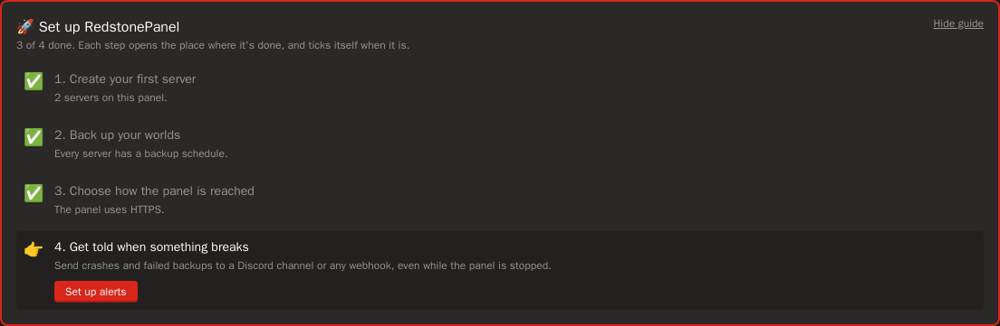

A new panel now shows you how to get to a safe setup: a short guide on the dashboard that walks you through your first server, backups, HTTPS and alerts.

<picture><source media="(prefers-color-scheme: light)" srcset="https://raw.githubusercontent.com/qrussell/redstonepanel/v1.16.1/docs/guide/images/light/setup-guide.png"></picture>

## Added

- **Set up RedstonePanel**, a card at the top of the dashboard for admins, with four steps:
  1. **Create your first server**: opens **➕ New Server**. If the firewall `ufw` is missing or off, the card says so, because the panel opens game ports only through `ufw`.
  2. **Back up your worlds**: a button for each server without a backup schedule, which opens its **Backups** tab.
  3. **Choose how the panel is reached**: **Turn on HTTPS** opens Panel Settings at **Connection**. On a home network you trust, **Keep HTTP, this is my home network** ticks the step instead.
  4. **Get told when something breaks**: opens Panel Settings at **Notifications** for a Discord or webhook alert.
- **Steps tick themselves** from what the panel can see, not from clicks in the guide. A step done from the command line or by another admin counts, and a panel you upgrade only shows what's still missing.
- **Hide guide** hides it for every admin. **Panel Settings → Setup guide** shows it again, and is where you take back **Keep HTTP**. The card goes away by itself once every step is done.
- **Clusters:** on a node, joining the cluster ticks the HTTPS step. On a master, servers on the nodes count for the first step.

## Upgrading an existing panel

Nothing to do. If your panel already has servers with backup schedules, HTTPS and a webhook, you won't see the card at all. If something is missing, the card shows just that step; **Hide guide** if you'd rather not see it.

## Installing

RedstonePanel runs on **Ubuntu 24.04 and 25.04**. The easiest way to install it, and to get every later version with `apt upgrade`, is the signed **qrussell-repo** apt repository:

```bash
sudo apt install -y curl ca-certificates
curl -fsSL https://qrussell.github.io/qrussell-repo/deb/qrussell-repo.gpg | sudo tee /usr/share/keyrings/qrussell-repo.gpg >/dev/null
echo "deb [signed-by=/usr/share/keyrings/qrussell-repo.gpg] https://qrussell.github.io/qrussell-repo/deb ./" | sudo tee /etc/apt/sources.list.d/qrussell.list
sudo apt update
sudo apt install redstonepanel
```

Or in one line: `curl -fsSL https://raw.githubusercontent.com/qrussell/redstonepanel/main/install.sh | sudo sh`

Then open **http://&lt;server&gt;:8080/** and sign in with a Linux account in the `sudo` group.

To check the repository key before trusting it, `gpg --show-keys /usr/share/keyrings/qrussell-repo.gpg` should show the fingerprint `9994A9EB39EB3C101C949FB2012BA14E0FE3A355`.

Prefer not to add a repository? Download `redstonepanel_1.16.1_all.deb` below and run `sudo apt install ./redstonepanel_1.16.1_all.deb`. You then install each new version the same way.

The [user manual](https://github.com/qrussell/redstonepanel/blob/main/docs/guide/README.md) walks through every feature, with screenshots.

## Upgrading

If you use the qrussell-repo repository:

```bash
sudo apt update && sudo apt upgrade
```

New versions reach the repository within a few hours of their release. Otherwise, install the new .deb as above.

Running servers keep running through the upgrade.

**Full Changelog**: https://github.com/qrussell/redstonepanel/compare/v1.16.0...v1.16.1
