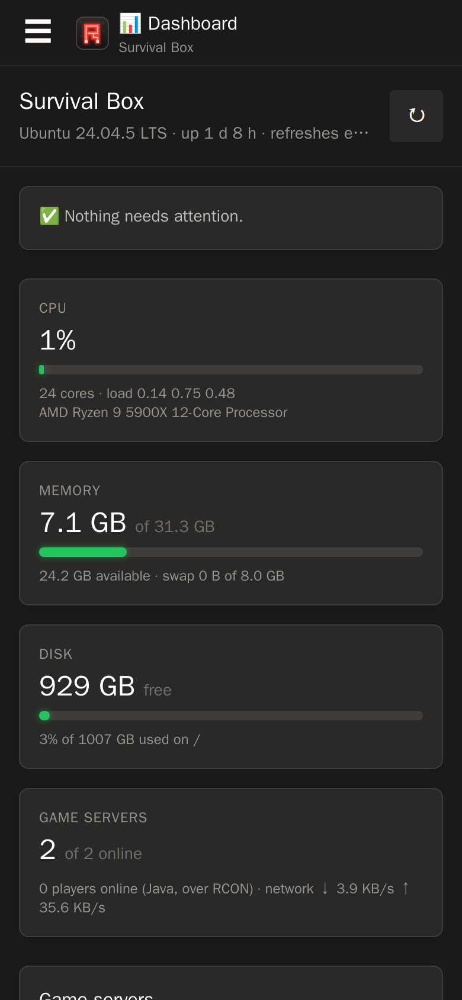
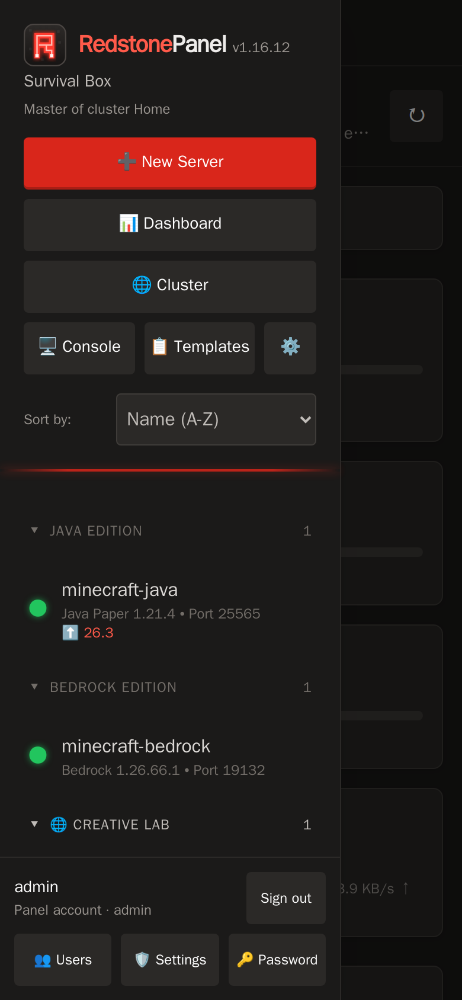
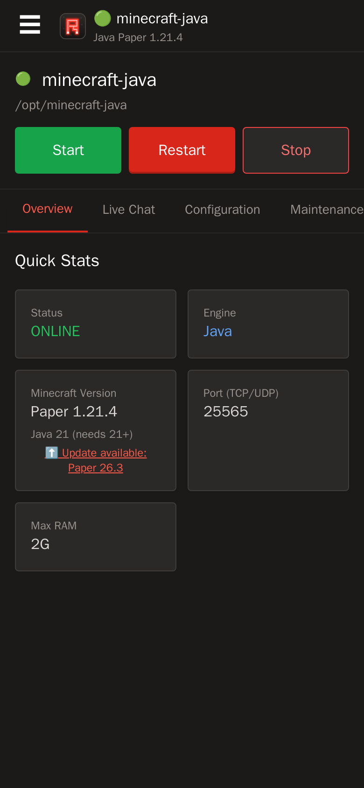
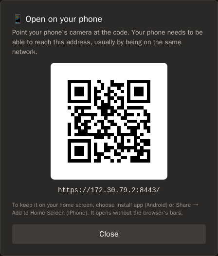

A panel that works on a phone: a ☰ menu, big buttons and tables as cards, installable as an app, and a QR code to open it on your phone.

<p>  </p>

## New

- **Every page fits a phone.** Below 768 px wide the sidebar becomes a menu: tap **☰** in the top bar, which also names the open server. It closes when you pick something, tap outside it or press Escape.
- **Big buttons on a server's page.** **Start**, **Restart** and **Stop** are three large buttons across the top, and the tabs scroll sideways instead of wrapping.
- **Tables become cards** on a phone: the dashboard's servers, backups, backup copies, the file manager and the access log. Dialogs fill the screen.
- **Typing on a phone.** Fields no longer make an iPhone zoom in, Live Chat keeps its box above the on-screen keyboard, and touch screens get controls at least 44 px tall.
- **Install it as an app.** Over HTTPS, Android offers **Install app** and an iPhone **Share → Add to Home Screen**, and the panel opens in its own window. If the phone can't reach the panel, the app shows **Can't reach the panel** with **Try again** instead of the browser's error. Browsers only install apps from HTTPS sites; on plain HTTP it's a home-screen bookmark.
- **📱 Open on your phone** on the desktop shows a QR code of the panel's address to scan with your phone's camera. The panel makes the code itself, so the address never goes to an outside service, and if you opened the panel as `localhost` it offers the machine's network addresses instead.

<picture><source media="(prefers-color-scheme: light)" srcset="https://raw.githubusercontent.com/qrussell/redstonepanel/v1.16.10/docs/guide/images/light/phone-qr.png"></picture>

On a computer the layout is unchanged apart from the new button.

Tested in Chromium with phone emulation in both themes, Chrome's installability check, and the QR code against a QR reader. Not yet tried on a real iPhone or Android phone: tell us in the discussions if something doesn't fit.

## Upgrading an existing panel

Nothing to do. Reload the panel in your browser after the upgrade (on a phone, close and reopen the tab). To install it as an app, the panel needs HTTPS (**🛡️ Settings → Connection**).

## Installing

RedstonePanel runs on **Ubuntu 24.04, 26.04 and 26.10**, **Debian 13** and **64-bit Raspberry Pi OS** (Raspberry Pi 4 or 5), on x86-64 and ARM64. See [Supported systems](https://github.com/qrussell/redstonepanel#supported-systems). The easiest way to install it, and to get every later version with `apt upgrade`, is the signed **qrussell-repo** apt repository:

```bash
sudo apt install -y curl ca-certificates
curl -fsSL https://qrussell.github.io/qrussell-repo/deb/qrussell-repo.gpg | sudo tee /usr/share/keyrings/qrussell-repo.gpg >/dev/null
echo "deb [signed-by=/usr/share/keyrings/qrussell-repo.gpg] https://qrussell.github.io/qrussell-repo/deb ./" | sudo tee /etc/apt/sources.list.d/qrussell.list
sudo apt update
sudo apt install redstonepanel
```

Or in one line: `curl -fsSL https://raw.githubusercontent.com/qrussell/redstonepanel/main/install.sh | sudo sh`

Then open **http://&lt;server&gt;:8080/** and sign in with a Linux account in the `sudo` group.

To check the repository key before trusting it, `gpg --show-keys /usr/share/keyrings/qrussell-repo.gpg` should show the fingerprint `9994A9EB39EB3C101C949FB2012BA14E0FE3A355`.

Prefer not to add a repository? Download `redstonepanel_1.16.10_all.deb` below and run `sudo apt install ./redstonepanel_1.16.10_all.deb`. You then install each new version the same way.

The [user manual](https://github.com/qrussell/redstonepanel/blob/main/docs/guide/README.md) walks through every feature, with screenshots.

## Upgrading

If you use the qrussell-repo repository:

```bash
sudo apt update && sudo apt upgrade
```

New versions reach the repository within a few hours of their release. Otherwise, install the new .deb as above.

Running servers keep running through the upgrade.

**Full Changelog**: https://github.com/qrussell/redstonepanel/compare/v1.16.9...v1.16.10
