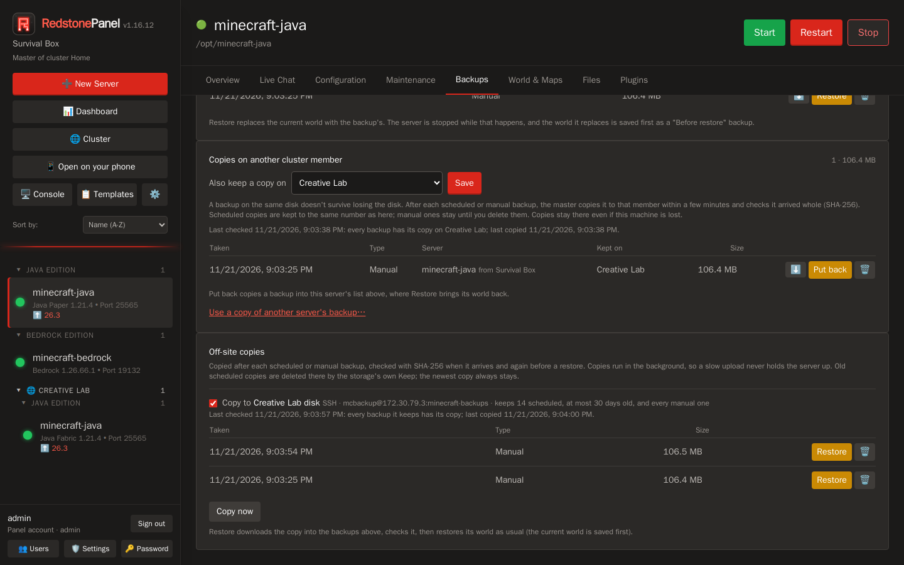
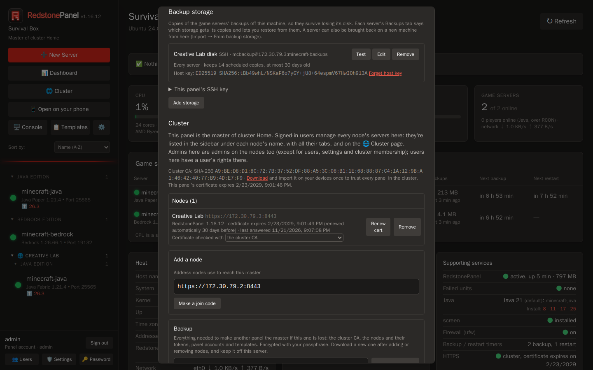

Backups off the machine: copy each server's backups to an SSH server or S3-compatible storage, keep them by age, and bring a server back on a new machine. Plus a Bedrock firewall fix.

<picture><source media="(prefers-color-scheme: light)" srcset="https://raw.githubusercontent.com/qrussell/redstonepanel/v1.16.11/docs/guide/images/light/offsite-copies.png"></picture>

## New

- **Backup storage.** Under **🛡️ Settings → Backup storage** (admins), add an **SSH server** (copied with rsync using the panel's own key, shown there to paste into the server's `authorized_keys`) or **S3-compatible storage**: Backblaze B2, Wasabi, Cloudflare R2, MinIO or AWS S3. **Test** writes, lists and deletes a file and says which step failed. Passwords and secret keys never go back to the browser.
- **Off-site copies.** On a server's **Backups** tab, tick the storage to copy to. After each scheduled backup the copy runs on its own, even while the panel is stopped; **Back up now** copies straight away, and **Copy now** retries. Every copy is checked with SHA-256 when it arrives and again before a restore.
- **Keep backups by age.** Each storage keeps its own number of copies and an optional age, and local schedules can also **delete backups after N days**. The newest backup or copy is never deleted by age.
- **Restore from a copy** on the Backups tab: the panel downloads it, checks it and restores it.
- **Bring a server back on a new machine.** On a fresh panel, add the same storage, then **➕ New Server → From backup storage** lists the old machine's copies. Java servers come back at the same Minecraft version and loader.
- **Alerts.** A failing copy shows under **Needs attention** and sends one **Backup copy to another member or storage failed** webhook until it works again.

<picture><source media="(prefers-color-scheme: light)" srcset="https://raw.githubusercontent.com/qrussell/redstonepanel/v1.16.11/docs/guide/images/light/backup-storage.png"></picture>

## Fixed

- **Bedrock servers reachable through the firewall.** A Bedrock server with no `transport` line in **server.properties** uses NetherNet, Bedrock's default since 1.26.50, which listens on TCP `server-port` and UDP 7551, but the panel only opened UDP `server-port`. Imports, restores, moves and older servers were affected. The panel now opens the right ports, and gives each Bedrock server a fixed UDP gameplay port.
- **The firewall follows hand edits.** If you change a port in **server.properties** by hand, the panel opens the new rules and closes the old ones within two minutes; a server removed by hand loses its rules. Rules still used by another server or a Phantom proxy are never closed, and every change is logged as `[FIREWALL]`. Game-port rules that nothing needs get a dashboard note with the command to remove them.

Tested: 29 new unit tests for backup storage (including AWS's own signing examples and an S3 server that checks every signature), an end-to-end test with an SSH server, an S3 server and a second panel as the new machine (39 checks, including a 110 MB upload), and a firewall test against the real Bedrock server (24 checks).

## Upgrading an existing panel

Nothing changes until you add backup storage. For SSH storage, install `rsync` and `openssh-client` if they aren't there (`sudo apt install rsync openssh-client`; new installs get them). After the upgrade, each Bedrock server is given its own fixed UDP gameplay port, used from its next restart, and the rules it needs are opened once; nothing is closed. Reload the panel in your browser after the upgrade.

## Installing

RedstonePanel runs on **Ubuntu 24.04, 26.04 and 26.10**, **Debian 13** and **64-bit Raspberry Pi OS** (Raspberry Pi 4 or 5), on x86-64 and ARM64. See [Supported systems](https://github.com/qrussell/redstonepanel#supported-systems). The easiest way to install it, and to get every later version with `apt upgrade`, is the signed **qrussell-repo** apt repository:

```bash
sudo apt install -y curl ca-certificates
curl -fsSL https://qrussell.github.io/qrussell-repo/deb/qrussell-repo.gpg | sudo tee /usr/share/keyrings/qrussell-repo.gpg >/dev/null
echo "deb [signed-by=/usr/share/keyrings/qrussell-repo.gpg] https://qrussell.github.io/qrussell-repo/deb ./" | sudo tee /etc/apt/sources.list.d/qrussell.list
sudo apt update
sudo apt install redstonepanel
```

Or in one line: `curl -fsSL https://raw.githubusercontent.com/qrussell/redstonepanel/main/install.sh | sudo sh`

Then open **http://&lt;server&gt;:8080/** and sign in with a Linux account in the `sudo` group.

To check the repository key before trusting it, `gpg --show-keys /usr/share/keyrings/qrussell-repo.gpg` should show the fingerprint `9994A9EB39EB3C101C949FB2012BA14E0FE3A355`.

Prefer not to add a repository? Download `redstonepanel_1.16.11_all.deb` below and run `sudo apt install ./redstonepanel_1.16.11_all.deb`. You then install each new version the same way.

The [user manual](https://github.com/qrussell/redstonepanel/blob/main/docs/guide/README.md) walks through every feature, with screenshots.

## Upgrading

If you use the qrussell-repo repository:

```bash
sudo apt update && sudo apt upgrade
```

New versions reach the repository within a few hours of their release. Otherwise, install the new .deb as above.

Running servers keep running through the upgrade.

**Full Changelog**: https://github.com/qrussell/redstonepanel/compare/v1.16.10...v1.16.11
