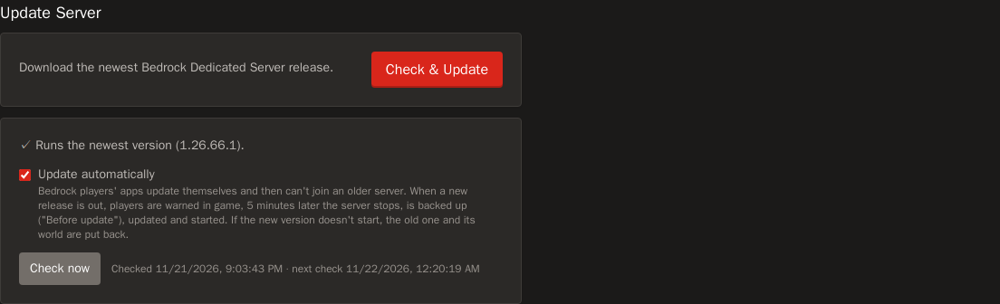
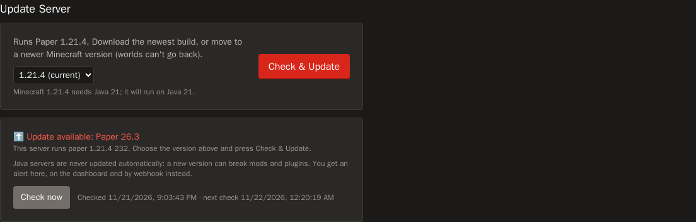

Bedrock that keeps up: update alerts for every server, Bedrock servers that update themselves, and Bedrock servers that always save before they stop.

<picture><source media="(prefers-color-scheme: light)" srcset="https://raw.githubusercontent.com/qrussell/redstonepanel/v1.16.12/docs/guide/images/light/bedrock-auto-update.png"></picture>

## New

- **Update available.** Every 6 hours the panel checks for a newer Bedrock release, Minecraft release, Paper build or Fabric loader (never snapshots). A server with one shows **⬆** in the sidebar, on the dashboard, the cluster page and its Overview, and **Maintenance → Update Server** says what's new, with **Check now**. Turn on the **Update available** webhook event for one message per new version.
- **Bedrock servers update themselves** if you tick **Update automatically** under **Maintenance → Update Server** (off by default). The new version is downloaded and checked first, players get 5 minutes of warnings, the server stops with Bedrock's own `stop`, a **Before update** backup is taken (the newest 3 are kept), and the files are swapped while **server.properties**, permissions, the allowlist and worlds stay. If the server doesn't start, the old version and world go back, it starts again, and it shows under **Needs attention** with an **update_failed** webhook.
- **The Update button** uses the same safe steps, for Bedrock servers updated by hand.
- The check runs from its own timer, `redstonepanel-updates.timer`, so it works while the panel is stopped. Java servers get the alert only, and update with **Update Server** as before.

<picture><source media="(prefers-color-scheme: light)" srcset="https://raw.githubusercontent.com/qrussell/redstonepanel/v1.16.12/docs/guide/images/light/update-alert.png"></picture>

## Fixed

- **Bedrock servers always save before they stop.** Until now the **Stop** and **Restart** buttons ended a Bedrock server without letting it save, so the last few minutes of play could be lost. Now every stop, from the buttons, backups, scheduled restarts, updates or shutting the machine down, first sends Bedrock its own `stop` command and waits up to 75 seconds for it to save and quit.

Tested: 30 new unit tests for updates and 9 for stopping, an end-to-end update test with a stand-in Bedrock server (43 checks) and a stop test (21 checks), and on a real Bedrock Dedicated Server: a 1.26.65.1 server updated itself to 1.26.66.1 with its settings kept, and Stop, Restart and `systemctl stop` all logged "Quit correctly".

## Upgrading an existing panel

Nothing to do: update alerts start on their own, and automatic updates stay off until you turn them on per Bedrock server. The safe stop applies to running Bedrock servers after the upgrade. Reload the panel in your browser after the upgrade.

## Installing

RedstonePanel runs on **Ubuntu 24.04, 26.04 and 26.10**, **Debian 13** and **64-bit Raspberry Pi OS** (Raspberry Pi 4 or 5), on x86-64 and ARM64. See [Supported systems](https://github.com/qrussell/redstonepanel#supported-systems). The easiest way to install it, and to get every later version with `apt upgrade`, is the signed **qrussell-repo** apt repository:

```bash
sudo apt install -y curl ca-certificates
curl -fsSL https://qrussell.github.io/qrussell-repo/deb/qrussell-repo.gpg | sudo tee /usr/share/keyrings/qrussell-repo.gpg >/dev/null
echo "deb [signed-by=/usr/share/keyrings/qrussell-repo.gpg] https://qrussell.github.io/qrussell-repo/deb ./" | sudo tee /etc/apt/sources.list.d/qrussell.list
sudo apt update
sudo apt install redstonepanel
```

Or in one line: `curl -fsSL https://raw.githubusercontent.com/qrussell/redstonepanel/main/install.sh | sudo sh`

Then open **http://&lt;server&gt;:8080/** and sign in with a Linux account in the `sudo` group.

To check the repository key before trusting it, `gpg --show-keys /usr/share/keyrings/qrussell-repo.gpg` should show the fingerprint `9994A9EB39EB3C101C949FB2012BA14E0FE3A355`.

Prefer not to add a repository? Download `redstonepanel_1.16.12_all.deb` below and run `sudo apt install ./redstonepanel_1.16.12_all.deb`. You then install each new version the same way.

The [user manual](https://github.com/qrussell/redstonepanel/blob/main/docs/guide/README.md) walks through every feature, with screenshots.

## Upgrading

If you use the qrussell-repo repository:

```bash
sudo apt update && sudo apt upgrade
```

New versions reach the repository within a few hours of their release. Otherwise, install the new .deb as above.

Running servers keep running through the upgrade.

**Full Changelog**: https://github.com/qrussell/redstonepanel/compare/v1.16.11...v1.16.12
