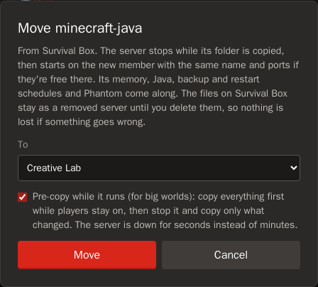
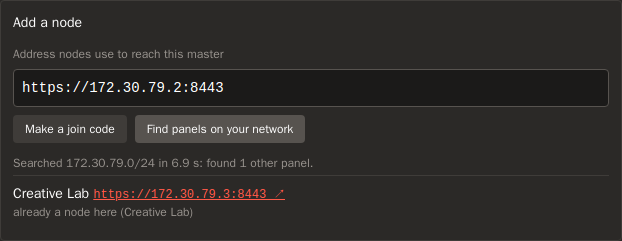

Less downtime for big worlds: moves that copy the world while the server keeps running, and finding the other RedstonePanels on your network.

<picture><source media="(prefers-color-scheme: light)" srcset="https://raw.githubusercontent.com/qrussell/redstonepanel/v1.16.13/docs/guide/images/light/cluster-precopy.png"></picture>

## New

- **Pre-copy while it runs.** In the **Move** window, tick **Pre-copy while it runs** for a big world. The server's folder is copied to the other member while players stay on; then the server stops and only what changed since, and what was deleted, is sent and applied. A world of several gigabytes is down for seconds instead of minutes, and the window says how long the server was down. Files changed while they were read are always sent again, and nothing is written through a link.
- **Find panels on your network.** On a cluster master, **🛡️ Settings → Cluster → Add a node → Find panels on your network** looks for RedstonePanels on this machine's private networks and lists each one as standalone, already a node here, or in another cluster. **Add to cluster** makes a join code and links to that panel, where you paste it as before; nothing joins without that step.

<picture><source media="(prefers-color-scheme: light)" srcset="https://raw.githubusercontent.com/qrussell/redstonepanel/v1.16.13/docs/guide/images/light/cluster-find.png"></picture>

Tested: 20 new unit tests, and an end-to-end test with several panels (48 checks) that moved a server writing to its world ten times a second with a pre-copy: it was down for 1 to 2 seconds and every world file arrived intact. Find panels found a node and a standalone panel on the same network in about 12 seconds.

## Upgrading an existing panel

A pre-copy needs **1.16.13 or later on both members** (cluster contract 5). Until a node is upgraded, the Move window says so and plain moves still work. Only master admins can search the network. Reload the panel in your browser after the upgrade.

## Installing

RedstonePanel runs on **Ubuntu 24.04, 26.04 and 26.10**, **Debian 13** and **64-bit Raspberry Pi OS** (Raspberry Pi 4 or 5), on x86-64 and ARM64. See [Supported systems](https://github.com/qrussell/redstonepanel#supported-systems). The easiest way to install it, and to get every later version with `apt upgrade`, is the signed **qrussell-repo** apt repository:

```bash
sudo apt install -y curl ca-certificates
curl -fsSL https://qrussell.github.io/qrussell-repo/deb/qrussell-repo.gpg | sudo tee /usr/share/keyrings/qrussell-repo.gpg >/dev/null
echo "deb [signed-by=/usr/share/keyrings/qrussell-repo.gpg] https://qrussell.github.io/qrussell-repo/deb ./" | sudo tee /etc/apt/sources.list.d/qrussell.list
sudo apt update
sudo apt install redstonepanel
```

Or in one line: `curl -fsSL https://raw.githubusercontent.com/qrussell/redstonepanel/main/install.sh | sudo sh`

Then open **http://&lt;server&gt;:8080/** and sign in with a Linux account in the `sudo` group.

To check the repository key before trusting it, `gpg --show-keys /usr/share/keyrings/qrussell-repo.gpg` should show the fingerprint `9994A9EB39EB3C101C949FB2012BA14E0FE3A355`.

Prefer not to add a repository? Download `redstonepanel_1.16.13_all.deb` below and run `sudo apt install ./redstonepanel_1.16.13_all.deb`. You then install each new version the same way.

The [user manual](https://github.com/qrussell/redstonepanel/blob/main/docs/guide/README.md) walks through every feature, with screenshots.

## Upgrading

If you use the qrussell-repo repository:

```bash
sudo apt update && sudo apt upgrade
```

New versions reach the repository within a few hours of their release. Otherwise, install the new .deb as above.

Running servers keep running through the upgrade.

**Full Changelog**: https://github.com/qrussell/redstonepanel/compare/v1.16.12...v1.16.13
