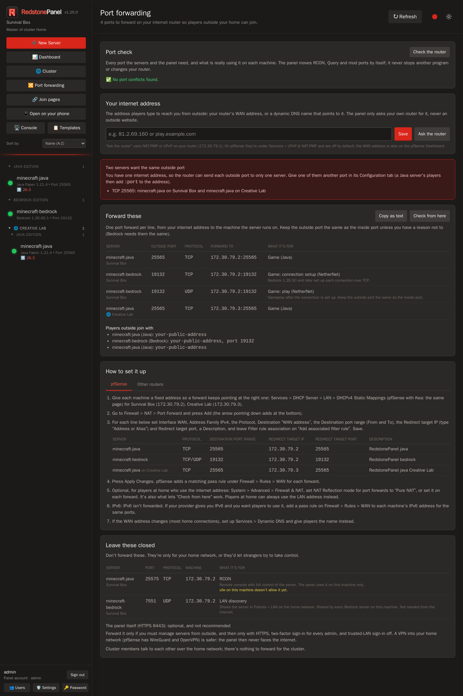

Port forwarding: a page that tells you exactly what to forward on your internet router so players outside your home can join.

<picture><source media="(prefers-color-scheme: light)" srcset="https://raw.githubusercontent.com/qrussell/redstonepanel/v1.16.14/docs/guide/images/light/port-forwarding.png"></picture>

## New

- **🔀 Port forwarding** (admins) lists one line per forward for every server on this panel and, on a cluster master, on every node: the outside port, TCP or UDP, the machine's LAN address and inside port, and what it's for. The ports come from the same rules the panel uses for the firewall on each machine, so the two never disagree, including Bedrock's NetherNet ports, Geyser and Simple Voice Chat.
- **Only what's needed.** Query is marked **only if you need it**; RCON, Bedrock's LAN discovery port (UDP 7551), Phantom and the panel itself are marked **leave closed**.
- **Clashes called out.** Two servers that want the same outside port on your one internet address are named, with how to fix it.
- **Your internet address** is typed in, or asked of your own router with NAT-PMP or UPnP; never an outside "what's my IP" website. Carrier-grade NAT and a second router in front of yours are explained.
- **Check from here** connects to your internet address and confirms the right server answers, with a note that a phone on mobile data is the real test.
- **Step-by-step for pfSense** (Firewall > NAT > Port Forward, with the exact values for each rule, static DHCP mappings and NAT reflection) and for other routers.

## Fixed

- **The phone menu shows every server.** On short phones the account buttons at the bottom of the ☰ menu covered the last servers in the list. The menu now scrolls as one page, with your account buttons after the last server.

Tested: 34 new unit tests for port forwarding and an end-to-end test with a master and a node (26 checks, including a clash and its fix, and Check from here before and after a server listens); the phone menu at 360x640, 375x667 and 390x844 in both themes.

## Upgrading an existing panel

Nothing to do. In a cluster, upgrade the nodes too so the master can list their ports with every extra (older nodes fall back to their server list). Reload the panel in your browser after the upgrade.

## Installing

RedstonePanel runs on **Ubuntu 24.04, 26.04 and 26.10**, **Debian 13** and **64-bit Raspberry Pi OS** (Raspberry Pi 4 or 5), on x86-64 and ARM64. See [Supported systems](https://github.com/qrussell/redstonepanel#supported-systems). The easiest way to install it, and to get every later version with `apt upgrade`, is the signed **qrussell-repo** apt repository:

```bash
sudo apt install -y curl ca-certificates
curl -fsSL https://qrussell.github.io/qrussell-repo/deb/qrussell-repo.gpg | sudo tee /usr/share/keyrings/qrussell-repo.gpg >/dev/null
echo "deb [signed-by=/usr/share/keyrings/qrussell-repo.gpg] https://qrussell.github.io/qrussell-repo/deb ./" | sudo tee /etc/apt/sources.list.d/qrussell.list
sudo apt update
sudo apt install redstonepanel
```

Or in one line: `curl -fsSL https://raw.githubusercontent.com/qrussell/redstonepanel/main/install.sh | sudo sh`

Then open **http://&lt;server&gt;:8080/** and sign in with a Linux account in the `sudo` group.

To check the repository key before trusting it, `gpg --show-keys /usr/share/keyrings/qrussell-repo.gpg` should show the fingerprint `9994A9EB39EB3C101C949FB2012BA14E0FE3A355`.

Prefer not to add a repository? Download `redstonepanel_1.16.14_all.deb` below and run `sudo apt install ./redstonepanel_1.16.14_all.deb`. You then install each new version the same way.

The [user manual](https://github.com/qrussell/redstonepanel/blob/main/docs/guide/README.md) walks through every feature, with screenshots.

## Upgrading

If you use the qrussell-repo repository:

```bash
sudo apt update && sudo apt upgrade
```

New versions reach the repository within a few hours of their release. Otherwise, install the new .deb as above.

Running servers keep running through the upgrade.

**Full Changelog**: https://github.com/qrussell/redstonepanel/compare/v1.16.13...v1.16.14
