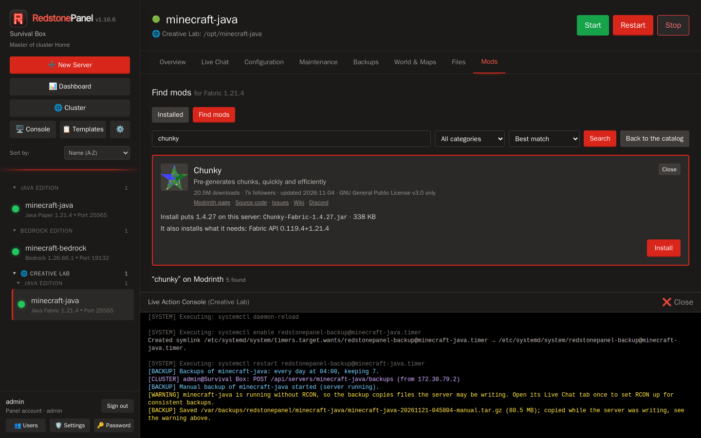

The console no longer covers the page: while it's open, everything above it can still be reached.

<picture><source media="(prefers-color-scheme: light)" srcset="https://raw.githubusercontent.com/qrussell/redstonepanel/v1.16.6/docs/guide/images/light/console.png"></picture>

## Changed

- **The console makes room instead of covering the page.** It used to slide up over the bottom 300 pixels of the window, sidebar included, so buttons near the bottom of a tab, and the sidebar's **Users**, **Settings**, **Password** and **Sign out**, were hidden until you closed it. Many actions open it by themselves, so new users often didn't know it was in the way. Now, while it's open:
  - the page beside the sidebar ends where the console starts, so you can scroll to everything on it, and pages that fill the window, such as **Live Chat**, get shorter;
  - it starts at the sidebar's edge, so the sidebar's buttons stay visible;
  - it's at most a third of the window's height (300 pixels on taller windows);
  - when a click opens it, the button you clicked is scrolled back into view above it.

## Upgrading an existing panel

Nothing to do. Reload the panel in your browser after the upgrade.

## Installing

RedstonePanel runs on **Ubuntu 24.04 and 25.04**. The easiest way to install it, and to get every later version with `apt upgrade`, is the signed **qrussell-repo** apt repository:

```bash
sudo apt install -y curl ca-certificates
curl -fsSL https://qrussell.github.io/qrussell-repo/deb/qrussell-repo.gpg | sudo tee /usr/share/keyrings/qrussell-repo.gpg >/dev/null
echo "deb [signed-by=/usr/share/keyrings/qrussell-repo.gpg] https://qrussell.github.io/qrussell-repo/deb ./" | sudo tee /etc/apt/sources.list.d/qrussell.list
sudo apt update
sudo apt install redstonepanel
```

Or in one line: `curl -fsSL https://raw.githubusercontent.com/qrussell/redstonepanel/main/install.sh | sudo sh`

Then open **http://&lt;server&gt;:8080/** and sign in with a Linux account in the `sudo` group.

To check the repository key before trusting it, `gpg --show-keys /usr/share/keyrings/qrussell-repo.gpg` should show the fingerprint `9994A9EB39EB3C101C949FB2012BA14E0FE3A355`.

Prefer not to add a repository? Download `redstonepanel_1.16.6_all.deb` below and run `sudo apt install ./redstonepanel_1.16.6_all.deb`. You then install each new version the same way.

The [user manual](https://github.com/qrussell/redstonepanel/blob/main/docs/guide/README.md) walks through every feature, with screenshots.

## Upgrading

If you use the qrussell-repo repository:

```bash
sudo apt update && sudo apt upgrade
```

New versions reach the repository within a few hours of their release. Otherwise, install the new .deb as above.

Running servers keep running through the upgrade.

**Full Changelog**: https://github.com/qrussell/redstonepanel/compare/v1.16.5...v1.16.6
