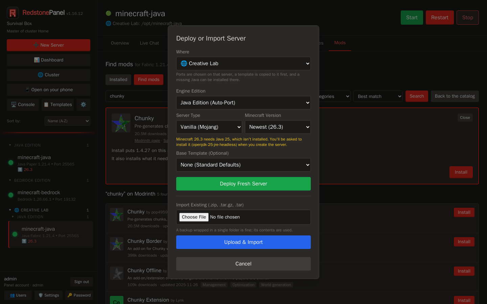

Debian, newer Ubuntu and the Raspberry Pi: RedstonePanel now installs on Ubuntu 26.04 LTS and 26.10, Debian 13 and a Raspberry Pi 4 or 5, on x86-64 and ARM64.

<picture><source media="(prefers-color-scheme: light)" srcset="https://raw.githubusercontent.com/qrussell/redstonepanel/v1.16.9/docs/guide/images/light/new-server.png"></picture>

## New

- **More systems.** The installer accepts Ubuntu 24.04, 26.04 LTS and 26.10, Debian 13 (trixie) and 64-bit Raspberry Pi OS, on x86-64 and ARM64 machines. Ubuntu 25.04 and 25.10 still install, with a note that Ubuntu no longer updates them. Debian 12 and 32-bit systems (including 32-bit Raspberry Pi OS) are refused with a message saying what to install instead.
- **Raspberry Pi 4 or 5.** Java servers run on a Pi with the 64-bit Raspberry Pi OS. New Java servers get a 1 GB heap on machines with 3 GB of memory or less. The [installation page](https://github.com/qrussell/redstonepanel/blob/main/docs/wiki/Installation.md#on-a-raspberry-pi) and the user manual cover memory per Pi, an SSD rather than a microSD card, and cooling.
- **The Java versions your system has.** The panel offers the OpenJDK versions your system packages: Debian 13 and Raspberry Pi OS have Java 21 and 25, Ubuntu 26.04 adds 26 and 26.10 adds 27 and 28. When a Minecraft version needs a Java the system doesn't package, the New Server dialog says so and the panel uses the closest newer one, or tells you when nothing is new enough.

## Changed

- **Bedrock is x86-64 only.** Mojang makes Bedrock Dedicated Server for 64-bit Intel and AMD machines only, so on an ARM64 panel or node Bedrock is greyed out, and creating, importing, restoring, updating or moving a Bedrock server there is refused. Bedrock players can join a Java server through Geyser, from the add-on catalog.

## Fixed

- **Installing Java 16 for Minecraft 1.17** failed with "isn't one the panel installs"; the panel now installs the closest Java the system has.

Tested: 12 new unit tests, the unit tests against each system's own Python packages, and install tests on Ubuntu 24.04, 26.04 and 26.10 and Debian 13 on x86-64, and on Ubuntu 26.04 and Debian 13 on ARM64, where a Paper server deploys and starts and Bedrock is refused.

## Upgrading an existing panel

Nothing to do. In a cluster, upgrade the nodes too, so the master learns which ones are ARM64 and hides Bedrock for them. Reload the panel in your browser after the upgrade.

## Installing

RedstonePanel runs on **Ubuntu 24.04, 26.04 and 26.10**, **Debian 13** and **64-bit Raspberry Pi OS** (Raspberry Pi 4 or 5), on x86-64 and ARM64. See [Supported systems](https://github.com/qrussell/redstonepanel#supported-systems). The easiest way to install it, and to get every later version with `apt upgrade`, is the signed **qrussell-repo** apt repository:

```bash
sudo apt install -y curl ca-certificates
curl -fsSL https://qrussell.github.io/qrussell-repo/deb/qrussell-repo.gpg | sudo tee /usr/share/keyrings/qrussell-repo.gpg >/dev/null
echo "deb [signed-by=/usr/share/keyrings/qrussell-repo.gpg] https://qrussell.github.io/qrussell-repo/deb ./" | sudo tee /etc/apt/sources.list.d/qrussell.list
sudo apt update
sudo apt install redstonepanel
```

Or in one line: `curl -fsSL https://raw.githubusercontent.com/qrussell/redstonepanel/main/install.sh | sudo sh`

Then open **http://&lt;server&gt;:8080/** and sign in with a Linux account in the `sudo` group.

To check the repository key before trusting it, `gpg --show-keys /usr/share/keyrings/qrussell-repo.gpg` should show the fingerprint `9994A9EB39EB3C101C949FB2012BA14E0FE3A355`.

Prefer not to add a repository? Download `redstonepanel_1.16.9_all.deb` below and run `sudo apt install ./redstonepanel_1.16.9_all.deb`. You then install each new version the same way.

The [user manual](https://github.com/qrussell/redstonepanel/blob/main/docs/guide/README.md) walks through every feature, with screenshots.

## Upgrading

If you use the qrussell-repo repository:

```bash
sudo apt update && sudo apt upgrade
```

New versions reach the repository within a few hours of their release. Otherwise, install the new .deb as above.

Running servers keep running through the upgrade.

**Full Changelog**: https://github.com/qrussell/redstonepanel/compare/v1.16.8...v1.16.9
