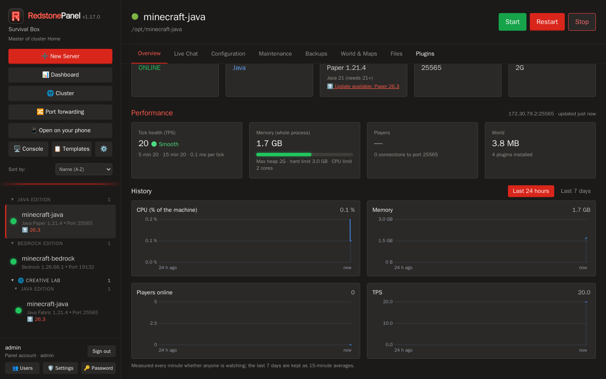
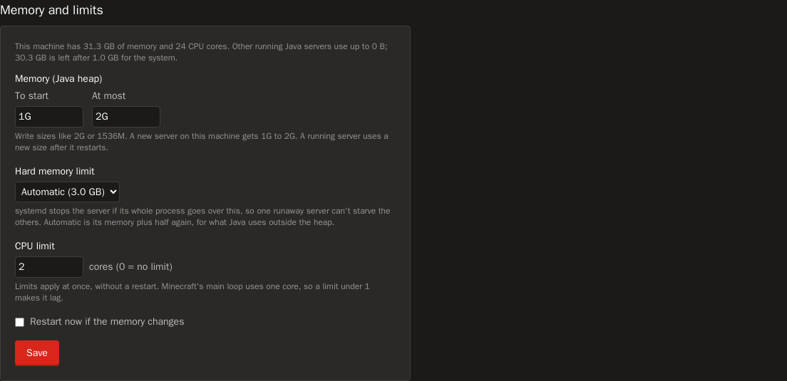

Server performance and tuning: see how well each server runs and how that changed over the day or the week, get suggestions based on what was measured, and set safe memory and CPU limits.

<picture><source media="(prefers-color-scheme: light)" srcset="https://raw.githubusercontent.com/qrussell/redstonepanel/v1.17.0/docs/guide/images/light/performance.png"></picture>

## New

- **Performance** on each server's **Overview**: tick health (TPS and MSPT, read over RCON for Paper, and for Vanilla and Fabric 1.20.3 and later), the server's memory against its Java heap and hard limit, players and connections, world size, and the number of plugins or mods. When a CPU or memory limit is slowing it down, it says **Held back by its limits**.
- **History charts.** Once a minute the panel records each server's CPU, memory, players and TPS, and the machine's CPU, memory, disk and network: 24 hours at 1-minute detail and 7 days at 15-minute detail, in small fixed-size files (no database). Server charts are on the Overview, the machine's on the dashboard, and the dashboard's server list gains a **TPS** column.
- **Memory and limits** under **Maintenance** (admins change, everyone sees): set a Java server's heap, keeping its Java, and the panel refuses a size that would leave too little memory for the system and the other running servers. Optionally set a **hard memory limit** (Off, Automatic as the heap plus half, or your own) and a **CPU limit** in cores. Limits apply straight away and survive unit rewrites.
- **Suggestions**, each shown only when measured: lower simulation distance when TPS has been low, Lithium or FerriteCore on Fabric, FastAsyncWorldEdit on Paper, a server hitting its memory limit, too much memory promised to heaps, pre-generating a big world with Chunky, no backup schedule, a big logs folder or a spinning disk. Nothing is applied for you.
- **Alerts** (off by default): **TPS under 15 for 5 minutes** and **Disk over 95 % full** webhook events, at most once an hour each.

<picture><source media="(prefers-color-scheme: light)" srcset="https://raw.githubusercontent.com/qrussell/redstonepanel/v1.17.0/docs/guide/images/light/memory-and-limits.png"></picture>

## Changed

- **Raspberry Pi and small machines:** on machines with 3 GB of memory or less, the heap check keeps 768 MB for the system, so the default 1 GB heap still fits on a 2 GB Pi. The Pi instructions now use **Memory and limits** instead of `systemctl edit`.

Tested: 38 new unit tests and 24 new install-test checks (the heap change, live memory and CPU limits, history files, and removing a server's limits on uninstall), and the screens at desktop and phone sizes in both themes.

## Upgrading an existing panel

Nothing to do: history starts recording after the upgrade, and no limits are set until you choose them. In a cluster, upgrade the nodes too so the master can show their machine history. Reload the panel in your browser after the upgrade.

## Installing

RedstonePanel runs on **Ubuntu 24.04, 26.04 and 26.10**, **Debian 13** and **64-bit Raspberry Pi OS** (Raspberry Pi 4 or 5), on x86-64 and ARM64. See [Supported systems](https://github.com/qrussell/redstonepanel#supported-systems). The easiest way to install it, and to get every later version with `apt upgrade`, is the signed **qrussell-repo** apt repository:

```bash
sudo apt install -y curl ca-certificates
curl -fsSL https://qrussell.github.io/qrussell-repo/deb/qrussell-repo.gpg | sudo tee /usr/share/keyrings/qrussell-repo.gpg >/dev/null
echo "deb [signed-by=/usr/share/keyrings/qrussell-repo.gpg] https://qrussell.github.io/qrussell-repo/deb ./" | sudo tee /etc/apt/sources.list.d/qrussell.list
sudo apt update
sudo apt install redstonepanel
```

Or in one line: `curl -fsSL https://raw.githubusercontent.com/qrussell/redstonepanel/main/install.sh | sudo sh`

Then open **http://&lt;server&gt;:8080/** and sign in with a Linux account in the `sudo` group.

To check the repository key before trusting it, `gpg --show-keys /usr/share/keyrings/qrussell-repo.gpg` should show the fingerprint `9994A9EB39EB3C101C949FB2012BA14E0FE3A355`.

Prefer not to add a repository? Download `redstonepanel_1.17.0_all.deb` below and run `sudo apt install ./redstonepanel_1.17.0_all.deb`. You then install each new version the same way.

The [user manual](https://github.com/qrussell/redstonepanel/blob/main/docs/guide/README.md) walks through every feature, with screenshots.

## Upgrading

If you use the qrussell-repo repository:

```bash
sudo apt update && sudo apt upgrade
```

New versions reach the repository within a few hours of their release. Otherwise, install the new .deb as above.

Running servers keep running through the upgrade.

**Full Changelog**: https://github.com/qrussell/redstonepanel/compare/v1.16.14...v1.17.0
