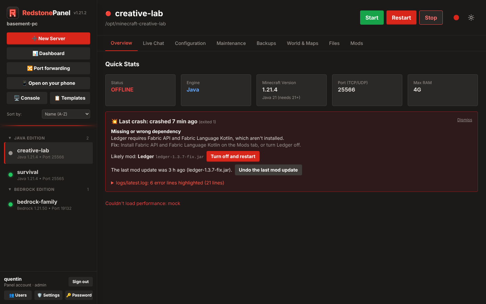

Why did it crash? When a server crashes or won't start, the panel now says why in plain words, names the mod or plugin it points at, and offers the fix.

<picture><source media="(prefers-color-scheme: light)" srcset="https://raw.githubusercontent.com/qrussell/redstonepanel/v1.17.1/docs/guide/images/light/overview-crash.png"></picture>

## New

- **Last crash** on each server's **Overview**. When a server crashes, or stops without anyone asking it to (a start that fails), the card names the cause in plain words: a missing dependency ("Ledger requires Fabric API and Fabric Language Kotlin, which aren't installed"), a mod or plugin made for another Minecraft version, the wrong Java ("needs Java 25 or newer. It was started with Java 21"), the port already in use, out of memory (including being stopped at its hard memory limit), the EULA not accepted, or a damaged `level.dat` or world chunk. It shows the newest crash report or the end of the log, with the error lines highlighted.
- **The likely mod or plugin**, from the crash report's "Suspected Mods", the log and the missing-dependency lines, matched against what's installed. Admins can **Turn off and restart** it (renamed to `.disabled`, as on the Mods tab) or **Undo the last mod update** when there was one in the last three days. Nothing changes without a click, and **Dismiss** hides the card.
- **Crash alerts say why.** The "crashed" webhook gets the cause line, and so does the "stopped" message of a start that failed. The dashboard's **Needs attention** lists the crash for a week with a link to the card.
- **The RedstonePanel logo and name** (sidebar, phone top bar, sign-in page) open the project website, [redstonepanel.cielocloud.org](https://redstonepanel.cielocloud.org), in a new tab.

## Fixed

- **A server that died straight after starting was reported as "stopped".** With the wrong Java, for example, the server exits within a second, while systemd is still finishing its start, and the crash alert said "stopped". It now says "crashed", with the reason.

Tested: real servers made to fail on purpose (vanilla 26.3 on Java 21, vanilla 1.21.4 without the EULA, with its port taken, with a damaged `level.dat` and with too little memory, and Fabric 0.20.1 with Ledger but no Fabric API), each named correctly; and a new 21-check install test in a systemd container that runs the real crash hooks, the alert, Needs attention and **Turn off and restart**.

## Upgrading an existing panel

Nothing to do. The card appears after the next crash; earlier crashes aren't analysed. In a cluster, upgrade the nodes too so their servers' crashes are explained. Reload the panel in your browser after the upgrade.

## Installing

RedstonePanel runs on **Ubuntu 24.04, 26.04 and 26.10**, **Debian 13** and **64-bit Raspberry Pi OS** (Raspberry Pi 4 or 5), on x86-64 and ARM64. See [Supported systems](https://github.com/qrussell/redstonepanel#supported-systems). The easiest way to install it, and to get every later version with `apt upgrade`, is the signed **qrussell-repo** apt repository:

```bash
sudo apt install -y curl ca-certificates
curl -fsSL https://qrussell.github.io/qrussell-repo/deb/qrussell-repo.gpg | sudo tee /usr/share/keyrings/qrussell-repo.gpg >/dev/null
echo "deb [signed-by=/usr/share/keyrings/qrussell-repo.gpg] https://qrussell.github.io/qrussell-repo/deb ./" | sudo tee /etc/apt/sources.list.d/qrussell.list
sudo apt update
sudo apt install redstonepanel
```

Or in one line: `curl -fsSL https://raw.githubusercontent.com/qrussell/redstonepanel/main/install.sh | sudo sh`

Then open **http://&lt;server&gt;:8080/** and sign in with a Linux account in the `sudo` group.

To check the repository key before trusting it, `gpg --show-keys /usr/share/keyrings/qrussell-repo.gpg` should show the fingerprint `9994A9EB39EB3C101C949FB2012BA14E0FE3A355`.

Prefer not to add a repository? Download `redstonepanel_1.17.1_all.deb` below and run `sudo apt install ./redstonepanel_1.17.1_all.deb`. You then install each new version the same way.

The [user manual](https://github.com/qrussell/redstonepanel/blob/main/docs/guide/README.md) walks through every feature, with screenshots.

## Upgrading

If you use the qrussell-repo repository:

```bash
sudo apt update && sudo apt upgrade
```

New versions reach the repository within a few hours of their release. Otherwise, install the new .deb as above.

Running servers keep running through the upgrade.

**Full Changelog**: https://github.com/qrussell/redstonepanel/compare/v1.17.0...v1.17.1
