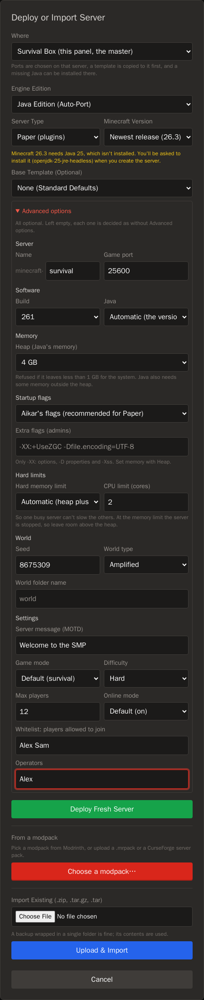
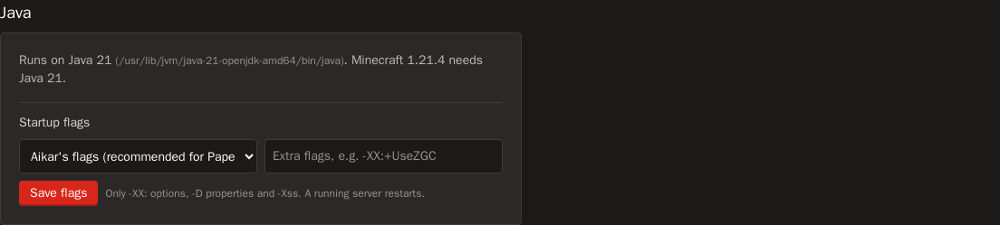

Advanced options on New server: choose what the panel otherwise decides for a new server, from the build and the Java it runs on to its memory, limits, startup flags, world and settings.

<picture><source media="(prefers-color-scheme: light)" srcset="https://raw.githubusercontent.com/qrussell/redstonepanel/v1.17.2/docs/guide/images/light/new-server-advanced.png"></picture>

## New

- **Advanced options** under **New server**, collapsed until you open it. Every field is optional; one left empty is decided as before. Everything is checked before anything is downloaded, so a taken name or port, or a heap the machine can't spare, fails straight away with nothing left behind.
- **Server:** the name (it becomes `minecraft-NAME`) and the game port.
- **Software** (Java): a specific **Paper build** or **Fabric loader** instead of the newest stable one, for a plugin or mod that needs a known one; **snapshots and pre-releases** of the current Vanilla cycle; and the installed **Java** to run on, never older than the version needs.
- **Memory and limits:** the Java **heap** (refused if it would leave under 1 GB for the system), and 1.17's **hard memory limit** (Automatic for Java: the heap plus room for Java) and **CPU limit**, in place before the first start.
- **Startup flags** (Java): **Aikar's flags**, the usual tuning for Paper, and for admins extra flags (`-XX:` options, `-D` properties and `-Xss` only). Change them later under **Maintenance → Java → Startup flags**; they stay through updates, Java changes, restores and moves.
- **World:** seed, world type (Flat, Large biomes, Amplified; Bedrock: Flat) and the world folder name, written the right way for the version.
- **Settings:** MOTD, game mode, difficulty, max players, online mode, the whitelist (Bedrock: allowlist) and Java operators. A **Base Template** is applied first, and anything chosen here wins over it.

<picture><source media="(prefers-color-scheme: light)" srcset="https://raw.githubusercontent.com/qrussell/redstonepanel/v1.17.2/docs/guide/images/light/startup-flags.png"></picture>

Tested: real servers created with Advanced options in a systemd container (Paper 26.3 with every option, including build 257 pinned, Java 25, Aikar's flags plus an extra flag, a flat world, a whitelisted operator and Automatic memory with 1.5 cores enforced by systemd; Fabric with loader 0.20.0 pinned; Vanilla 26.4-snapshot-10, whose update back to 26.3 was refused), each reaching "Done"; the install test with the refusals (an unsafe flag, a taken name or port, a heap too big, a limit under the heap), startup flags and limits; and 29 new unit tests.

## Upgrading an existing panel

Nothing to do. In a cluster, upgrade the nodes too: a node needs 1.17.2 to take Advanced options (the section says so when it doesn't). Reload the panel in your browser after the upgrade.

## Installing

RedstonePanel runs on **Ubuntu 24.04, 26.04 and 26.10**, **Debian 13** and **64-bit Raspberry Pi OS** (Raspberry Pi 4 or 5), on x86-64 and ARM64. See [Supported systems](https://github.com/qrussell/redstonepanel#supported-systems). The easiest way to install it, and to get every later version with `apt upgrade`, is the signed **qrussell-repo** apt repository:

```bash
sudo apt install -y curl ca-certificates
curl -fsSL https://qrussell.github.io/qrussell-repo/deb/qrussell-repo.gpg | sudo tee /usr/share/keyrings/qrussell-repo.gpg >/dev/null
echo "deb [signed-by=/usr/share/keyrings/qrussell-repo.gpg] https://qrussell.github.io/qrussell-repo/deb ./" | sudo tee /etc/apt/sources.list.d/qrussell.list
sudo apt update
sudo apt install redstonepanel
```

Or in one line: `curl -fsSL https://raw.githubusercontent.com/qrussell/redstonepanel/main/install.sh | sudo sh`

Then open **http://&lt;server&gt;:8080/** and sign in with a Linux account in the `sudo` group.

To check the repository key before trusting it, `gpg --show-keys /usr/share/keyrings/qrussell-repo.gpg` should show the fingerprint `9994A9EB39EB3C101C949FB2012BA14E0FE3A355`.

Prefer not to add a repository? Download `redstonepanel_1.17.2_all.deb` below and run `sudo apt install ./redstonepanel_1.17.2_all.deb`. You then install each new version the same way.

The [user manual](https://github.com/qrussell/redstonepanel/blob/main/docs/guide/README.md) walks through every feature, with screenshots.

## Upgrading

If you use the qrussell-repo repository:

```bash
sudo apt update && sudo apt upgrade
```

New versions reach the repository within a few hours of their release. Otherwise, install the new .deb as above.

Running servers keep running through the upgrade.

**Full Changelog**: https://github.com/qrussell/redstonepanel/compare/v1.17.1...v1.17.2
