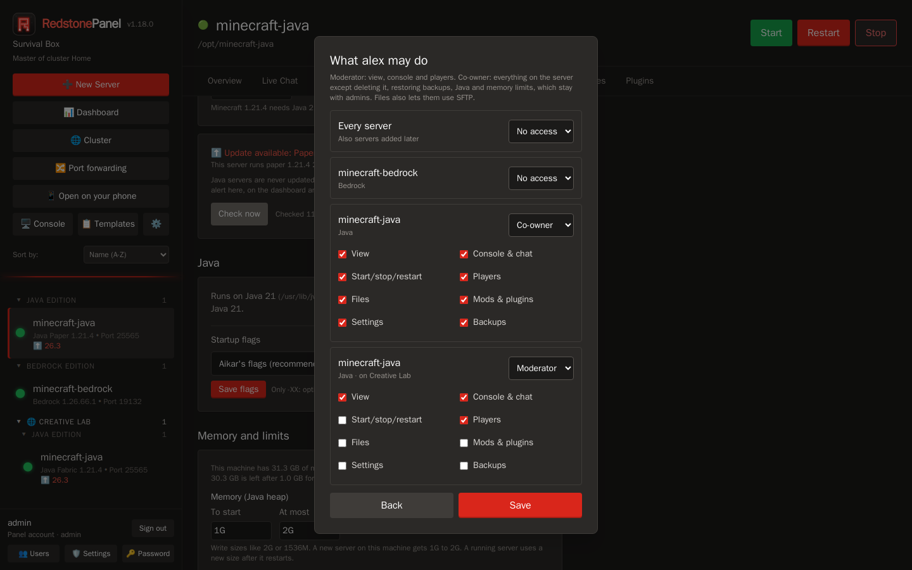
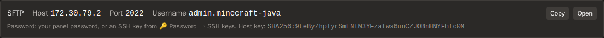
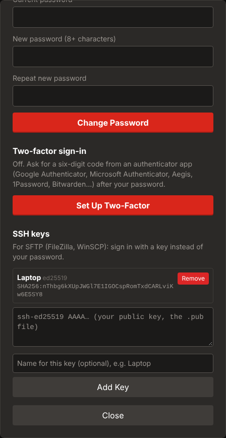

Helpers with their own access, and SFTP: choose what each user account may do on each server, and move files with FileZilla or WinSCP.

<picture><source media="(prefers-color-scheme: light)" srcset="https://raw.githubusercontent.com/qrussell/redstonepanel/v1.18.0/docs/guide/images/light/user-servers.png"></picture>

## New

- **Per-server permissions.** **👥 Users → Servers** next to a user account sets what it may do on each server: **View**, **Console & chat**, **Start/stop/restart**, **Players**, **Files**, **Mods & plugins**, **Settings** and **Backups**. Pick **Moderator** (view, console, players) or **Co-owner** (all eight), or tick boxes yourself. **Every server** covers all servers, including ones added later.
- **Users see only their servers:** the dashboard, the server list, Needs attention and the activity log leave the rest out, and tabs and buttons they can't use are hidden. With no servers they see a note to ask an admin.
- **Admins stay admins.** Creating, importing, uninstalling and restoring servers, restoring backups, editing templates, Java, memory and limits, moving servers and Panel Settings stay with admins whatever is ticked.
- **On a cluster,** the master keeps what its users may do on node servers and checks it before anything reaches the node. A moved server takes its permissions along.
- **SFTP** for FileZilla, WinSCP or any SFTP program. It is **off until you turn it on** under **🛡️ Settings → SFTP** (port 2022, which the panel opens in ufw). Each server's **Files** tab then shows the host, port and username, with **Copy** and **Open**.

<picture><source media="(prefers-color-scheme: light)" srcset="https://raw.githubusercontent.com/qrussell/redstonepanel/v1.18.0/docs/guide/images/light/sftp.png"></picture>

- **Signing in to SFTP:** the username is your account, a dot and the server (`alex.minecraft-java`), with your panel or Linux password. Each sign-in reaches that one server's folder. Users need **Files** on the server; admins reach every server. Taking the permission away ends an open session within 30 seconds.
- **SSH keys** under **🔑 Password → SSH keys** sign in without a password. Accounts with two-factor sign-in must use a key, because an SFTP program can't ask for the code.

<picture><source media="(prefers-color-scheme: light)" srcset="https://raw.githubusercontent.com/qrussell/redstonepanel/v1.18.0/docs/guide/images/light/ssh-keys.png"></picture>

- **Safe by design:** SFTP only (no shell, commands or forwarding), the file manager's checks (nothing outside the folder, symlinks never followed, files owned by `minecraft`), uploads and deletes in the activity log with who did them, and wrong passwords counted towards the sign-in page's limit.

Tested: 50 new unit tests (every API route has a permission rule; SFTP against a live server), run on Ubuntu 24.04, 26.04 and 26.10 and Debian 13 with each system's own SFTP library; and an install test on Ubuntu 24.04 with the real OpenSSH client: what each permission opens and refuses, password and key sign-in for panel and Linux accounts, uploads and downloads compared by checksum, escapes through `..` and symlinks, a refused shell, access ending when a permission is removed, the shared sign-in limit, changing the port and turning SFTP off.

## Upgrading an existing panel

- **User accounts you already have keep what users could always do** (everything except Files and Mods & plugins) on every server, so nothing changes for them until you narrow it under **Users → Servers**. User accounts you add from now on start with no servers.
- A few things users could do are now **for admins only**: importing a server, the removed-servers list and restore, editing and deleting templates, and the cluster's list of moves.
- **SFTP stays off** until you turn it on. It needs the `python3-paramiko` package, which `apt` installs with the panel as a recommended package; if it's missing, the SFTP setting says how to add it.
- In a cluster, upgrade the nodes too. Each machine serves SFTP for its own servers: for a server on a node, turn SFTP on in that node's own panel and sign in with an account of that panel.
- Reload the panel in your browser after the upgrade.

## Installing

RedstonePanel runs on **Ubuntu 24.04, 26.04 and 26.10**, **Debian 13** and **64-bit Raspberry Pi OS** (Raspberry Pi 4 or 5), on x86-64 and ARM64. See [Supported systems](https://github.com/qrussell/redstonepanel#supported-systems). The easiest way to install it, and to get every later version with `apt upgrade`, is the signed **qrussell-repo** apt repository:

```bash
sudo apt install -y curl ca-certificates
curl -fsSL https://qrussell.github.io/qrussell-repo/deb/qrussell-repo.gpg | sudo tee /usr/share/keyrings/qrussell-repo.gpg >/dev/null
echo "deb [signed-by=/usr/share/keyrings/qrussell-repo.gpg] https://qrussell.github.io/qrussell-repo/deb ./" | sudo tee /etc/apt/sources.list.d/qrussell.list
sudo apt update
sudo apt install redstonepanel
```

Or in one line: `curl -fsSL https://raw.githubusercontent.com/qrussell/redstonepanel/main/install.sh | sudo sh`

Then open **http://&lt;server&gt;:8080/** and sign in with a Linux account in the `sudo` group.

To check the repository key before trusting it, `gpg --show-keys /usr/share/keyrings/qrussell-repo.gpg` should show the fingerprint `9994A9EB39EB3C101C949FB2012BA14E0FE3A355`.

Prefer not to add a repository? Download `redstonepanel_1.18.0_all.deb` below and run `sudo apt install ./redstonepanel_1.18.0_all.deb`. You then install each new version the same way.

The [user manual](https://github.com/qrussell/redstonepanel/blob/main/docs/guide/README.md) walks through every feature, with screenshots.

## Upgrading

If you use the qrussell-repo repository:

```bash
sudo apt update && sudo apt upgrade
```

New versions reach the repository within a few hours of their release. Otherwise, install the new .deb as above.

Running servers keep running through the upgrade.

**Full Changelog**: https://github.com/qrussell/redstonepanel/compare/v1.17.2...v1.18.0
