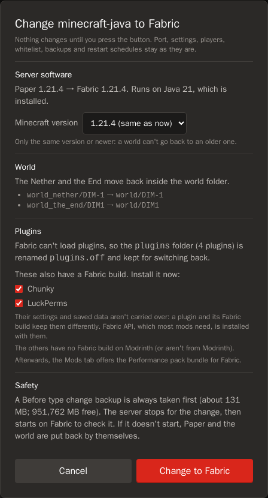
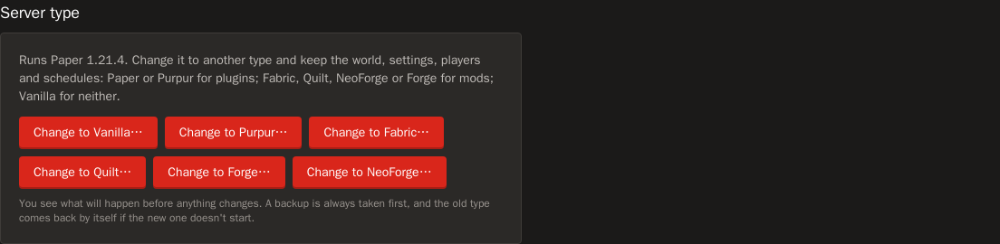

Change a server's type without making a new one: move a Java server between Vanilla, Paper and Fabric and keep its world, with a backup first and a way back.

<picture><source media="(prefers-color-scheme: light)" srcset="https://raw.githubusercontent.com/qrussell/redstonepanel/v1.19.0/docs/guide/images/light/change-type-preview.png"></picture>

## New

- **Server type on the Maintenance tab.** Pick **Vanilla**, **Paper** or **Fabric** for a Java server (and a newer Minecraft version at the same time, if you like). The world, port, settings, players, whitelist and schedules stay.
- **A preview first.** It lists what will be downloaded, which folders move, what happens to each mod or plugin, and the Java the new type needs. Nothing changes until you confirm.
- **Always a backup,** kept as **Before type change**. If the new type doesn't finish starting, the panel puts the old one back by itself and tells you why it failed.
- **Undo type change** returns to the old software and the world from before the change.

<picture><source media="(prefers-color-scheme: light)" srcset="https://raw.githubusercontent.com/qrussell/redstonepanel/v1.19.0/docs/guide/images/light/server-type.png"></picture>

- **The world follows the type.** Paper keeps the Nether and the End in their own folders (before Minecraft 26.1) and some world settings with each dimension (26.1 and later). The panel moves them when you leave or join Paper, so all three dimensions arrive intact.
- **Mods and plugins are set aside, not deleted** (`mods.off`, `plugins.off`), and come back if you return. Where the same Modrinth project has a build for the new type, the preview offers it; Fabric API is added when a Fabric mod needs it.
- **A clear warning before losing things.** Leaving Fabric with mods that add blocks, items or dimensions lists them and asks for the server's name, because those things vanish from the world.
- **Roll back the last update.** **Update Server** for Java now takes a backup first (you can untick it), and **Roll back the last update** returns to the server software and the world from before it.
- **Backups show what made them.** The new **Made by** column gives the type and version, and a world from a newer Minecraft version is not restored onto an older server, which would damage it.
- **Who can do it:** changing the type, undoing it and rolling back an update are for admins. Users with **View** see the type.

Tested: 35 new unit tests, and a test with real servers that takes one world Vanilla → Paper → Vanilla → Fabric → Paper, with a block placed in the Overworld, the Nether and the End checked after every step, plus undo, a failed start that rolls back by itself, an update and its rollback, and the refused restore. It ran on Minecraft 1.21.11 and 26.1.2. The 26.1.2 run found that Paper stores four world settings files differently there, which the panel now handles.

## Upgrading an existing panel

- Nothing to do. Bedrock servers are not affected; they have one type.
- Backups made before this version have no **Made by** entry and restore as before.
- In a cluster, upgrade the nodes too, so their servers get the **Server type** card.
- Reload the panel in your browser after the upgrade.

## Installing

RedstonePanel runs on **Ubuntu 24.04, 26.04 and 26.10**, **Debian 13** and **64-bit Raspberry Pi OS** (Raspberry Pi 4 or 5), on x86-64 and ARM64. See [Supported systems](https://github.com/qrussell/redstonepanel#supported-systems). The easiest way to install it, and to get every later version with `apt upgrade`, is the signed **qrussell-repo** apt repository:

```bash
sudo apt install -y curl ca-certificates
curl -fsSL https://qrussell.github.io/qrussell-repo/deb/qrussell-repo.gpg | sudo tee /usr/share/keyrings/qrussell-repo.gpg >/dev/null
echo "deb [signed-by=/usr/share/keyrings/qrussell-repo.gpg] https://qrussell.github.io/qrussell-repo/deb ./" | sudo tee /etc/apt/sources.list.d/qrussell.list
sudo apt update
sudo apt install redstonepanel
```

Or in one line: `curl -fsSL https://raw.githubusercontent.com/qrussell/redstonepanel/main/install.sh | sudo sh`

Then open **http://&lt;server&gt;:8080/** and sign in with a Linux account in the `sudo` group.

To check the repository key before trusting it, `gpg --show-keys /usr/share/keyrings/qrussell-repo.gpg` should show the fingerprint `9994A9EB39EB3C101C949FB2012BA14E0FE3A355`.

Prefer not to add a repository? Download `redstonepanel_1.19.0_all.deb` below and run `sudo apt install ./redstonepanel_1.19.0_all.deb`. You then install each new version the same way.

The [user manual](https://github.com/qrussell/redstonepanel/blob/main/docs/guide/README.md) walks through every feature, with screenshots.

## Upgrading

If you use the qrussell-repo repository:

```bash
sudo apt update && sudo apt upgrade
```

New versions reach the repository within a few hours of their release. Otherwise, install the new .deb as above.

Running servers keep running through the upgrade.

**Full Changelog**: https://github.com/qrussell/redstonepanel/compare/v1.18.0...v1.19.0
