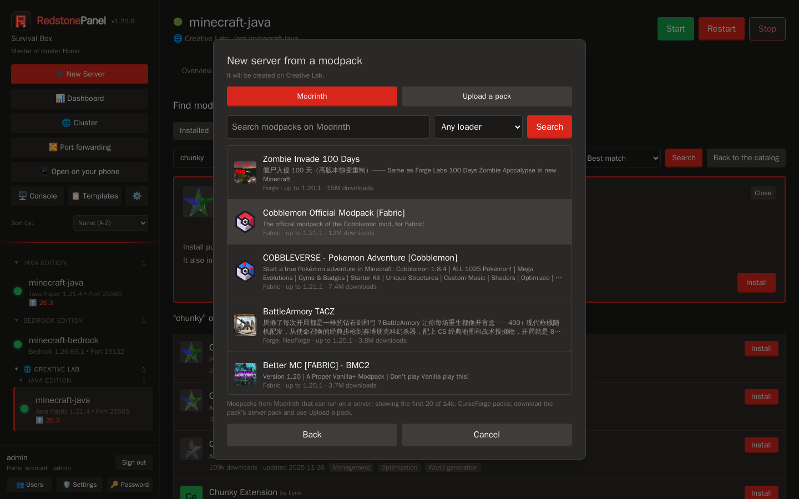
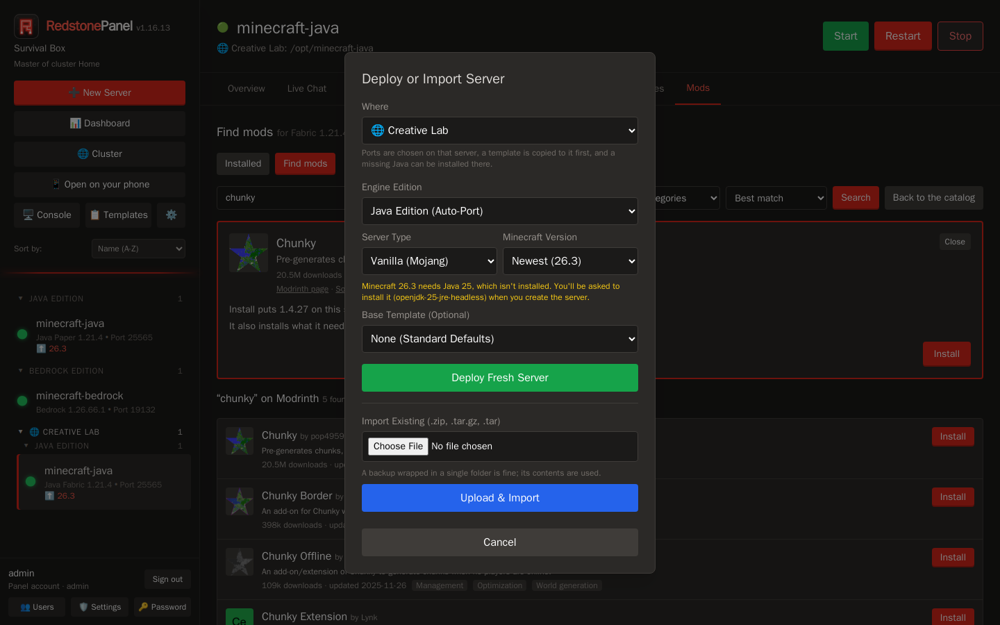
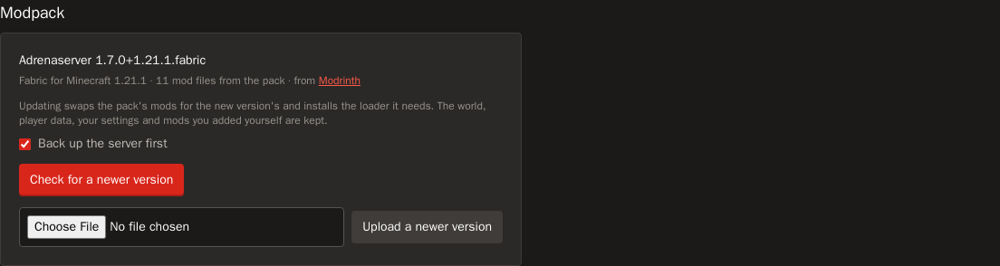

Run the servers people actually ask for: Purpur, Quilt, NeoForge and Forge, and whole modpacks from Modrinth or a CurseForge server pack.

<picture><source media="(prefers-color-scheme: light)" srcset="https://raw.githubusercontent.com/qrussell/redstonepanel/v1.20.0/docs/guide/images/light/modpack-search.png"></picture>

## New

- **Four more Java server types.** **Purpur** (plugins, Paper with more to tune), **Quilt**, **NeoForge** and **Forge** (mods) join Vanilla, Paper and Fabric on **New server**. Forge goes back to Minecraft 1.12.2, Quilt to 1.14.4, NeoForge to 1.20.2.
- **The right Java for each,** installed for you as before. Forge for Minecraft 1.12.2 runs on Java 8, and 1.13 to 1.16.5 on Java 11 at most, because those versions don't start on a newer one.
- **A specific build if you need one.** **Advanced options → Build** lists Purpur builds and Quilt, NeoForge and Forge versions. Forge picks its recommended build otherwise, NeoForge its newest stable one.

<picture><source media="(prefers-color-scheme: light)" srcset="https://raw.githubusercontent.com/qrussell/redstonepanel/v1.20.0/docs/guide/images/light/new-server.png"></picture>

- **New server → From a modpack** (admins). Search Modrinth's modpacks and pick a version, or upload a `.mrpack`, or upload a CurseForge **server pack** zip (on the pack's CurseForge page: **Files**, then **Server Pack** under *Additional files*).
- **The panel does the install.** It works out the server type and Minecraft version the pack needs, installs that itself, downloads only the server-side mods (each checked against the pack's checksum, and only from the hosts the format allows) and copies the pack's config in. Nothing from a pack is ever run: start scripts, installers and server jars in an uploaded pack are left out.
- **Modpack on the Maintenance tab.** **Check for a newer version** asks Modrinth, or upload a newer pack. A backup is taken first. The world, your settings, the whitelist and the mods you added yourself are kept; mods the new pack version dropped are removed.

<picture><source media="(prefers-color-scheme: light)" srcset="https://raw.githubusercontent.com/qrussell/redstonepanel/v1.20.0/docs/guide/images/light/modpack-card.png"></picture>

- **Mods and the catalog follow the type.** **Find mods** lists Forge mods on a Forge server, NeoForge mods on NeoForge, and Quilt and Fabric mods on Quilt; Purpur gets Paper's plugins from Modrinth and Hangar. A jar for another loader is refused with the reason. There are bundles for each type.
- **Server type works with the new types.** Paper ↔ Purpur and Fabric ↔ Quilt keep plugins and mods where they are. A server made from a modpack keeps the type its pack needs.
- **Update alerts** for Purpur, Quilt, NeoForge and Forge builds. A modpack server gets none, because its pack decides.

No CurseForge browser in the panel: you download the server pack yourself, so no API key is needed and authors' download rules are respected.

## Fixed

- **Java 8 was never seen as installed** on Ubuntu, because its package is laid out differently. Old Minecraft versions that need it now find it.

Tested: 50 new unit tests, and a test with real downloads that starts Purpur 1.21.4, Quilt 1.21.4, NeoForge 1.21.1, Forge 1.20.1 and Forge 1.12.2, updates NeoForge and rolls it back, installs a Modrinth modpack and updates it across Minecraft versions with the world kept, starts servers from an uploaded `.mrpack` and an uploaded Forge server pack, changes Paper → Purpur and Fabric → Quilt and back, and checks that a wrong checksum, a download from another host and a CurseForge client zip are refused with nothing left behind (119 checks). Not tested on ARM64 yet.

## Upgrading an existing panel

- Nothing to do for existing servers.
- In a cluster, upgrade the nodes too: a node needs 1.20 before the master offers the new types and modpacks there.
- Modpacks often want 6 GB of memory or more; on a Raspberry Pi pick light ones.
- Reload the panel in your browser after the upgrade.

## Installing

RedstonePanel runs on **Ubuntu 24.04, 26.04 and 26.10**, **Debian 13** and **64-bit Raspberry Pi OS** (Raspberry Pi 4 or 5), on x86-64 and ARM64. See [Supported systems](https://github.com/qrussell/redstonepanel#supported-systems). The easiest way to install it, and to get every later version with `apt upgrade`, is the signed **qrussell-repo** apt repository:

```bash
sudo apt install -y curl ca-certificates
curl -fsSL https://qrussell.github.io/qrussell-repo/deb/qrussell-repo.gpg | sudo tee /usr/share/keyrings/qrussell-repo.gpg >/dev/null
echo "deb [signed-by=/usr/share/keyrings/qrussell-repo.gpg] https://qrussell.github.io/qrussell-repo/deb ./" | sudo tee /etc/apt/sources.list.d/qrussell.list
sudo apt update
sudo apt install redstonepanel
```

Or in one line: `curl -fsSL https://raw.githubusercontent.com/qrussell/redstonepanel/main/install.sh | sudo sh`

Then open **http://&lt;server&gt;:8080/** and sign in with a Linux account in the `sudo` group.

To check the repository key before trusting it, `gpg --show-keys /usr/share/keyrings/qrussell-repo.gpg` should show the fingerprint `9994A9EB39EB3C101C949FB2012BA14E0FE3A355`.

Prefer not to add a repository? Download `redstonepanel_1.20.0_all.deb` below and run `sudo apt install ./redstonepanel_1.20.0_all.deb`. You then install each new version the same way.

The [user manual](https://github.com/qrussell/redstonepanel/blob/main/docs/guide/README.md) walks through every feature, with screenshots.

## Upgrading

If you use the qrussell-repo repository:

```bash
sudo apt update && sudo apt upgrade
```

New versions reach the repository within a few hours of their release. Otherwise, install the new .deb as above.

Running servers keep running through the upgrade.

**Full Changelog**: https://github.com/qrussell/redstonepanel/compare/v1.19.0...v1.20.0
