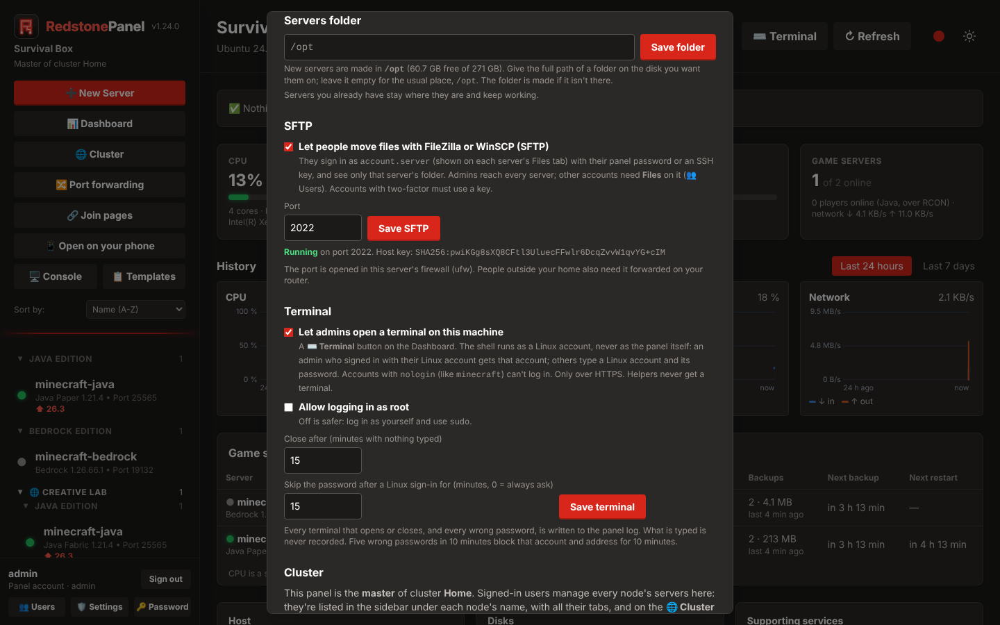

Choose the disk and folder your servers are kept in.

## New

- **A servers folder you choose.** Servers have always gone in `/opt`, on the system disk. If your room is on a second drive or another partition, open **Panel Settings → Servers folder**, type the full path of a folder there, for example `/srv/minecraft` or `/mnt/disk2/minecraft`, and choose **Save folder**. The panel makes the folder and shows how much space is free on that disk. Leave the box empty for the usual place.

  

- **New servers go there.** That covers servers you create, import from a backup file, restore from backup storage, install from a modpack, and servers moved in from another cluster member.
- **Servers you already have stay where they are** and keep working. The panel remembers every folder it has used, so names and ports stay unique across them, and a server you removed while keeping its world is still found under **Removed servers**.
- **A clear no when a folder won't work.** System folders, the top folder of a disk such as `/mnt` or `/home`, names with spaces, a disk mounted read-only or `noexec`, and a folder the `minecraft` account can't get into are refused, with the reason and what to do about it. The path also can't contain the words "java" or "bedrock".
- **In a cluster, each machine has its own servers folder**, set in that machine's own panel.

Not in this release: moving a server you already have to the new folder, and choosing where backups are kept.

Tested: 15 new unit tests, and the install test on Ubuntu 24.04, 26.04 and 26.10 and Debian 13, on x86-64 and ARM64, with 27 new checks: a second folder, an import into it under a name `/opt` doesn't use, the file manager and a backup there, uninstalling and finding the server again, and going back to `/opt`.

## Upgrading an existing panel

- Nothing to do. Your servers stay in `/opt` until you choose another folder.

## Installing

RedstonePanel runs on **Ubuntu 24.04, 26.04 and 26.10**, **Debian 13** and **64-bit Raspberry Pi OS** (Raspberry Pi 4 or 5), on x86-64 and ARM64. See [Supported systems](https://github.com/qrussell/redstonepanel#supported-systems). The easiest way to install it, and to get every later version with `apt upgrade`, is the signed **qrussell-repo** apt repository:

```bash
sudo apt install -y curl ca-certificates
curl -fsSL https://qrussell.github.io/qrussell-repo/deb/qrussell-repo.gpg | sudo tee /usr/share/keyrings/qrussell-repo.gpg >/dev/null
echo "deb [signed-by=/usr/share/keyrings/qrussell-repo.gpg] https://qrussell.github.io/qrussell-repo/deb ./" | sudo tee /etc/apt/sources.list.d/qrussell.list
sudo apt update
sudo apt install redstonepanel
```

Or in one line: `curl -fsSL https://raw.githubusercontent.com/qrussell/redstonepanel/main/install.sh | sudo sh`

Then open **http://&lt;server&gt;:8080/** and sign in with a Linux account in the `sudo` group.

To check the repository key before trusting it, `gpg --show-keys /usr/share/keyrings/qrussell-repo.gpg` should show the fingerprint `9994A9EB39EB3C101C949FB2012BA14E0FE3A355`.

Prefer not to add a repository? Download `redstonepanel_1.21.1_all.deb` below and run `sudo apt install ./redstonepanel_1.21.1_all.deb`. You then install each new version the same way.

The [user manual](https://github.com/qrussell/redstonepanel/blob/main/docs/guide/README.md) walks through every feature, with screenshots.

## Upgrading

If you use the qrussell-repo repository:

```bash
sudo apt update && sudo apt upgrade
```

New versions reach the repository within a few hours of their release. Otherwise, install the new .deb as above.

Running servers keep running through the upgrade.

**Full Changelog**: https://github.com/qrussell/redstonepanel/compare/v1.21.0...v1.21.1
