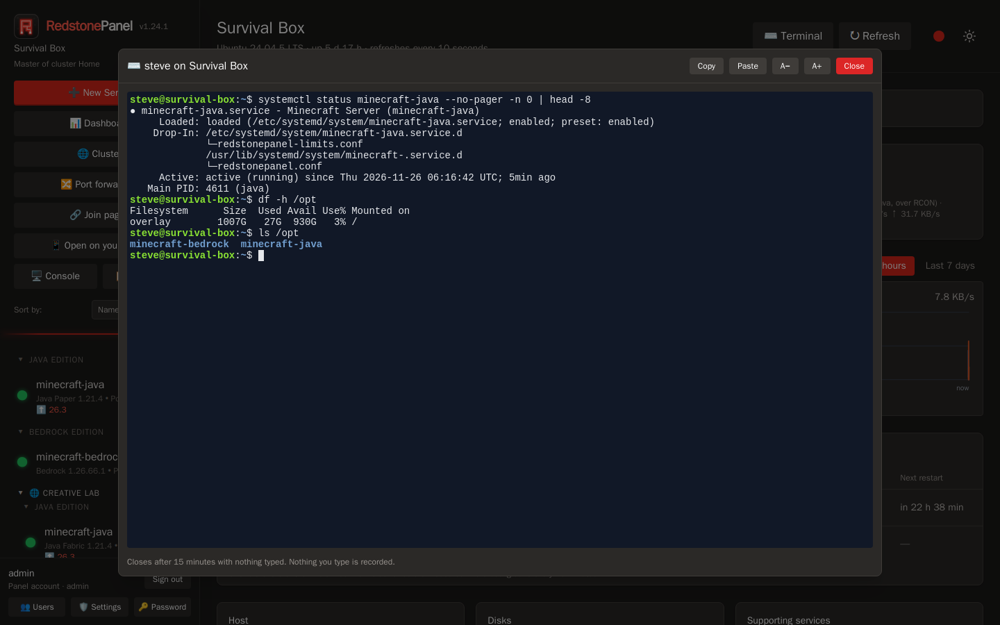
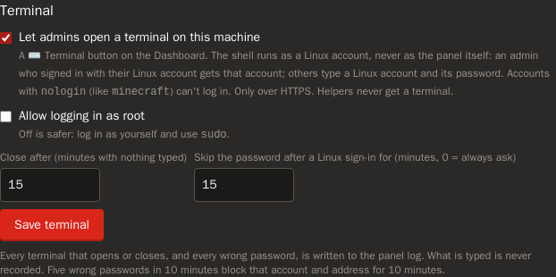

A terminal in the panel: admins can open a shell on the machine from the browser, on a phone too, as a Linux account and never as the panel.

## New

- **⌨️ Terminal.** A **⌨️ Terminal** button at the top of the Dashboard, and on each machine of the Cluster page, opens a full terminal on that machine in your browser: colours, `htop`, `nano`, `sudo`. On a phone it adds a row of keys a phone keyboard doesn't have (Esc, Tab, Ctrl and the arrows), and **A−**/**A+** change the text size.

  

- **Always a Linux account, never the panel.** The panel runs as root, but the terminal never does. If you signed in to the panel **with your Linux account**, the terminal opens as that account, straight away for 15 minutes after signing in and with its password after that. If you signed in with a **panel account**, the terminal shows a `login:` prompt: type a Linux account on that machine and its password, as you would over SSH. A panel account named like a Linux account is not that account. `root` can't log in unless you allow it; accounts that can't log in at all, such as `minecraft`, can't log in here either.

- **For admins, on Linux, when you turn it on.** User accounts (helpers) never get a terminal, and neither do visitors let in by trusted networks. It is **off** until an admin turns it on under **🛡️ Settings → Terminal**, and it works only over HTTPS (or from the machine itself), so what you type can't be read on your network. The button doesn't appear on Windows.

  

- **Checked and logged.** Passwords are checked by the system (PAM), with the panel's two-factor code after them when two-factor sign-in is on. Five wrong passwords in 10 minutes block that account and that address for 10 minutes. Every terminal that opens or closes, and every wrong password, is in the activity log, and the login is in the system's own log; what you type is never recorded.

- **Closes on its own.** After 15 minutes with nothing typed (with a minute's warning; **Close after** changes it), after 12 hours, when you sign out and when the terminal is turned off. Each admin can have 3 open and a machine 10; **Open now** in Settings lists them with an **End** button.

- **Clusters.** The master can open a terminal on a node only when that node's own admin ticks **Allow a terminal from the cluster master** in the node's settings. You log in with an account of the node, and the node checks the password.

- **Command line.** `sudo redstonepanel terminal off` turns it off from SSH in an emergency (`on` turns it back on).

See [Terminal](https://github.com/qrussell/redstonepanel/blob/main/docs/guide/README.md#terminal) in the manual.

## Fixed

- **Signing out ends that sign-in everywhere.** Signing out now also stops that sign-in's cookie opening terminals, and closes the terminals it opened.

Tested: in two systemd containers on Ubuntu 24.04 (a master and a node), with a scripted browser over a real websocket: the button only for admins with the terminal on, the `login:` prompt for a panel account, a Linux account opening straight in and asking for its password once the sign-in is older, wrong passwords and the block, root and `minecraft` refused, `sudo` working, the idle warning and close, sign-out closing the terminal, the per-admin limit, a node's terminal through the master only after the node allows it, and no websocket on the join port (46 checks). In Chromium at desktop and phone sizes. The unit tests pass.

## Upgrading an existing panel

- **Nothing changes until you turn it on.** The terminal is off after upgrading. To use it, turn on HTTPS (Panel Settings → Connection) and then **Settings → Terminal**.
- The package now needs `python3-websockets`, from Ubuntu's or Debian's own archive. `apt upgrade` installs it; if you install the .deb by hand, use `sudo apt install ./redstonepanel_1.21.10_all.deb` so apt fetches it.
- On a cluster, upgrade the master and its nodes; a node's terminal works from the master once both run 1.21.10.

## Installing

RedstonePanel runs on **Ubuntu 24.04, 26.04 and 26.10**, **Debian 13** and **64-bit Raspberry Pi OS** (Raspberry Pi 4 or 5), on x86-64 and ARM64. See [Supported systems](https://github.com/qrussell/redstonepanel#supported-systems). The easiest way to install it, and to get every later version with `apt upgrade`, is the signed **qrussell-repo** apt repository:

```bash
sudo apt install -y curl ca-certificates
curl -fsSL https://qrussell.github.io/qrussell-repo/deb/qrussell-repo.gpg | sudo tee /usr/share/keyrings/qrussell-repo.gpg >/dev/null
echo "deb [signed-by=/usr/share/keyrings/qrussell-repo.gpg] https://qrussell.github.io/qrussell-repo/deb ./" | sudo tee /etc/apt/sources.list.d/qrussell.list
sudo apt update
sudo apt install redstonepanel
```

Or in one line: `curl -fsSL https://raw.githubusercontent.com/qrussell/redstonepanel/main/install.sh | sudo sh`

Then open **http://&lt;server&gt;:8080/** and sign in with a Linux account in the `sudo` group.

To check the repository key before trusting it, `gpg --show-keys /usr/share/keyrings/qrussell-repo.gpg` should show the fingerprint `9994A9EB39EB3C101C949FB2012BA14E0FE3A355`.

Prefer not to add a repository? Download `redstonepanel_1.21.10_all.deb` below and run `sudo apt install ./redstonepanel_1.21.10_all.deb`. You then install each new version the same way.

The [user manual](https://github.com/qrussell/redstonepanel/blob/main/docs/guide/README.md) walks through every feature, with screenshots.

## Upgrading

If you use the qrussell-repo repository:

```bash
sudo apt update && sudo apt upgrade
```

New versions reach the repository within a few hours of their release. Otherwise, install the new .deb as above.

Running servers keep running through the upgrade.

**Full Changelog**: https://github.com/qrussell/redstonepanel/compare/v1.21.9...v1.21.10
