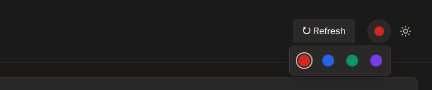

Light and dark mode is one click, in the top right corner.

## New

- **A sun/moon switch in the top right corner.** Click it to change between light and dark mode. It is on every page and on the sign-in page. On a phone it sits at the right end of the top bar.

  

- **The accent color is a colored dot beside it.** Click the dot and pick **Redstone Red**, Diamond Blue, Emerald Green or Amethyst Purple. It applies straight away.

  

- **The ⚙️ button in the sidebar is gone.** It opened these choices under the title "Panel Settings" and was easy to mistake for the real **🛡️ Settings** button at the bottom of the sidebar.

Your mode and color are still saved in your browser, and the ones you chose before carry over.

Tested: in Chromium at desktop (1280 x 800) and phone (390 x 844) size: the switch and the color choices work and are remembered, the choices close on a pick, on Esc and on a click elsewhere, nothing scrolls sideways, and the phone buttons are 44 px. The 819 unit tests pass.

## Upgrading an existing panel

- Nothing to do.

## Installing

RedstonePanel runs on **Ubuntu 24.04, 26.04 and 26.10**, **Debian 13** and **64-bit Raspberry Pi OS** (Raspberry Pi 4 or 5), on x86-64 and ARM64. See [Supported systems](https://github.com/qrussell/redstonepanel#supported-systems). The easiest way to install it, and to get every later version with `apt upgrade`, is the signed **qrussell-repo** apt repository:

```bash
sudo apt install -y curl ca-certificates
curl -fsSL https://qrussell.github.io/qrussell-repo/deb/qrussell-repo.gpg | sudo tee /usr/share/keyrings/qrussell-repo.gpg >/dev/null
echo "deb [signed-by=/usr/share/keyrings/qrussell-repo.gpg] https://qrussell.github.io/qrussell-repo/deb ./" | sudo tee /etc/apt/sources.list.d/qrussell.list
sudo apt update
sudo apt install redstonepanel
```

Or in one line: `curl -fsSL https://raw.githubusercontent.com/qrussell/redstonepanel/main/install.sh | sudo sh`

Then open **http://&lt;server&gt;:8080/** and sign in with a Linux account in the `sudo` group.

To check the repository key before trusting it, `gpg --show-keys /usr/share/keyrings/qrussell-repo.gpg` should show the fingerprint `9994A9EB39EB3C101C949FB2012BA14E0FE3A355`.

Prefer not to add a repository? Download `redstonepanel_1.21.2_all.deb` below and run `sudo apt install ./redstonepanel_1.21.2_all.deb`. You then install each new version the same way.

The [user manual](https://github.com/qrussell/redstonepanel/blob/main/docs/guide/README.md) walks through every feature, with screenshots.

## Upgrading

If you use the qrussell-repo repository:

```bash
sudo apt update && sudo apt upgrade
```

New versions reach the repository within a few hours of their release. Otherwise, install the new .deb as above.

Running servers keep running through the upgrade.

**Full Changelog**: https://github.com/qrussell/redstonepanel/compare/v1.21.1...v1.21.2
