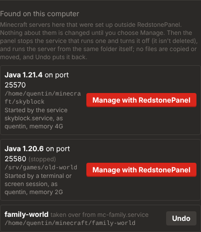

The panel finds Minecraft servers you set up yourself and can take them over, in place.

## New

- **Found on this computer.** If the machine already runs a Minecraft server that RedstonePanel didn't make, started by your own systemd service, a script or a `screen` session, **New server** now lists it with its folder, port, version and what started it. Java and Bedrock servers are found. Looking changes nothing. Admins only.

  

- **Manage with RedstonePanel** hands a server over. The service that ran it is stopped and turned off, never deleted. The panel then runs the server from the **same folder** under a service of its own, with the memory it had. No file is copied or moved; the folder is given to the `minecraft` account and a jar with another name is renamed `server.jar`. Players are disconnected for the moment it takes to restart. If the server doesn't start under the panel, everything is put back by itself and you are told why.

- **Undo** puts a handed-over server back: the panel's service is removed, the folder goes back to its owner, the jar gets its name back and the old service is turned on and started again. The world is never touched.

- A server started from a terminal or `screen` has no service the panel could stop safely. Stop it yourself (type `stop` in its console); it stays listed, as stopped, for an hour so you can hand it over.

See [A server you set up yourself, outside the panel](https://github.com/qrussell/redstonepanel/blob/main/docs/guide/README.md#4-create-or-import-a-server) in the manual.

## Fixed

- **A new server no longer opens with an earlier server's Last crash.** The crash record is kept by name, so a new server given the name of one you had removed showed the old server's crash card. Removing a server for good now drops its record, and a new server starts clean.

Tested: on Ubuntu 24.04 in a systemd container with real servers, 43 checks: servers run by a foreign systemd service, by a script and from a terminal are listed; handing over keeps every file, the port and the memory; a server that can't start is put back; Undo restores the service, the owner and the jar name. The 838 unit tests pass. The picture above was made with sample data.

## Upgrading an existing panel

- Nothing to do. Nothing is taken over unless you click **Manage with RedstonePanel**.

## Installing

RedstonePanel runs on **Ubuntu 24.04, 26.04 and 26.10**, **Debian 13** and **64-bit Raspberry Pi OS** (Raspberry Pi 4 or 5), on x86-64 and ARM64. See [Supported systems](https://github.com/qrussell/redstonepanel#supported-systems). The easiest way to install it, and to get every later version with `apt upgrade`, is the signed **qrussell-repo** apt repository:

```bash
sudo apt install -y curl ca-certificates
curl -fsSL https://qrussell.github.io/qrussell-repo/deb/qrussell-repo.gpg | sudo tee /usr/share/keyrings/qrussell-repo.gpg >/dev/null
echo "deb [signed-by=/usr/share/keyrings/qrussell-repo.gpg] https://qrussell.github.io/qrussell-repo/deb ./" | sudo tee /etc/apt/sources.list.d/qrussell.list
sudo apt update
sudo apt install redstonepanel
```

Or in one line: `curl -fsSL https://raw.githubusercontent.com/qrussell/redstonepanel/main/install.sh | sudo sh`

Then open **http://&lt;server&gt;:8080/** and sign in with a Linux account in the `sudo` group.

To check the repository key before trusting it, `gpg --show-keys /usr/share/keyrings/qrussell-repo.gpg` should show the fingerprint `9994A9EB39EB3C101C949FB2012BA14E0FE3A355`.

Prefer not to add a repository? Download `redstonepanel_1.21.3_all.deb` below and run `sudo apt install ./redstonepanel_1.21.3_all.deb`. You then install each new version the same way.

The [user manual](https://github.com/qrussell/redstonepanel/blob/main/docs/guide/README.md) walks through every feature, with screenshots.

## Upgrading

If you use the qrussell-repo repository:

```bash
sudo apt update && sudo apt upgrade
```

New versions reach the repository within a few hours of their release. Otherwise, install the new .deb as above.

Running servers keep running through the upgrade.

**Full Changelog**: https://github.com/qrussell/redstonepanel/compare/v1.21.2...v1.21.3
