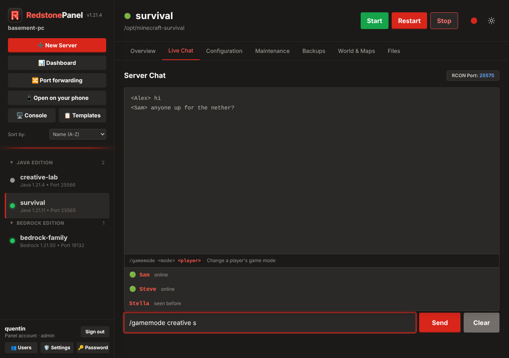
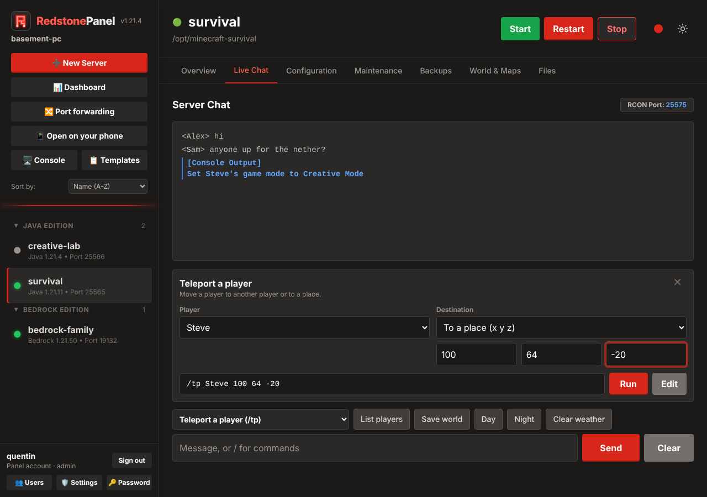
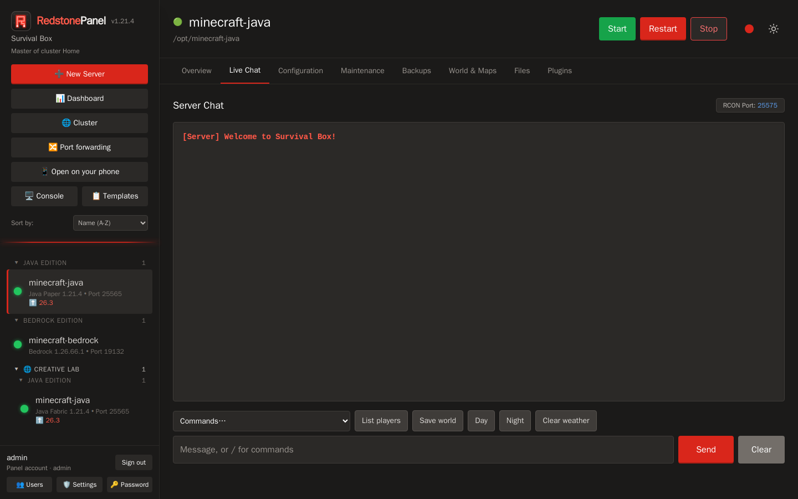

Live Chat helps you write commands: suggestions as you type, a form that builds the command, and one-click buttons.

## New

- **Suggestions as you type, like the game.** In **Live Chat**, type `/` and a list opens above the box with the commands that match and what each does. After the command, a line shows what it takes, with the part you are on highlighted, and the list changes to what fits there: the players online now, players seen before, `@a` for everyone, or the fixed choices such as `survival`, `creative`, `clear`, `rain`. **Tab** or a click fills one in, the arrow keys move through the list, **Esc** closes it and **Enter** sends as before. In a plain message, type two letters of an online player's name and press **Tab** to finish it.

  

- **A Commands list that builds the command for you.** Pick a command from **Commands…** above the message box, grouped under Players, World, Messages and Server. A form asks only for what that command needs: a player from a list, a choice, three numbers for a place, a reason. The exact command is shown before you press **Run**, and **Edit** puts it in the message box to change by hand. Stopping the server, killing a player and emptying an inventory ask first.

  

- **One-click buttons** for commands that need nothing filled in: **List players**, **Save world**, **Day**, **Night** and **Clear weather**.

  

- **The server's own commands.** A running Vanilla, Fabric, Quilt, Forge or NeoForge server tells the panel which commands and game rules it has, so commands added by mods are suggested too, and game rules are offered as that Minecraft version names them (they were renamed in 1.21.11). The panel only asks; it sends `list`, `help` and `help gamerule`.

- **Java and Bedrock each get their own commands**, about 35 everyday ones per edition: a Java server has `/whitelist` and `/ban`, a Bedrock server `/allowlist`. A Bedrock gamertag with a space is put in quotes for you. Anything not in the list can still be typed in full.

- It works on a phone, and it is for anyone with **Console & chat** on the server, the same permission as the chat itself.

See [Live Chat](https://github.com/qrussell/redstonepanel/blob/main/docs/guide/README.md#6-live-chat) in the manual.

Good to know:

- Paper and Purpur don't tell the panel their commands, so commands added by plugins aren't suggested. They can still be typed.
- Bedrock servers send no reply back to the panel, so **List players** and **Save world** are offered on Java servers only, and who is online on a Bedrock server comes from its log, up to 30 seconds behind.
- In a cluster, a node still on an older version gives no player names until it is updated; the rest works.

Tested: every Java command in the list, with and without its optional values, and each item, effect and game rule, against real Minecraft 1.21.10 and 1.21.11 servers; the same for Bedrock against a real Bedrock Dedicated Server 1.26.66.1. None was refused as wrong. 25 install checks in a systemd container on Ubuntu 24.04, browser checks at desktop and phone size, and the 856 unit tests pass. Not tested with a real player online, so player names were checked with stand-in servers. The first two pictures above were made with sample data.

## Upgrading an existing panel

- Nothing to do. Reload the page once after the update so the browser loads the new Live Chat.

## Installing

RedstonePanel runs on **Ubuntu 24.04, 26.04 and 26.10**, **Debian 13** and **64-bit Raspberry Pi OS** (Raspberry Pi 4 or 5), on x86-64 and ARM64. See [Supported systems](https://github.com/qrussell/redstonepanel#supported-systems). The easiest way to install it, and to get every later version with `apt upgrade`, is the signed **qrussell-repo** apt repository:

```bash
sudo apt install -y curl ca-certificates
curl -fsSL https://qrussell.github.io/qrussell-repo/deb/qrussell-repo.gpg | sudo tee /usr/share/keyrings/qrussell-repo.gpg >/dev/null
echo "deb [signed-by=/usr/share/keyrings/qrussell-repo.gpg] https://qrussell.github.io/qrussell-repo/deb ./" | sudo tee /etc/apt/sources.list.d/qrussell.list
sudo apt update
sudo apt install redstonepanel
```

Or in one line: `curl -fsSL https://raw.githubusercontent.com/qrussell/redstonepanel/main/install.sh | sudo sh`

Then open **http://&lt;server&gt;:8080/** and sign in with a Linux account in the `sudo` group.

To check the repository key before trusting it, `gpg --show-keys /usr/share/keyrings/qrussell-repo.gpg` should show the fingerprint `9994A9EB39EB3C101C949FB2012BA14E0FE3A355`.

Prefer not to add a repository? Download `redstonepanel_1.21.4_all.deb` below and run `sudo apt install ./redstonepanel_1.21.4_all.deb`. You then install each new version the same way.

The [user manual](https://github.com/qrussell/redstonepanel/blob/main/docs/guide/README.md) walks through every feature, with screenshots.

## Upgrading

If you use the qrussell-repo repository:

```bash
sudo apt update && sudo apt upgrade
```

New versions reach the repository within a few hours of their release. Otherwise, install the new .deb as above.

Running servers keep running through the upgrade.

**Full Changelog**: https://github.com/qrussell/redstonepanel/compare/v1.21.3...v1.21.4
