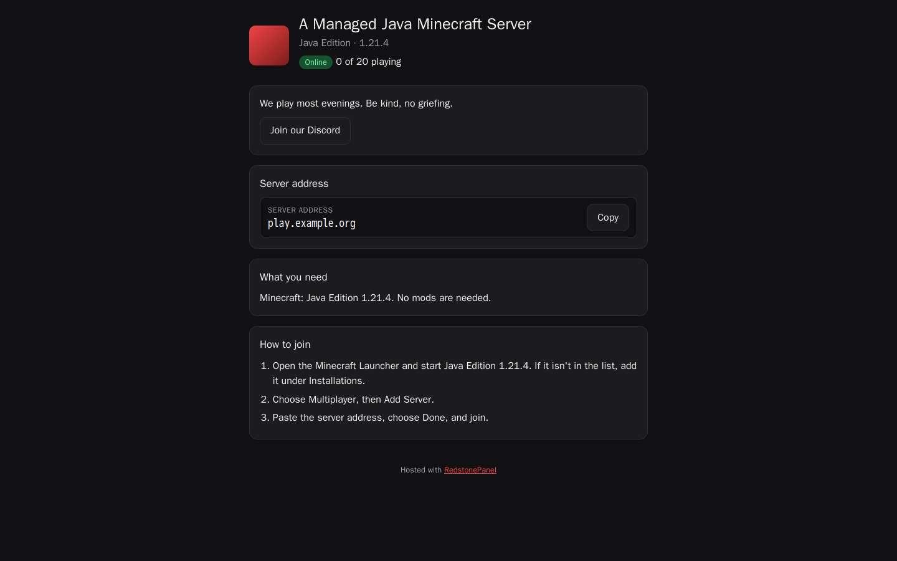
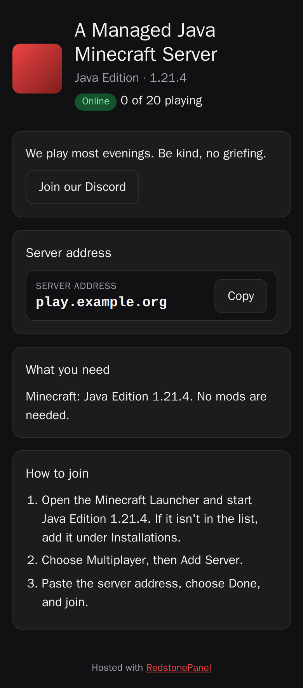
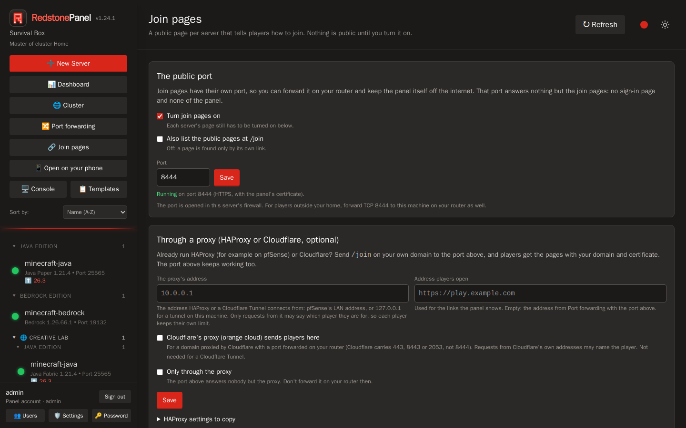

Join pages: a public page for each server that tells players how to join, on a port of its own.

## New

- **A join page for each server.** Getting a friend onto your server usually means sending the address, the version and, for a modded server, which mods to get. A join page says all of it and keeps itself up to date: whether the server is online, how many are playing, the address to type, the Minecraft version and how to join, step by step. Open **🔗 Join pages** in the sidebar, press **Set up** next to a server and send your players the link.

  

- **The exact modpack, one click away.** A server made **From a modpack** on Modrinth links to the pack version it runs, with an **Open in Modrinth App** button and steps for Modrinth App and Prism Launcher. For other mod servers, paste the link to the pack's page. Vanilla, Paper and Purpur pages say that no mods are needed.

- **Bedrock too.** A Bedrock server's page gives the address and port and an **Add this server to Minecraft** button for phones, tablets and Windows. A Java server with Geyser shows both ways in.

  

- **Nothing is public until you turn it on**, twice: the public port, then each server's page. Join pages have a port of their own (8444 unless you change it). It answers nothing but the join pages: no sign-in page and none of the panel. So you can forward that one port on your router and keep the panel itself off the internet. It uses HTTPS with the panel's certificate when the panel does.

  

- **You choose what a page says.** The address is only ever one you typed, here or as your internet address under **🔀 Port forwarding**. Player names are shown only if you turn that on; otherwise just the number. An **unlisted** page gets a long random link for a friends-only server. Add a note for players and a link of your own, such as a Discord invite. A list of your public pages at `/join` is a separate switch.

- **Clusters.** On a cluster master, the list includes the servers on every node and the master serves their pages. Nodes open nothing.

See [Join pages](https://github.com/qrussell/redstonepanel/blob/main/docs/guide/README.md#join-pages) in the manual.

Good to know:

- A page never shows a LAN address, a machine's or node's name, a folder, the panel's version, account names or the plugin list. It sets no cookies and has no forms.
- The game server is asked for its player count at most once every 30 seconds, however many people look at the page.
- A Bedrock server on the default NetherNet transport shows online or offline without a player count.
- A server whose mods you picked by hand shows the link you paste for now. A pack the panel builds for your players is planned for 1.21.6.
- For players outside your home, forward TCP 8444 on your router to the panel's machine.

Tested: 87 install checks in systemd containers on Ubuntu 24.04, where every address the panel answers (209 of them) is tried on the public port and gets "Not found"; pages for a plugin server, a modpack server and a Bedrock server; unlisted pages; a stopped server; a panel restart; and a cluster master serving a node's server over HTTPS. Browser checks at desktop and phone size, and the 880 unit tests pass. Not tested: a real player following a page from outside the home, the **Open in Modrinth App** button on a real desktop and the **Add this server to Minecraft** button on a real phone. The pictures above show the test's stand-in servers.

## Upgrading an existing panel

- Nothing to do. Join pages are off until you turn them on. Reload the page once after the update so the sidebar shows **🔗 Join pages**.

## Installing

RedstonePanel runs on **Ubuntu 24.04, 26.04 and 26.10**, **Debian 13** and **64-bit Raspberry Pi OS** (Raspberry Pi 4 or 5), on x86-64 and ARM64. See [Supported systems](https://github.com/qrussell/redstonepanel#supported-systems). The easiest way to install it, and to get every later version with `apt upgrade`, is the signed **qrussell-repo** apt repository:

```bash
sudo apt install -y curl ca-certificates
curl -fsSL https://qrussell.github.io/qrussell-repo/deb/qrussell-repo.gpg | sudo tee /usr/share/keyrings/qrussell-repo.gpg >/dev/null
echo "deb [signed-by=/usr/share/keyrings/qrussell-repo.gpg] https://qrussell.github.io/qrussell-repo/deb ./" | sudo tee /etc/apt/sources.list.d/qrussell.list
sudo apt update
sudo apt install redstonepanel
```

Or in one line: `curl -fsSL https://raw.githubusercontent.com/qrussell/redstonepanel/main/install.sh | sudo sh`

Then open **http://&lt;server&gt;:8080/** and sign in with a Linux account in the `sudo` group.

To check the repository key before trusting it, `gpg --show-keys /usr/share/keyrings/qrussell-repo.gpg` should show the fingerprint `9994A9EB39EB3C101C949FB2012BA14E0FE3A355`.

Prefer not to add a repository? Download `redstonepanel_1.21.5_all.deb` below and run `sudo apt install ./redstonepanel_1.21.5_all.deb`. You then install each new version the same way.

The [user manual](https://github.com/qrussell/redstonepanel/blob/main/docs/guide/README.md) walks through every feature, with screenshots.

## Upgrading

If you use the qrussell-repo repository:

```bash
sudo apt update && sudo apt upgrade
```

New versions reach the repository within a few hours of their release. Otherwise, install the new .deb as above.

Running servers keep running through the upgrade.

**Full Changelog**: https://github.com/qrussell/redstonepanel/compare/v1.21.4...v1.21.5
