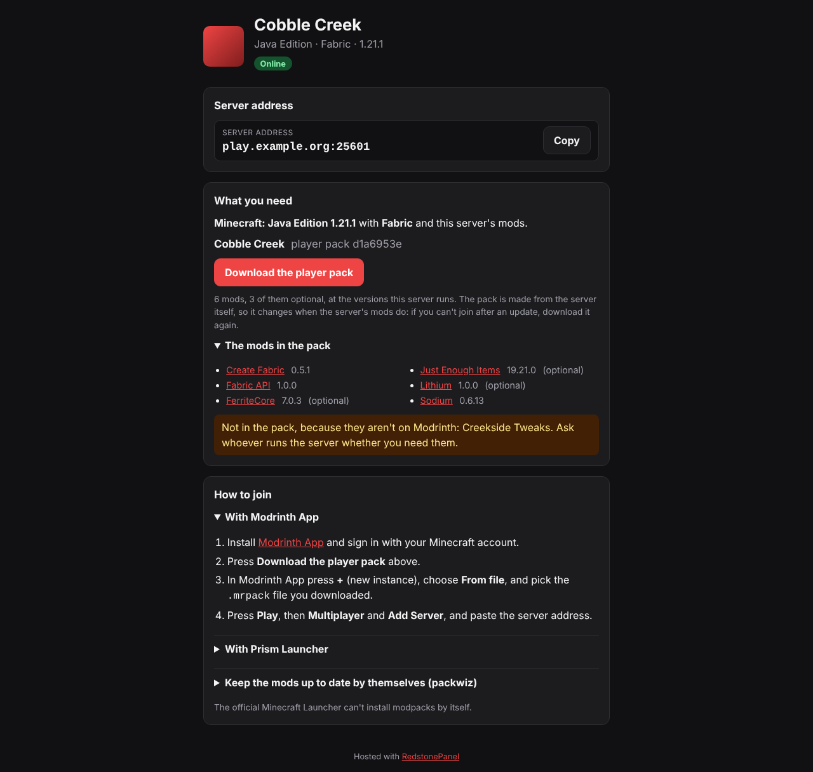
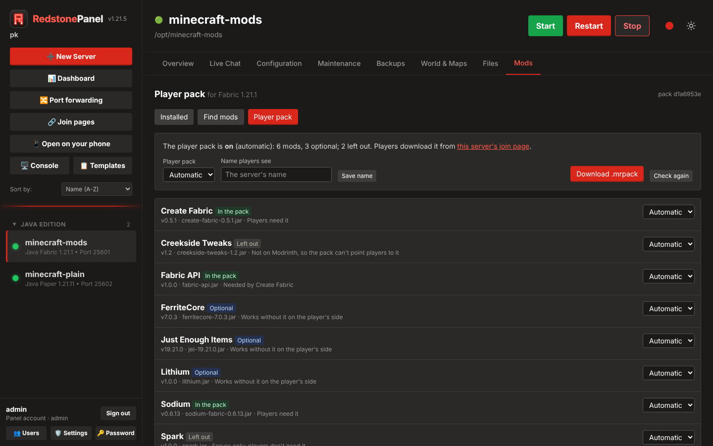

Player packs: the panel works out which mods your players need and hands them over as one download that follows the server.

## New

- **A pack for your players, made from the server itself.** On a Fabric, Quilt, Forge or NeoForge server, players need the same mods as the server before they can join. The panel now reads the server's own `mods` folder, asks Modrinth which mod each file is, and offers the result on the server's join page as a **player pack**: one `.mrpack` file that Modrinth App, Prism Launcher and most other launchers install in one go, with the right loader and Minecraft version.

  

- **It follows the server.** Add, update or remove a mod and the pack on the join page is the new one, with a new pack number. Nobody has to rebuild or re-upload anything.

- **Only what players need.** Mods that run only on the server are left out. Mods that work without the player having them are marked optional, so the launcher lets a player skip them. What a required mod depends on (Fabric API, for one) is required too. A mod Modrinth doesn't know is left out and named on the join page, so players know to ask.

- **You have the last word.** The Mods tab has a new **Player pack** view that shows every mod and why it is in or out. A menu on each line overrules it: **Include**, **Optional** or **Leave out**. **Include** on a file Modrinth doesn't know copies the file itself into the pack. **Extras for players** adds mods the server doesn't run, such as shaders or a minimap. You can name the pack or turn it off.

  

- **Always up to date, for those who want it.** The join page also offers the pack as a [packwiz](https://packwiz.infra.link) folder. A player who sets Prism Launcher or MultiMC up with packwiz-installer gets the server's current mods every time the game starts.

- **Clusters.** On a cluster master, the join page of a server on a node offers that server's pack.

See [Player packs](https://github.com/qrussell/redstonepanel/blob/main/docs/guide/README.md#player-packs) in the manual.

Good to know:

- The pack holds no mods, only where each one is on Modrinth and its checksum, so launchers download them from Modrinth. The exception is a file you chose to **Include** that Modrinth doesn't know (up to 64 MB of such files together). Only do that with mods you may hand out.
- A server made **From a modpack** on Modrinth keeps linking to that pack. Set **Player pack** to **On** if you have added or removed mods since.
- The panel needs to reach Modrinth to work the list out. If it can't, the last pack it built stays in place.
- The pack needs the server's join page to be on (**🔗 Join pages**, 1.21.5). **Download .mrpack** in the Player pack view gives you the same file without it.
- Paper, Purpur and Vanilla servers need no mods on the player's side, so they have no player pack.

Tested: 55 install checks in systemd containers on Ubuntu 24.04 with a stand-in for Modrinth: which mods go in, the pack and the packwiz folder a join page hands out, an admin's choices, a mod removed from the server, Modrinth out of reach, and a cluster master building the pack of a node's server. The 897 unit tests pass, and the sorting was tried against Modrinth's real answers for Sodium, Lithium, Fabric API, spark, FerriteCore and Iris. Not tested: importing the pack into Modrinth App or Prism Launcher on a real desktop, and packwiz-installer against the packwiz folder.

## Upgrading an existing panel

- Nothing to do. A mod server whose join page is on starts offering its player pack. To hand out nothing, set **Player pack** to **Off** in the Mods tab.

## Installing

RedstonePanel runs on **Ubuntu 24.04, 26.04 and 26.10**, **Debian 13** and **64-bit Raspberry Pi OS** (Raspberry Pi 4 or 5), on x86-64 and ARM64. See [Supported systems](https://github.com/qrussell/redstonepanel#supported-systems). The easiest way to install it, and to get every later version with `apt upgrade`, is the signed **qrussell-repo** apt repository:

```bash
sudo apt install -y curl ca-certificates
curl -fsSL https://qrussell.github.io/qrussell-repo/deb/qrussell-repo.gpg | sudo tee /usr/share/keyrings/qrussell-repo.gpg >/dev/null
echo "deb [signed-by=/usr/share/keyrings/qrussell-repo.gpg] https://qrussell.github.io/qrussell-repo/deb ./" | sudo tee /etc/apt/sources.list.d/qrussell.list
sudo apt update
sudo apt install redstonepanel
```

Or in one line: `curl -fsSL https://raw.githubusercontent.com/qrussell/redstonepanel/main/install.sh | sudo sh`

Then open **http://&lt;server&gt;:8080/** and sign in with a Linux account in the `sudo` group.

To check the repository key before trusting it, `gpg --show-keys /usr/share/keyrings/qrussell-repo.gpg` should show the fingerprint `9994A9EB39EB3C101C949FB2012BA14E0FE3A355`.

Prefer not to add a repository? Download `redstonepanel_1.21.6_all.deb` below and run `sudo apt install ./redstonepanel_1.21.6_all.deb`. You then install each new version the same way.

The [user manual](https://github.com/qrussell/redstonepanel/blob/main/docs/guide/README.md) walks through every feature, with screenshots.

## Upgrading

If you use the qrussell-repo repository:

```bash
sudo apt update && sudo apt upgrade
```

New versions reach the repository within a few hours of their release. Otherwise, install the new .deb as above.

Running servers keep running through the upgrade.

**Full Changelog**: https://github.com/qrussell/redstonepanel/compare/v1.21.5...v1.21.6
