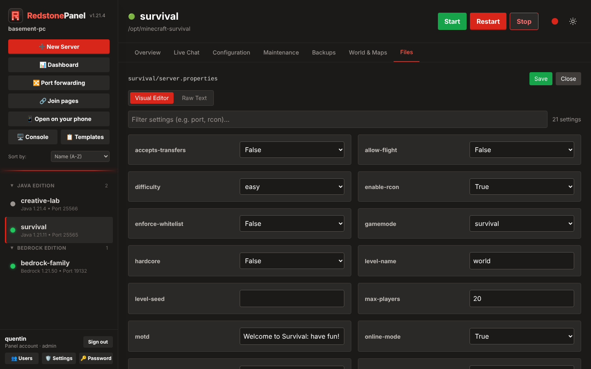

A Visual Editor for settings files on the Files tab, the same form Configuration uses for server.properties.

## New

- **Settings files open as a form.** On the **Files** tab, a file that is a list of `name=value` settings opens in a **Visual Editor** like the one on **Configuration**: one card per setting, with **True**/**False** lists, the choices for `difficulty` and `gamemode`, number boxes and a filter. That covers `server.properties` (Java and Bedrock), `eula.txt`, any `.properties` file and most `.cfg`, `.conf` and `.ini` files, including ones with `[section]` headings.

  

- **Switch any time.** **Visual Editor** and **Raw Text** above the file switch between the form and the plain text. They show the same file, so a change made in one is already in the other, and the panel opens the next file in the view you used last.

- **Only your changes are written.** Comments, blank lines, spacing and the order of the file stay exactly as they were. In `.properties` files, values such as `a:b!` are saved the way Java writes them (`a\:b\!`), as Configuration does.

See [Files](https://github.com/qrussell/redstonepanel/blob/main/docs/guide/README.md#11-files) in the manual.

Good to know:

- The switch appears only when every line of the file is blank, a comment, a heading or `name=value`. A file with one line that doesn't fit opens as text, and if you type such a line in **Raw Text**, **Visual Editor** says which line it is.
- `.yml`, `.json` and `.toml` files have their own layout and always open as text.
- To add or remove a setting, or to edit a comment, use **Raw Text**.
- Nothing changed on the server side: the editor uses the same **Files** permission and saving as before, and each save is still logged.

## Fixed

- **Windows line endings are kept.** Saving a file from the Files tab used to turn Windows line endings (CRLF) into Unix ones (LF), for example in Bedrock's `server.properties` and many plugin files. The editor now saves a file with the line endings it had.

Tested: 9 Node tests of the reading and writing, including a check that values written by the form are read back the same by the panel's own `server.properties` code; 24 browser checks at desktop and phone sizes in both themes; and the .deb installed in a systemd container on Ubuntu 24.04, with `server.properties`, a `.cfg` with sections and Windows line endings, and `eula.txt` edited in a browser and checked on disk. The 901 unit tests pass.

## Installing

RedstonePanel runs on **Ubuntu 24.04, 26.04 and 26.10**, **Debian 13** and **64-bit Raspberry Pi OS** (Raspberry Pi 4 or 5), on x86-64 and ARM64. See [Supported systems](https://github.com/qrussell/redstonepanel#supported-systems). The easiest way to install it, and to get every later version with `apt upgrade`, is the signed **qrussell-repo** apt repository:

```bash
sudo apt install -y curl ca-certificates
curl -fsSL https://qrussell.github.io/qrussell-repo/deb/qrussell-repo.gpg | sudo tee /usr/share/keyrings/qrussell-repo.gpg >/dev/null
echo "deb [signed-by=/usr/share/keyrings/qrussell-repo.gpg] https://qrussell.github.io/qrussell-repo/deb ./" | sudo tee /etc/apt/sources.list.d/qrussell.list
sudo apt update
sudo apt install redstonepanel
```

Or in one line: `curl -fsSL https://raw.githubusercontent.com/qrussell/redstonepanel/main/install.sh | sudo sh`

Then open **http://&lt;server&gt;:8080/** and sign in with a Linux account in the `sudo` group.

To check the repository key before trusting it, `gpg --show-keys /usr/share/keyrings/qrussell-repo.gpg` should show the fingerprint `9994A9EB39EB3C101C949FB2012BA14E0FE3A355`.

Prefer not to add a repository? Download `redstonepanel_1.21.7_all.deb` below and run `sudo apt install ./redstonepanel_1.21.7_all.deb`. You then install each new version the same way.

The [user manual](https://github.com/qrussell/redstonepanel/blob/main/docs/guide/README.md) walks through every feature, with screenshots.

## Upgrading

If you use the qrussell-repo repository:

```bash
sudo apt update && sudo apt upgrade
```

New versions reach the repository within a few hours of their release. Otherwise, install the new .deb as above.

Running servers keep running through the upgrade.

**Full Changelog**: https://github.com/qrussell/redstonepanel/compare/v1.21.6...v1.21.7
