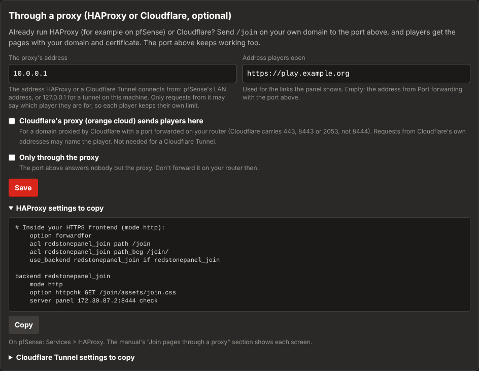

Join pages through a proxy (HAProxy or Cloudflare), a port of their own for mods such as Simple Voice Chat, and upgrades that leave game servers running.

## New

- **Join pages on your own domain.** Already run HAProxy (for example on pfSense) or Cloudflare? It can now send `/join` on your own domain to the join pages, so players open `https://play.example.com/join/survival` with your certificate. **🔗 Join pages** has a new section, **Through a proxy (HAProxy or Cloudflare)**. The join port keeps working as before.

  

- **Each player keeps their own limit.** Behind a proxy, every request seems to come from the proxy, so all players would share one request limit. Enter **the proxy's address** (pfSense's LAN address, or `127.0.0.1` for a Cloudflare Tunnel on the same machine) and the panel reads who the player is from that address only. Anyone else who sends such a header is ignored, so nobody can use it to get around the limit.

- **Cloudflare, two ways.** A **Cloudflare Tunnel** needs no port forwarding at all: point a public hostname with path `^/join` at the join port. For a domain proxied by Cloudflare (orange cloud) with a port forwarded, tick **Cloudflare's proxy sends players here**. The panel ships Cloudflare's list of addresses and refreshes it from cloudflare.com once a day.

- **Address players open** sets the address the panel uses in its links, and **Only through the proxy** makes the join port refuse everyone but the proxy.

- **Settings to copy.** The section shows the lines for `haproxy.cfg` and for a Cloudflare Tunnel, filled in with this panel's address and port. The manual has the pfSense steps.

See [Join pages through a proxy](https://github.com/qrussell/redstonepanel/blob/main/docs/guide/README.md#join-pages-through-a-proxy-haproxy-or-cloudflare-1218) in the manual.

- **Mods and plugins that open their own port get one each.** Simple Voice Chat, Geyser, BlueMap, Dynmap, Plan and NuVotifier open a port of their own. When two servers use the same one (two servers with Simple Voice Chat both on UDP 24454, say), the second one to start lost it, and a Fabric server then stopped and restarted over and over. The panel now moves the port of the server that doesn't hold it to the next free one, in that mod's own settings file, opens it in the firewall, and says so under **Needs attention** until the server restarts. Mods it doesn't know are never changed. Most of these mods write their settings file on their first start, so a new one is moved after that first start. A crash caused by a taken port now names the port and the mod, instead of blaming the server's game port.

## Fixed

- **Upgrades leave game servers running.** On Ubuntu, `needrestart` restarts services that still use an old copy of a system library after any `apt` install or upgrade, and that included Minecraft servers, which dropped their players. The package now tells it to leave Minecraft servers and their Bedrock proxies alone. They pick up new libraries at their next restart (a scheduled restart, or **Restart** in the panel).
- **A Last crash card closes on its own.** It no longer stays for a week after the problem is fixed: it closes once the server has run for 10 minutes.
- **New accounts start with no servers.** An account added with `redstonepanel add-user` in the first seconds after installing or updating could be taken for an account from before per-server permissions (1.18) and get every server. It now starts with none, as intended.
- **Server folders owned by root work again.** Since 1.21.8 the panel works in a server's folder with the game account's rights. A server whose service runs as another account, such as root, had its files refused. The panel now uses the account the server's own service runs as.

Tested: in systemd containers on Ubuntu 24.04, a real HAProxy running exactly the lines the panel offers: the pages and the health check through it, a separate limit for each player, a forged header from elsewhere ignored, and the join port closed to everyone but HAProxy (104 join page checks). `needrestart` in automatic mode with a stand-in game server, a stand-in Bedrock proxy and an ordinary service all using a deleted library: only the ordinary service is restarted, and without the new rule the game server would have been (10 checks). Mod ports: two stand-in servers running Simple Voice Chat on one UDP port, in a systemd container with ufw: a start from the panel moves the second, the crash hook moves it before systemd's restart and the card names the voice port, ufw and Port forwarding get the voice ports, a port another program holds is skipped (26 checks). The unit tests pass. Not tested: a real Cloudflare Tunnel or Cloudflare-proxied domain.

## Upgrading an existing panel

- Nothing to do. The proxy settings are empty until you fill them in, and join pages work as before.

## Installing

RedstonePanel runs on **Ubuntu 24.04, 26.04 and 26.10**, **Debian 13** and **64-bit Raspberry Pi OS** (Raspberry Pi 4 or 5), on x86-64 and ARM64. See [Supported systems](https://github.com/qrussell/redstonepanel#supported-systems). The easiest way to install it, and to get every later version with `apt upgrade`, is the signed **qrussell-repo** apt repository:

```bash
sudo apt install -y curl ca-certificates
curl -fsSL https://qrussell.github.io/qrussell-repo/deb/qrussell-repo.gpg | sudo tee /usr/share/keyrings/qrussell-repo.gpg >/dev/null
echo "deb [signed-by=/usr/share/keyrings/qrussell-repo.gpg] https://qrussell.github.io/qrussell-repo/deb ./" | sudo tee /etc/apt/sources.list.d/qrussell.list
sudo apt update
sudo apt install redstonepanel
```

Or in one line: `curl -fsSL https://raw.githubusercontent.com/qrussell/redstonepanel/main/install.sh | sudo sh`

Then open **http://&lt;server&gt;:8080/** and sign in with a Linux account in the `sudo` group.

To check the repository key before trusting it, `gpg --show-keys /usr/share/keyrings/qrussell-repo.gpg` should show the fingerprint `9994A9EB39EB3C101C949FB2012BA14E0FE3A355`.

Prefer not to add a repository? Download `redstonepanel_1.21.9_all.deb` below and run `sudo apt install ./redstonepanel_1.21.9_all.deb`. You then install each new version the same way.

The [user manual](https://github.com/qrussell/redstonepanel/blob/main/docs/guide/README.md) walks through every feature, with screenshots.

## Upgrading

If you use the qrussell-repo repository:

```bash
sudo apt update && sudo apt upgrade
```

New versions reach the repository within a few hours of their release. Otherwise, install the new .deb as above.

Running servers keep running through the upgrade.

**Full Changelog**: https://github.com/qrussell/redstonepanel/compare/v1.21.8...v1.21.9
