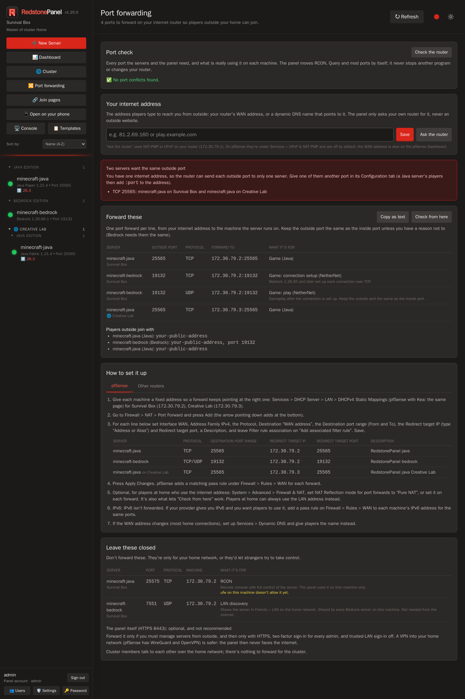

RedstonePanel now checks the ports on the machine for conflicts it can't prevent when it makes a server, names the program behind each one and fixes what it safely can. On Linux and Windows.

## New

- **A Port check at the top of the Port forwarding page.** It compares every port your servers and the panel need with what really uses each port on the machine (on a cluster master, on every member). It catches what happens outside the panel: another program on a server's port (a Docker container, a server started by hand, another panel), two servers edited by hand onto one port, a mod or plugin the panel doesn't know opening a port, and a server set to the panel's own port.

- **It names the other program,** so you can change or stop it yourself: its name, process id, path and command line, the systemd unit or Windows service it runs as, or the Docker container and its published port. A Java or Bedrock server the panel didn't start is recognised as one. When nothing visible holds a port, such as WSL mirrored networking on Windows or Docker publishing through firewall rules only, the panel tests the port itself and tells you the command that shows more. **The panel never stops or changes another program, and never changes your router.**

- **Fixes it can make safely happen by themselves.** RCON and Query ports, the known mods' ports (now also when another program holds them) and a port an unknown mod opened, when exactly one config line sets it, move to a free port. **Needs attention** says what moved until the server restarts.

- **Move to a free port** moves a server's game port, with its IPv6, Query and gameplay ports, on your click. It stops and starts the server if it was running, opens the new port in the firewall and tells you what to change on your router. The join page follows by itself.

- **Starting a server whose game port another program holds is refused** with the reason, instead of the server crashing and restarting over and over.

- **Check the router** reads your router's forwards over UPnP and says which point to the wrong machine or port, are turned off, or lead to a port no server uses now.

- Problems also show under **Needs attention** with a **Port check** link, the **Last crash** card links to it when a port was taken, `sudo redstonepanel ports` prints the same report, and a new **port_conflict** webhook (Panel Settings > Notifications, on by default) sends each new problem once.



See [Port check](https://github.com/qrussell/redstonepanel/blob/main/docs/guide/README.md#port-check) in the manual.

## Upgrading an existing panel

Nothing to do. On Windows, click **Update now** on the dashboard, or run `RedstonePanel-1.23.1-x64.msi` below.

Tested: 24 new unit tests (1,088 in all), a new install test that sets up each kind of conflict in a systemd container (31 of 31 checks), the Windows install test on Windows Server 2022 and 2025 with a new Port check section, and a test build on a real panel with four live servers.

## Installing

RedstonePanel runs on **Ubuntu 24.04, 26.04 and 26.10**, **Debian 13** and **64-bit Raspberry Pi OS** (Raspberry Pi 4 or 5), on x86-64 and ARM64. See [Supported systems](https://github.com/qrussell/redstonepanel#supported-systems). The easiest way to install it, and to get every later version with `apt upgrade`, is the signed **qrussell-repo** apt repository:

```bash
sudo apt install -y curl ca-certificates
curl -fsSL https://qrussell.github.io/qrussell-repo/deb/qrussell-repo.gpg | sudo tee /usr/share/keyrings/qrussell-repo.gpg >/dev/null
echo "deb [signed-by=/usr/share/keyrings/qrussell-repo.gpg] https://qrussell.github.io/qrussell-repo/deb ./" | sudo tee /etc/apt/sources.list.d/qrussell.list
sudo apt update
sudo apt install redstonepanel
```

Or in one line: `curl -fsSL https://raw.githubusercontent.com/qrussell/redstonepanel/main/install.sh | sudo sh`

Then open **http://&lt;server&gt;:8080/** and sign in with a Linux account in the `sudo` group.

To check the repository key before trusting it, `gpg --show-keys /usr/share/keyrings/qrussell-repo.gpg` should show the fingerprint `9994A9EB39EB3C101C949FB2012BA14E0FE3A355`.

Prefer not to add a repository? Download `redstonepanel_1.23.1_all.deb` below and run `sudo apt install ./redstonepanel_1.23.1_all.deb`. You then install each new version the same way.

The [user manual](https://github.com/qrussell/redstonepanel/blob/main/docs/guide/README.md) walks through every feature, with screenshots.

## Upgrading

If you use the qrussell-repo repository:

```bash
sudo apt update && sudo apt upgrade
```

New versions reach the repository within a few hours of their release. Otherwise, install the new .deb as above.

Running servers keep running through the upgrade.

**Full Changelog**: https://github.com/qrussell/redstonepanel/compare/v1.23.0...v1.23.1
