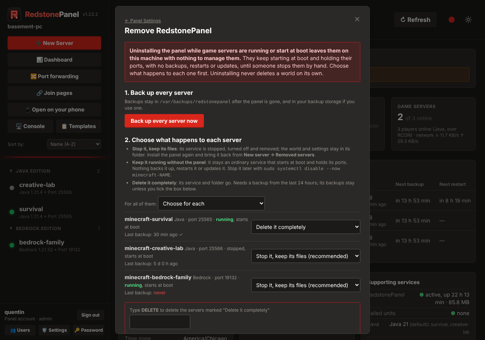

RedstonePanel now tells you how to remove it without leaving game servers behind, and asks what happens to each one first. On Linux and Windows.

## New

- **Panel Settings → Remove RedstonePanel.** It goes through three steps: **back up every server** (one button), **choose what happens to each server**, then **remove the panel**. Every server's **Maintenance** tab links to it, so you find it where you manage your servers instead of reaching for `apt remove`.

- **For each server, or for all of them at once:** **Stop it, keep its files** (recommended): its service is stopped and removed, the world stays in its folder, and you can bring it back from **New server → Removed servers** after installing the panel again. **Keep it running without the panel** (Linux only): it stays an ordinary service, with no backups, restarts or updates. **Delete it completely**: only after a backup from the last 24 hours and typing **DELETE**; its backups stay unless you ask for those to go too. **Uninstalling never deletes a world on its own.**

- **`sudo redstonepanel uninstall`** asks the same questions in a terminal, or runs without questions: `sudo redstonepanel uninstall --servers stop --yes`.

- **A plain `apt remove` is safe too.** The panel never stops a server nobody chose for, but it turns off its own backup, restart and update timers (their settings stay) and lists every server left running or starting at boot, with the command to stop it. Installing the panel again turns those servers' schedules back on.

- The message after installing the panel, and the last page of the Windows installer, say how to remove it safely.



See [Removing RedstonePanel](https://github.com/qrussell/redstonepanel/blob/main/docs/guide/README.md#removing-redstonepanel) in the manual.

## Upgrading an existing panel

Nothing to do. On Windows, click **Update now** on the dashboard, or run `RedstonePanel-1.23.2-x64.msi` below.

Tested: 17 new unit tests, a new install test in a systemd container that removes the panel every way (30 of 30 checks), and read-only checks against the real servers of a Windows panel.

## Installing

RedstonePanel runs on **Ubuntu 24.04, 26.04 and 26.10**, **Debian 13** and **64-bit Raspberry Pi OS** (Raspberry Pi 4 or 5), on x86-64 and ARM64. See [Supported systems](https://github.com/qrussell/redstonepanel#supported-systems). The easiest way to install it, and to get every later version with `apt upgrade`, is the signed **qrussell-repo** apt repository:

```bash
sudo apt install -y curl ca-certificates
curl -fsSL https://qrussell.github.io/qrussell-repo/deb/qrussell-repo.gpg | sudo tee /usr/share/keyrings/qrussell-repo.gpg >/dev/null
echo "deb [signed-by=/usr/share/keyrings/qrussell-repo.gpg] https://qrussell.github.io/qrussell-repo/deb ./" | sudo tee /etc/apt/sources.list.d/qrussell.list
sudo apt update
sudo apt install redstonepanel
```

Or in one line: `curl -fsSL https://raw.githubusercontent.com/qrussell/redstonepanel/main/install.sh | sudo sh`

Then open **http://&lt;server&gt;:8080/** and sign in with a Linux account in the `sudo` group.

To check the repository key before trusting it, `gpg --show-keys /usr/share/keyrings/qrussell-repo.gpg` should show the fingerprint `9994A9EB39EB3C101C949FB2012BA14E0FE3A355`.

Prefer not to add a repository? Download `redstonepanel_1.23.2_all.deb` below and run `sudo apt install ./redstonepanel_1.23.2_all.deb`. You then install each new version the same way.

The [user manual](https://github.com/qrussell/redstonepanel/blob/main/docs/guide/README.md) walks through every feature, with screenshots.

## Upgrading

If you use the qrussell-repo repository:

```bash
sudo apt update && sudo apt upgrade
```

New versions reach the repository within a few hours of their release. Otherwise, install the new .deb as above.

Running servers keep running through the upgrade.

**Full Changelog**: https://github.com/qrussell/redstonepanel/compare/v1.23.1...v1.23.2
