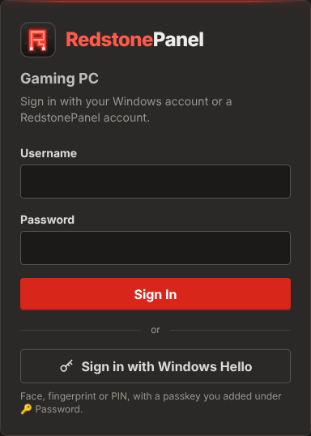

RedstonePanel clusters now mix Linux and Windows: a Windows PC can be a cluster's master or one of its nodes, and servers and backups move between the two. Windows panels also get SFTP, Windows Hello sign-in and an easier first password, and Windows is no longer a preview.

## New

- **Mixed Linux and Windows clusters.** Join a Windows panel to a Linux master, or the other way round. Join codes come with the command for each system, and the **Cluster** page and **Panel Settings** say **Linux** or **Windows** for each member.

- **Moves both ways.** Java servers move unchanged. A Bedrock server gets the new machine's own Bedrock program, of the version it ran where minecraft.net still has it. Before a move or restore onto Windows, the panel checks for file names Windows can't hold (names that differ only by case, names with `:` or a trailing dot, reserved names like `aux`) and refuses with the list, before anything stops.

- **Backups across systems.** Backup copies on another member, restores from them, and encrypted cluster backups work between Linux and Windows.

- **SFTP on Windows** (FileZilla, WinSCP), as on Linux. **HTTPS with your own certificate** now picks up a certificate that win-acme or certbot renewed, by itself.

- **Sign in with Windows Hello** on a Windows panel. Add a passkey under **🔑 Password**, then click **Sign in with Windows Hello**: your face, fingerprint or Windows Hello PIN, with no user name. Only a public key is stored, and it counts as two-factor sign-in. Passkeys work at `localhost` or a host name over HTTPS. Linux panels keep Linux accounts, panel accounts and two-factor codes.

- **An easier first password on Windows.** The installer's **Finish** page opens the panel on a one-time page to choose the **admin** password. **RedstonePanel** in the Start menu opens the panel later, at the right address.

- **`redstonepanel reset-password NAME`** sets a forgotten panel password from an administrator prompt (with `sudo` on Linux) and signs that account out everywhere.

- **Accounts in a cluster** are explained in the manual: each panel keeps its own accounts, and the master's accounts manage the servers on every node.



See [Clusters](https://github.com/qrussell/redstonepanel/blob/main/docs/guide/README.md#18-clusters) and [Windows Hello](https://github.com/qrussell/redstonepanel/blob/main/docs/guide/README.md#windows-hello-passkeys) in the manual.

## Fixed

- **A server moved away and back keeps its name**, numbered (`minecraft-survival-2`) when its old copy is still there, instead of taking the next free name.
- **Start, stop and restart of a server on a node** no longer report an error while the node is still starting it: the master waits up to three minutes for the answer.

## Upgrading an existing panel

Nothing to do. On Windows, click **Update now** on the dashboard, or run `RedstonePanel-1.24.0-x64.msi` below. In a cluster, update the master and its nodes; a member on 1.23 can't join a mixed cluster.

Tested: 1,178 unit tests, including passkeys checked with a test authenticator; the whole sign-in flow in a real browser; the Windows install and installer tests on Windows Server 2022 and 2025 (SFTP, a Windows master with an encrypted backup read back, archives with bad names refused, the first-password link); the Linux install and cluster tests on every supported system; and a real mixed cluster on a Windows PC with a Linux master, with Java and Bedrock moves both ways, backup copies both ways, a restore across and SFTP on the node.

## Installing on Windows

1. Download `RedstonePanel-1.24.0-x64.msi` below and open it. It isn't signed yet, so SmartScreen says **Windows protected your PC**: choose **More info**, then **Run anyway**. Its SHA-256 is in `RedstonePanel-1.24.0-x64.msi.sha256` next to it.
2. Choose where servers, backups and settings are kept. The default is `C:\ProgramData\RedstonePanel`, and the folder's name can't have a space in it.
3. Leave **Open RedstonePanel in my browser** ticked and click **Finish**, then choose your password for **admin**. Or sign in with your own Windows administrator account.

See [On Windows](https://github.com/qrussell/redstonepanel/blob/main/docs/guide/README.md#on-windows) in the manual.

## Installing

RedstonePanel runs on **Ubuntu 24.04, 26.04 and 26.10**, **Debian 13** and **64-bit Raspberry Pi OS** (Raspberry Pi 4 or 5), on x86-64 and ARM64. See [Supported systems](https://github.com/qrussell/redstonepanel#supported-systems). The easiest way to install it, and to get every later version with `apt upgrade`, is the signed **qrussell-repo** apt repository:

```bash
sudo apt install -y curl ca-certificates
curl -fsSL https://qrussell.github.io/qrussell-repo/deb/qrussell-repo.gpg | sudo tee /usr/share/keyrings/qrussell-repo.gpg >/dev/null
echo "deb [signed-by=/usr/share/keyrings/qrussell-repo.gpg] https://qrussell.github.io/qrussell-repo/deb ./" | sudo tee /etc/apt/sources.list.d/qrussell.list
sudo apt update
sudo apt install redstonepanel
```

Or in one line: `curl -fsSL https://raw.githubusercontent.com/qrussell/redstonepanel/main/install.sh | sudo sh`

Then open **http://&lt;server&gt;:8080/** and sign in with a Linux account in the `sudo` group.

To check the repository key before trusting it, `gpg --show-keys /usr/share/keyrings/qrussell-repo.gpg` should show the fingerprint `9994A9EB39EB3C101C949FB2012BA14E0FE3A355`.

Prefer not to add a repository? Download `redstonepanel_1.24.0_all.deb` below and run `sudo apt install ./redstonepanel_1.24.0_all.deb`. You then install each new version the same way.

The [user manual](https://github.com/qrussell/redstonepanel/blob/main/docs/guide/README.md) walks through every feature, with screenshots.

## Upgrading

If you use the qrussell-repo repository:

```bash
sudo apt update && sudo apt upgrade
```

New versions reach the repository within a few hours of their release. Otherwise, install the new .deb as above.

Running servers keep running through the upgrade.

**Full Changelog**: https://github.com/qrussell/redstonepanel/compare/v1.23.2...v1.24.0
