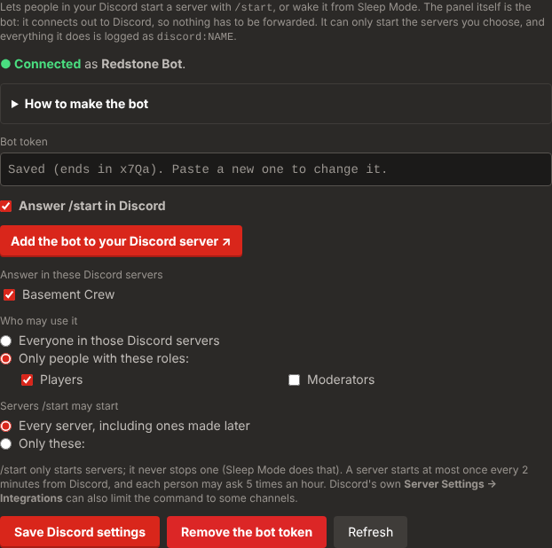

Discord /start: people in your Discord start a server, or wake it from sleep mode, with a slash command. The panel itself is the bot.

## New

- **Discord /start.** In **Panel Settings → Discord**, paste a bot token from the [Discord Developer Portal](https://discord.com/developers/applications), tick **Answer /start in Discord**, add the bot to your Discord server with **Add the bot to your Discord server**, and tick that Discord server. Then anyone there (or only people with the roles you tick) types `/start`, picks a server from the list, and the panel starts it, or wakes it if it's asleep. The bot answers in the channel ("Starting survival for Steve") and edits that answer to "survival is online. Join at play.example.com" as soon as the server answers. A server that's already online gets its address back. See [Discord /start](https://github.com/qrussell/redstonepanel/blob/v1.27.0/docs/guide/README.md#discord-start).

  <picture><source media="(prefers-color-scheme: light)" srcset="https://raw.githubusercontent.com/qrussell/redstonepanel/v1.27.0/docs/guide/images/light/discord-settings.png"></picture>

- **The panel is the bot.** It connects out to Discord, so there's no port to forward and no website to publish, and it works the same on Linux and Windows. The bot token stays on the machine (the page only shows its last four characters), and a bot answers only in the Discord servers you tick.

- **Only ever starts servers.** `/start` can start only the game servers you choose (every server, including later ones, or chosen ones, also on cluster nodes), never stops or changes anything, starts a server at most once every 2 minutes and lets each person ask 5 times an hour. Every start is in the panel log as `[DISCORD] discord:NAME ... started survival from Discord (your Discord server)`.

## Upgrading an existing panel

Nothing to do: `apt upgrade`, **Update now**, or the new MSI as usual. Discord /start is off until you paste a bot token. In a cluster, set it up on the master: it starts servers on every node.

Tested: 1,315 unit tests, including 35 new ones for the bot (its settings, every refusal, the limits, starts on nodes, the websocket client against a real socket and the Discord connection with a stand-in for Discord); the bot's connection checked against Discord's real servers from Windows; and a real test with a bot in a Discord server, where `/start` started a stopped vanilla server on a test panel. Also the install tests on every supported system and the cluster tests.

## Installing on Windows

1. Download `RedstonePanel-1.27.0-x64.msi` below and open it. It isn't signed yet, so SmartScreen says **Windows protected your PC**: choose **More info**, then **Run anyway**. Its SHA-256 is in `RedstonePanel-1.27.0-x64.msi.sha256` next to it.
2. Choose where servers, backups and settings are kept. The default is `C:\ProgramData\RedstonePanel`, and the folder's name can't have a space in it.
3. Leave **Open RedstonePanel in my browser** ticked and click **Finish**, then choose your password for **admin**. Or sign in with your own Windows administrator account.

See [On Windows](https://github.com/qrussell/redstonepanel/blob/main/docs/guide/README.md#on-windows) in the manual.

## Installing

RedstonePanel runs on **Ubuntu 24.04, 26.04 and 26.10**, **Debian 13** and **64-bit Raspberry Pi OS** (Raspberry Pi 4 or 5), on x86-64 and ARM64. See [Supported systems](https://github.com/qrussell/redstonepanel#supported-systems). The easiest way to install it, and to get every later version with `apt upgrade`, is the signed **qrussell-repo** apt repository:

```bash
sudo apt install -y curl ca-certificates
curl -fsSL https://qrussell.github.io/qrussell-repo/deb/qrussell-repo.gpg | sudo tee /usr/share/keyrings/qrussell-repo.gpg >/dev/null
echo "deb [signed-by=/usr/share/keyrings/qrussell-repo.gpg] https://qrussell.github.io/qrussell-repo/deb ./" | sudo tee /etc/apt/sources.list.d/qrussell.list
sudo apt update
sudo apt install redstonepanel
```

Or in one line: `curl -fsSL https://raw.githubusercontent.com/qrussell/redstonepanel/main/install.sh | sudo sh`

Then open **http://&lt;server&gt;:8080/** and sign in with a Linux account in the `sudo` group.

To check the repository key before trusting it, `gpg --show-keys /usr/share/keyrings/qrussell-repo.gpg` should show the fingerprint `9994A9EB39EB3C101C949FB2012BA14E0FE3A355`.

Prefer not to add a repository? Download `redstonepanel_1.27.0_all.deb` below and run `sudo apt install ./redstonepanel_1.27.0_all.deb`. You then install each new version the same way.

The [user manual](https://github.com/qrussell/redstonepanel/blob/main/docs/guide/README.md) walks through every feature, with screenshots.

## Upgrading

If you use the qrussell-repo repository:

```bash
sudo apt update && sudo apt upgrade
```

New versions reach the repository within a few hours of their release. Otherwise, install the new .deb as above.

Running servers keep running through the upgrade.

**Full Changelog**: https://github.com/qrussell/redstonepanel/compare/v1.26.0...v1.27.0
