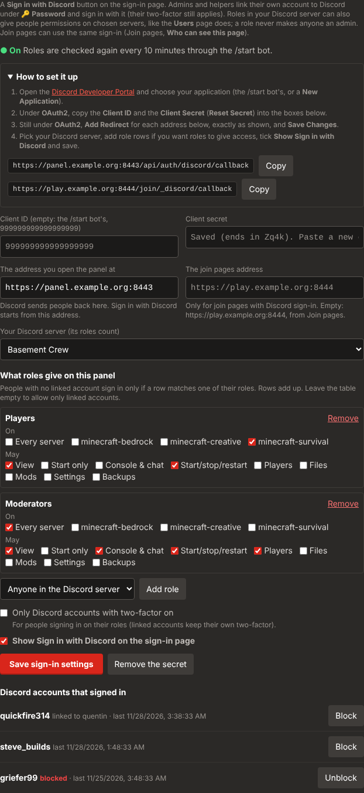
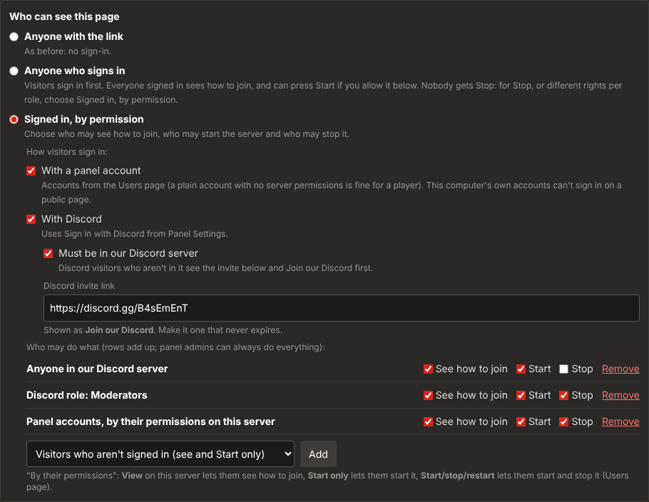
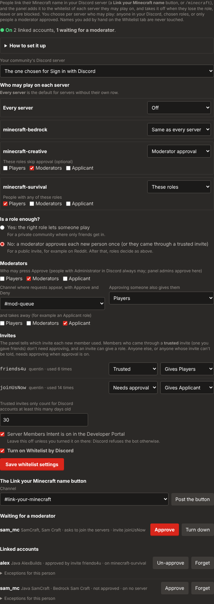

Discord for your community: sign in with Discord, join pages by permission, and a whitelist your Discord roles keep up to date.

## New

- **Sign in with Discord.** In **Panel Settings → Sign in with Discord**, paste the Client ID and Client Secret of your Discord application (the /start bot's is fine), add the two redirect addresses the panel shows, and pick your Discord server. A **Sign in with Discord** button appears on the sign-in page. Admins and helpers link their own account under **🔑 Password → Discord** (their two-factor still applies). People without a panel account can sign in on their Discord roles: each row gives a role permissions on chosen servers, with the same ticks as the Users page. A role never makes anyone an admin. See [Sign in with Discord](https://github.com/qrussell/redstonepanel/blob/v1.28.0/docs/guide/README.md#sign-in-with-discord-128).

  <picture><source media="(prefers-color-scheme: light)" srcset="https://raw.githubusercontent.com/qrussell/redstonepanel/v1.28.0/docs/guide/images/light/discord-signin-settings.png"></picture>

- **Who can see a join page.** Each join page can stay open to anyone with the link, ask visitors to sign in (with a panel account or Discord), or go **by permission**: row by row, who may **See how to join**, **Start** and, new, **Stop** the server. A page can require joining your Discord server first and show its invite. **Visitors who aren't signed in** can be allowed to see the page and press Start, while moderators sign in for Stop. See [Who can see a join page](https://github.com/qrussell/redstonepanel/blob/v1.28.0/docs/guide/README.md#who-can-see-a-join-page-128).

  <picture><source media="(prefers-color-scheme: light)" srcset="https://raw.githubusercontent.com/qrussell/redstonepanel/v1.28.0/docs/guide/images/light/join-access.png"></picture>

- **Whitelist by Discord.** Players press **Link your Minecraft name** in your Discord (or type `/minecraft`), and the panel puts the name on the whitelist (Bedrock: allowlist) of each server they may play on. Per server you choose **Off**, **Anyone in our Discord**, **These roles**, or **Moderator approval**. For a public invite, a moderator approves each new person once with **Approve** in your moderators' channel, which can also give them a role; invites you mark **Trusted** (your friends' link) skip that. Losing the role, leaving your Discord or being blocked takes the name off again. Names you add by hand are never touched. See [Whitelist by Discord](https://github.com/qrussell/redstonepanel/blob/v1.28.0/docs/guide/README.md#whitelist-by-discord-128).

  <picture><source media="(prefers-color-scheme: light)" srcset="https://raw.githubusercontent.com/qrussell/redstonepanel/v1.28.0/docs/guide/images/light/discord-whitelist.png"></picture>

- **Start only.** A new per-server permission next to **Start/stop/restart**, for Users page accounts, API tokens and Discord roles: they can start a server but not stop it.

- **Discord /start** now lets the Discord server's owner and administrators use it without one of the listed roles. When the bot asks for the Server Members Intent and it isn't turned on in the Developer Portal, the bot keeps running without it and the panel says what to turn on.

## Upgrading an existing panel

Nothing to do: `apt upgrade`, **Update now**, or the new MSI as usual. Every new Discord feature is off until you set it up, and join pages stay open to anyone with the link. In a cluster, set Whitelist by Discord up on the master (it keeps its nodes' whitelists too); each panel has its own sign-in settings. Update nodes too: a node older than 1.28 refuses accounts that may only start.

Tested: 1,381 unit tests, including 27 new ones for Discord sign-in and join pages and 34 for the whitelist; the join page install test with sign-in, Start and Stop on a real server; and a real test with a new Discord community server, where Discord sign-in, `/start`, linking a name, a moderator's approval and joining the game on the whitelist all worked. Also the install tests on every supported system and the cluster tests.

## Installing on Windows

1. Download `RedstonePanel-1.28.0-x64.msi` below and open it. It isn't signed yet, so SmartScreen says **Windows protected your PC**: choose **More info**, then **Run anyway**. Its SHA-256 is in `RedstonePanel-1.28.0-x64.msi.sha256` next to it.
2. Choose where servers, backups and settings are kept. The default is `C:\ProgramData\RedstonePanel`, and the folder's name can't have a space in it.
3. Leave **Open RedstonePanel in my browser** ticked and click **Finish**, then choose your password for **admin**. Or sign in with your own Windows administrator account.

See [On Windows](https://github.com/qrussell/redstonepanel/blob/main/docs/guide/README.md#on-windows) in the manual.

## Installing

RedstonePanel runs on **Ubuntu 24.04, 26.04 and 26.10**, **Debian 13** and **64-bit Raspberry Pi OS** (Raspberry Pi 4 or 5), on x86-64 and ARM64. See [Supported systems](https://github.com/qrussell/redstonepanel#supported-systems). The easiest way to install it, and to get every later version with `apt upgrade`, is the signed **qrussell-repo** apt repository:

```bash
sudo apt install -y curl ca-certificates
curl -fsSL https://qrussell.github.io/qrussell-repo/deb/qrussell-repo.gpg | sudo tee /usr/share/keyrings/qrussell-repo.gpg >/dev/null
echo "deb [signed-by=/usr/share/keyrings/qrussell-repo.gpg] https://qrussell.github.io/qrussell-repo/deb ./" | sudo tee /etc/apt/sources.list.d/qrussell.list
sudo apt update
sudo apt install redstonepanel
```

Or in one line: `curl -fsSL https://raw.githubusercontent.com/qrussell/redstonepanel/main/install.sh | sudo sh`

Then open **http://&lt;server&gt;:8080/** and sign in with a Linux account in the `sudo` group.

To check the repository key before trusting it, `gpg --show-keys /usr/share/keyrings/qrussell-repo.gpg` should show the fingerprint `9994A9EB39EB3C101C949FB2012BA14E0FE3A355`.

Prefer not to add a repository? Download `redstonepanel_1.28.0_all.deb` below and run `sudo apt install ./redstonepanel_1.28.0_all.deb`. You then install each new version the same way.

The [user manual](https://github.com/qrussell/redstonepanel/blob/main/docs/guide/README.md) walks through every feature, with screenshots.

## Upgrading

If you use the qrussell-repo repository:

```bash
sudo apt update && sudo apt upgrade
```

New versions reach the repository within a few hours of their release. Otherwise, install the new .deb as above.

Running servers keep running through the upgrade.

**Full Changelog**: https://github.com/qrussell/redstonepanel/compare/v1.27.0...v1.28.0
